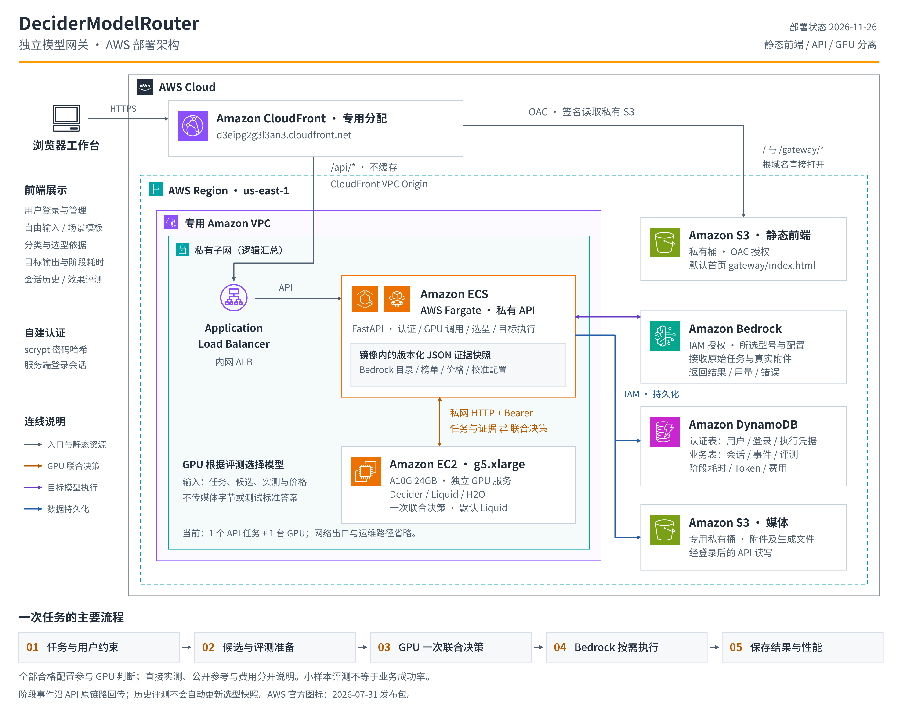

# DeciderModelRouter

独立的 Amazon Bedrock 模型网关：GPU 决策模型一次请求同时判断任务属性，并依据 Bedrock 实测、公开评测、价格和延迟选择目标模型；后端校验能力、预算与配额，前端展示完整决策过程。

生产服务使用专用 **CloudFront + OAC + 私有 S3、ECS Fargate、DynamoDB、g5.xlarge GPU 和 VPC**。自建用户认证，不使用 Cognito；基础设施通过 AWS SDK 创建，不使用 CloudFormation。[打开在线工作台](https://d3eipg2g3l3an3.cloudfront.net/)，当前状态和资源见 [部署记录](deployment/DEPLOYED.md)。

[服务架构图](docs/INDEPENDENT_SERVICE.zh.md#已部署服务架构) · [请求时序图](docs/INDEPENDENT_SERVICE.zh.md#一次请求的调用顺序) · [决策流程图](docs/BEDROCK_CLASSIFIED_ROUTING.zh.md#决策流程总览) · [评测证据与校准流程](docs/BEDROCK_CLASSIFIED_ROUTING.zh.md#评测证据如何进入选型) · [分类场景通过率](#分类场景通过率)

[](docs/diagrams/decider-model-router-aws.zh.svg)

[下载 SVG 矢量图](docs/diagrams/decider-model-router-aws.zh.svg) · [下载高清 PNG](docs/diagrams/decider-model-router-aws.zh.png)

GPU默认使用 **Liquid d1-2B** 完成任务判断和型号选择，也可切换 Decider 或 H2O。实时路由采用 `gpu-evidence-single-pass-v2`：全部可能适用的配置一次进入GPU判断，与七项任务属性同时返回，不再按榜单批次、程序Top-K或Agent固定名单提前淘汰。直接评测绑定精确Bedrock端点；内容正确、格式、接口支持、延迟和样本量分别提供给决策模型。[新机制与补测方法](docs/BEDROCK_CLASSIFIED_ROUTING.zh.md) · [逐型号补测报告](validation/independent_gateway/bedrock-evidence-2026-11-26/README.zh.md)。历史87场景通过率保留，不能当作新策略准确率。

2026-11-26已发布一次联合决策：普通对话、连续会话与代码的线上路由实测 **1.24–1.41秒**，前一版同类样本仅选模为3.12–5.45秒。默认Liquid每次 **1个GPU请求、1次实际前向计算、8项决策**，134个候选也无需逐组淘汰。四项质量/价格交换对照全部通过；Decider的两项质量对照未通过，保留为比较选项，不将接口完成视作选模效果通过。[性能对照、限制与原始记录](validation/independent_gateway/single-pass-2026-11-26/README.zh.md)。

新增[一次需求评估 + CPU策略选模实验](validation/independent_gateway/profile-policy-2026-11-26/README.zh.md)：参考OpenRouter的评估与策略分工，同机Liquid实测普通/代码约 **96毫秒**、合成长历史约 **204毫秒**，CPU选模约1.1–1.2毫秒；不含ECS网络、建池和目标生成。60次正式路由调用完成，额外3次目标调用均完整，但2项回答发现内容错误。**实验尚未部署，速度提升不能代替效果验收。**

该实验的[143项全面质量测试](validation/independent_gateway/profile-policy-quality-2026-11-26/README.zh.md)已完成：**69/143（48.3%）通过**，60项未通过、2项待复核、12项未测，均保留在分母。原87场景中，文本/代码/检索 **42/64（65.6%）**，多模态 **8/16（50.0%）**；新增诊断4/8，12行业Agent多轮 **12/48（25.0%）**，行业代码0/12。基础3个函数的316项功能检查全部通过，但原始输出均违反“不要围栏”的格式要求。167次正式路由均为一次GPU前向，实验完整路由P50/P95为125/216ms；模型切换不能代表质量通过，缓存读取为0。**保持未部署**；本轮行业测试使用本地原生适配器，不是AgentCore运行结果，记录在GitHub，未写入线上历史。历史数据使用不同输入/评分，不能直接作策略优劣比较。

- **行业 Agent**：12个行业、每个4轮业务任务，支持自由追问。Strands Agent运行在AgentCore Runtime **V2**，模型入口指定为本项目`model-router`；每次模型调用都经过Liquid任务判断与基于评测的选模，展示原生工具调用、实际模型及沿用/切换原因。[打开行业Agent](https://d3eipg2g3l3an3.cloudfront.net/#agents) · [行业说明与AWS架构图](docs/INDUSTRY_AGENTS.zh.md) · [真实多轮测试](validation/independent_gateway/industry-agents-2026-11-25/README.zh.md)。数据为明确标注的合成业务记录。
- **多轮会话与粘性**：下一轮真正带入完整成功的历史对话，支持显式角色消息、轮次裁剪、会话并发保护和私有附件复用。每轮仍进行分类与约束检查，由GPU结合评测和本轮需求决定是否沿用原模型配置。[OpenRouter 对照、决策流程与 API](docs/SESSION_ROUTING.zh.md)。
- **缓存、流式与回退**：对已核验型号启用 Bedrock 原生提示词缓存，展示真实读写 Token；目标回答逐步显示。限流等明确错误且尚未输出时，由GPU在满足原约束的剩余候选中重新选择，含首选最多尝试三个端点；部分输出或超时不自动重试。
- **会话与历史**：按账户隔离，跨登录和容器重启保存对话、阶段事件、输出、Token、费用、错误及人工验收，可检索、复用任务和导出。
- **性能**：按时间与会话筛选，区分新版联合决策与旧版分类/选模耗时，同一次推理不重复累加，并显示路由 P50/P95、目标首字 P50、上下文/沿用模型次数、缓存命中、回退次数、完整执行数、目标模型对比和已知费用；回放不计入性能，缓存费用未知时不猜测节省比例。
- **自由输入与27个场景模板**：保留6个简单通用场景（日常知识、自由写作、澄清需求、生活建议、中英翻译、会议摘要），同时提供12个行业任务及检索、多模态场景；可按类别筛选，模板只填写示例，不参与分类匹配，仍可直接输入任意问题或通用对话。
- **多模态**：图片/视频理解、音频转写、英语语音生成、图片编辑和文档重排；附件及生成结果私有保存，可从历史播放、预览和下载。当前区域无可用纯文生图或视频生成型号，页面明确提示。媒体同样由GPU读取专项评测后选型，完整媒体费用未知时不使用文本价格替代。
- **端到端效果评测**：87 个用例、25 类场景，支持自定义任务；实际运行分类、选模与目标模型，对比低价/高能力策略，保存输出、质量、耗时、费用和缺口。明确答案自动校验，开放答案区分用户/助手评审，代码用隔离功能测试；未测与未知价格不补零。[方法](docs/effectiveness-evaluation.zh.md) · [完整场景](docs/effectiveness-scenarios.zh.md) · [16384-token 全量复测](validation/independent_gateway/full-effects-16384-2026-11-25/README.zh.md) · [2048-token 原报告](validation/independent_gateway/full-effects-2026-11-25/README.zh.md)。
- **分类诊断**：保留 Decider / Liquid / H2O 七项分类参考一致率。24 个有标签的开发样本，每次最多选 16 个；分类标签一致率不等于业务正确率。
- **整体验收（主指标）**：统一以全部计划场景为分母，错误路由计入未通过；待评、未测单列并留在分母。最新全量批次 Decider **47/87（54.0%）**、Liquid **58/87（66.7%）**、H2O **57/87（65.5%）**，分别为44、55、54个答案通过加3次预设边界正确拦截。原“44/50”等仅作已评分答案的辅助指标，历史输出与评审保留。[口径与验证](validation/independent_gateway/overall-metrics-2026-11-25/README.zh.md)。
- **文本与多模态分项**：下方直接列出[分类场景通过率](#分类场景通过率)，包括四组汇总、25个细分类及待评/未测数量。[分类诊断与各模态指标说明](validation/independent_gateway/overall-metrics-2026-11-25/modality-breakdown/README.zh.md)。
- **评测诊断**：“任务类型判断正确”检查后端调整后的用途标签；GPU原始类型匹配在分组报告中另列。完整答案不合格、输出未完成和调用错误分开统计。新效果评测默认输出上限为 16384 tokens，历史结果显示当时预算。[指标与预算调整](validation/independent_gateway/metrics-budget-2026-11-25/README.zh.md)。
- **失败原因与优化结论**：区分多模态内容质量、格式要求、能力未接通及通用路由误判；记录3项能力边界用例的指标归类问题，明确尚未修复。[完整分析与改进顺序](validation/independent_gateway/overall-metrics-2026-11-25/failure-analysis.zh.md)。
- **账户管理**：管理员创建、禁用、恢复和重置用户；用户修改密码；密码使用 scrypt，认证会话保存在专用数据库。
- **目标模型证据**：128个Bedrock型号均有覆盖说明：112个有直接测量记录（包含调用失败），16个受账户、配额或容量条件限制；另保留60个型号的外部评测映射。没有外部映射的默认配置也可参与决策。小样本开发测试不等于生产成功率，业务校准仍为 `uncalibrated`。

[独立服务架构、开发与部署](docs/INDEPENDENT_SERVICE.zh.md) · [路由机制与评测标准](docs/BEDROCK_CLASSIFIED_ROUTING.zh.md) · [独立服务验证](validation/independent_gateway/README.zh.md) · [评测映射来源](validation/routing_mappings/README.zh.md)

最新[会话功能实测](validation/independent_gateway/sessions-2026-11-25/README.zh.md)：五次真实分类与目标调用全部完成，连续追问保留信息且沿用模型，长前缀追问实际读取 **2,109 缓存 tokens**。结果已在会话历史与性能页面展示；这是功能验收，不是全场景效果提升或费用节省比例。

新增[行业Agent实测](validation/independent_gateway/industry-agents-2026-11-25/README.zh.md)：标准12行业×4轮，8192-token主批次完成36/48轮，提高到16384后累计 **46/48轮执行完成**，补测实际读取23534缓存tokens。标准任务均选择Haiku 4.5；进阶追问在同一会话实测 **Haiku→Opus→Haiku**，摘要带入6条历史消息、21472字节，未重新查询工具。进阶结果另列，不混入48轮分母。SaaS代码仍截断；业务抽查发现算术、排程、方案证明及格式错误，执行完成或切换模型不代表业务通过。

2026-11-26的新策略[上线验证](validation/independent_gateway/bedrock-evidence-2026-11-26/live-validation.json)：七项网关调用完成；Agent四轮完整执行，实测 **GPT-5.4 → GPT-5.6-Terra → GPT-6.2-Sol**，读取1,506缓存Token。全部候选均有GPU判断记录，过程与历史可查看；这不是端到端准确率承诺。

## Bedrock直接端点补测（2026-11-26）

128个型号中112个有测量记录、16个受账户/配额/容量限制；**1,446条有效记录**。下表汇总观测，内容通过率为内容核验通过数/该项全部记录，待复核留在分母；各型号样本量不同，不能作为模型总排名或新路由的端到端准确率。路由读取每个精确端点的分项证据。

| 分项 | 内容核验通过 / 观测数 | 比例 | 待复核 |
|---|---:|---:|---:|
| 通用文本 | 248/331 | 74.9% | 0 |
| 推理与行业核算 | 275/482 | 57.1% | 106 |
| 代码功能 | 181/237 | 76.4% | 28 |
| 工具结果使用 | 57/79 | 72.2% | 0 |
| 多轮记忆 | 64/79 | 81.0% | 0 |
| 图片理解 | 96/192 | 50.0% | 94 |
| 图片编辑 | 6/13 | 46.2% | 0 |
| 视频理解 | 4/5 | 80.0% | 1 |
| 语音转写 | 2/2 | 100.0% | 0 |
| 英语语音生成 | 2/2 | 100.0% | 0 |
| 向量检索 | 18/18 | 100.0% | 0 |
| 文档重排 | 2/2 | 100.0% | 0 |
| 安全分类 | 4/4 | 100.0% | 0 |

文本通常使用4096输出上限；早期Llama 3与Palmyra Vision按2048补测，配置分别标注。83个文本端点另做参数检查，19个适用较低上限，网关不再统一发送端点不接受的16384。图片编辑仅检查尺寸/颜色/透明度，语音仅检查英语单句；这些小样本不代表完整多模态能力。

[逐型号结果、失败、配置和全部原始记录](validation/independent_gateway/bedrock-evidence-2026-11-26/README.zh.md)。以下87场景表属于历史独立批次，保留原口径。

## 分类场景通过率

以下为2026-11-25的16384-token批次 `f263333e0db0e16e53b73a5a`，验收口径 `end-to-end-v1`，分组版本 `task-modality-v1`。**通过率 = 该类验收通过数 / 该类全部计划场景数**；待评、未测保留在分母，不等于已判错。按原始任务意图分类，文字问候误路由成语音仍计入文本，文生图和文生语音计入多模态。

该批次早于新增的多轮、粘性和缓存功能；表内“多轮与长上下文未测”等历史标记保留，不将后续软件验证混入原模型效果分数。新增机制及验证入口见[会话路由说明](docs/SESSION_ROUTING.zh.md)。

这些比例衡量使用对应决策模型的完整路由方案，包含后端选型与目标模型输出，不能直接解释成GPU分类准确率。表内每格为“通过数/场景数（通过率）”。

| 场景分组 | Decider | Liquid | H2O |
|---|---:|---:|---:|
| **全部场景** | **47/87（54.0%）** | **58/87（66.7%）** | **57/87（65.5%）** |
| 文本、代码与检索 | 41/64（64.1%） | 52/64（81.3%） | 51/64（79.7%） |
| 图像、音频、视频与复合多模态 | 3/16（18.8%） | 3/16（18.8%） | 3/16（18.8%） |
| 文档与复杂文件 | 0/2（0.0%） | 0/2（0.0%） | 0/2（0.0%） |
| 约束与系统 | 3/5（60.0%） | 3/5（60.0%） | 3/5（60.0%） |

文本三者均为2项待评、7项未测，未通过分别为14、3、4项。多模态均为3通过、7未通过、1待评、5未测。复杂文件2项均未测；约束与系统包含3项预设边界正确拦截和2项未测，正确拦截不计入文本或媒体答案通过数。

### 文本、代码与检索细分类

下列“待评 / 未测”数量在三种方案中相同；例如向量与重排的2/5，另有2项待评、1项未测，不表示另3项都失败。

| 场景 | Decider | Liquid | H2O | 待评 / 未测 |
|---|---:|---:|---:|---:|
| 通用对话 | 1/5（20.0%） | 5/5（100.0%） | 5/5（100.0%） | 0 / 0 |
| 指令与边界 | 2/2（100.0%） | 2/2（100.0%） | 2/2（100.0%） | 0 / 0 |
| 知识与事实 | 3/4（75.0%） | 4/4（100.0%） | 4/4（100.0%） | 0 / 0 |
| 翻译与多语言 | 4/5（80.0%） | 5/5（100.0%） | 5/5（100.0%） | 0 / 0 |
| 文本处理 | 1/2（50.0%） | 2/2（100.0%） | 2/2（100.0%） | 0 / 0 |
| 抽取与格式 | 2/4（50.0%） | 3/4（75.0%） | 3/4（75.0%） | 0 / 0 |
| 创作与规划 | 2/3（66.7%） | 3/3（100.0%） | 3/3（100.0%） | 0 / 0 |
| 数学与推理 | 8/8（100.0%） | 8/8（100.0%） | 8/8（100.0%） | 0 / 0 |
| 数据与分析 | 4/4（100.0%） | 4/4（100.0%） | 4/4（100.0%） | 0 / 0 |
| 代码与工程 | 6/7（85.7%） | 5/7（71.4%） | 4/7（57.1%） | 0 / 0 |
| 客服与业务 | 0/1（0.0%） | 1/1（100.0%） | 1/1（100.0%） | 0 / 0 |
| 专业与安全 | 3/5（60.0%） | 5/5（100.0%） | 5/5（100.0%） | 0 / 0 |
| 给定资料问答 | 3/3（100.0%） | 3/3（100.0%） | 3/3（100.0%） | 0 / 0 |
| 向量与重排 | 2/5（40.0%） | 2/5（40.0%） | 2/5（40.0%） | 2 / 1 |
| 工具与结构化接口 | 0/4（0.0%） | 0/4（0.0%） | 0/4（0.0%） | 0 / 4 |
| 多轮与长上下文 | 0/2（0.0%） | 0/2（0.0%） | 0/2（0.0%） | 0 / 2 |

### 多模态、文件与系统细分类

| 场景 | Decider | Liquid | H2O | 待评 / 未测 |
|---|---:|---:|---:|---:|
| 图像理解 | 2/4（50.0%） | 2/4（50.0%） | 2/4（50.0%） | 0 / 0 |
| 音频与语音 | 0/5（0.0%） | 0/5（0.0%） | 0/5（0.0%） | 1 / 2 |
| 视频理解 | 1/2（50.0%） | 1/2（50.0%） | 1/2（50.0%） | 0 / 1 |
| 图像生成与编辑 | 0/2（0.0%） | 0/2（0.0%） | 0/2（0.0%） | 0 / 0 |
| 视频生成 | 0/1（0.0%） | 0/1（0.0%） | 0/1（0.0%） | 0 / 0 |
| 复合多模态 | 0/2（0.0%） | 0/2（0.0%） | 0/2（0.0%） | 0 / 2 |
| 文档与复杂输入 | 0/2（0.0%） | 0/2（0.0%） | 0/2（0.0%） | 0 / 2 |
| 输入与约束 | 3/3（100.0%） | 3/3（100.0%） | 3/3（100.0%） | 0 / 0 |
| 系统可靠性 | 0/2（0.0%） | 0/2（0.0%） | 0/2（0.0%） | 0 / 2 |

多模态7项未通过包括2项内容错误、2项格式违规，以及中文语音、文生图、文生视频3项能力未交付且存在旧指标边界标记问题；这3项沿用原判定，尚未修复。相同目标输出在部分方案间共享，不能当作独立重复实验；这是可见开发回归集的结果。

[完整分组报告与指标说明](validation/independent_gateway/overall-metrics-2026-11-25/modality-breakdown/README.zh.md) · [逐场景分组及机器可读数据](validation/independent_gateway/overall-metrics-2026-11-25/modality-breakdown/metrics.json) · [失败原因与已知问题](validation/independent_gateway/overall-metrics-2026-11-25/failure-analysis.zh.md)

## 本地开发

```bash
uv sync --python 3.12 --extra dev --extra speech
export AUTH_COOKIE_SECURE=false
export AUTH_DB_PATH=.data/auth.sqlite3
export GATEWAY_DB_PATH=.data/gateway.sqlite3
.venv/bin/python -m scripts.manage_users create admin --admin
# 终端一：独立 API
SERVE_FRONTEND=false .venv/bin/uvicorn app.gateway_main:app --host 127.0.0.1 --port 8000
# 终端二：前端与同源 API 代理
.venv/bin/python -m scripts.serve_gateway --api http://127.0.0.1:8000
```

打开 `http://127.0.0.1:5173/`。真实推理需要配置 GPU 服务地址及服务密钥；Bedrock 使用后端 AWS 凭据。未配置模型服务时可登录、管理会话和查看流程回放。详细环境变量见 [.env.example](.env.example)。

## 验证与项目历史

```bash
.venv/bin/python -m pytest -q
# 浏览器验证额外需要 Playwright 和 Chromium
uv pip install playwright
.venv/bin/python -m playwright install chromium
.venv/bin/python -m scripts.check_gateway_browser --output .deployment/browser-check
```

浏览器脚本使用合成服务，只验证交互与集成，不生成模型性能结论。真实 AWS 验证另存于 [validation/independent_gateway](validation/independent_gateway/README.zh.md)。

项目从 Strands Decider 实验代码演进而来。旧支付、视觉和多模型对比说明保留在 [LEGACY.md](LEGACY.md)；独立生产入口为 `app.gateway_main:app`，只加载模型网关及账户功能。
