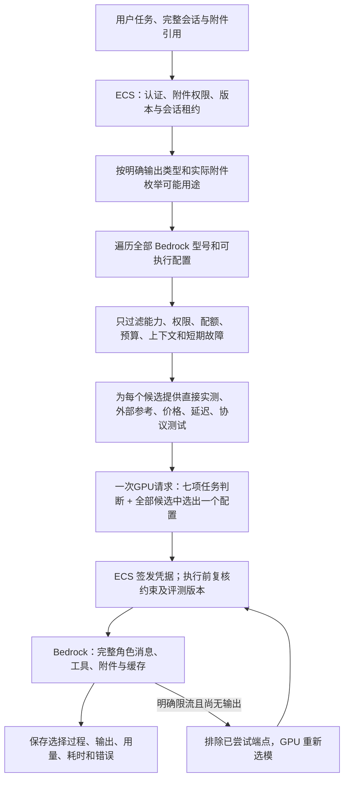

# Bedrock 路由：GPU 根据评测选择模型

2026-11-26 更新。独立网关采用 `gpu-evidence-single-pass-v2`，执行协议为 `bedrock-classified-v4`。默认 **Liquid d1-2B**。一次GPU请求同时回答七项任务属性和目标配置选择，取消“先分类、再逐组淘汰”的串行路由。ECS 负责能力、权限、预算校验和接口适配。

旧的同批次筛选、程序计算非劣集合、固定媒体型号顺序和 Agent 型号白名单，均不再用于独立网关的实时选模。旧算法仅保留在历史比较和无推理回放中。历史87场景结果不改写，也不代表新策略效果。

## 决策流程总览



所有可能适用的配置均进入同一次GPU请求，没有按质量排名截取 Top-K。分类前合并各个可能用途的候选集合，因此参加判断的配置数可以大于最终符合本轮任务属性的配置数。七项属性与选模同时判断，选模问题直接根据用户需求和证据做选择，不依赖另一个问题先返回答案。只有一个候选时，由 GPU 判断执行或不执行。GPU选择不符合同时返回的任务属性或硬约束时，明确拒绝执行，不偷偷重新排名或追加串行决策。

决策卡片压缩重复字段：内容通过/已评数量保持精确；未完成、待评和错误计数单列；P95取到0.01秒，参考费用保留原始USD数值。关键质量指标使用直白描述，例如 Coding correctness 99/100；来源、批次和公开指标列共用图例，完整原始评测仍保留在目录与历史中。当前请求完整传入，决策预览最近两条历史消息、每条最多200字；目标模型仍接收按会话设置保留的历史。

Liquid使用原生多问题接口，在一次前向计算中读取八个问题的答案；后端记录实际前向计算次数。联合决策总耗时包含证据准备、HTTP排队和模型计算，分类和选模共享同一段时间，不能重复相加。其他服务的一次HTTP请求不应被称为一次前向计算，只有服务提供计数时才展示该指标。

模型判断仍可能出错；一次比较全部候选不代表数学上保证全局最优。模型、GPU实例与直接评测数据没有更换，改变的是候选编码、服务上下文配置和调用流程。历史分组记录保留当时的计时方式；界面展示的是输入证据与实际选择，不是模型生成的推理过程。

## 评测证据如何进入选型

| 证据 | 用途与限制 |
| --- | --- |
| `app/bedrock_catalog.json` | AWS目录、精确invoke_id、账户状态、区域、模态和配额；容量变体不继承基础端点评测 |
| `app/bedrock_evaluations.json` | 对精确Bedrock端点的直接测量；按任务类型提供内容正确、严格通过、调用错误、样本量、P50/P95及协议能力 |
| `app/routing_rankings.json` | 保留公开评测来源、日期、分项和推理配置；不同批次原始分数不能直接当作共同标尺 |
| AWS价格快照 | 能精确匹配的按需价优先；其余保留外部参考或未知，不将未知当作免费 |
| 当前会话 | 最近对话片段、上次成功配置、短期端点错误；完整保留历史发送给目标模型 |

新增型号即使没有公开榜单映射，也会以Bedrock默认参数配置进入能力筛选。已有外部成绩但参数未核验的档位不执行；这不妨碍同一型号的默认参数配置参与决策。直接测量只绑定实际测试端点和配置，不能转移到其他reasoning档位。

默认 `benchmark_release=auto` 提供全部合格型号，不再先选一个评测批次。调用方明确指定日期时，仍按其要求只使用该批次配置。可调用的旧版型号默认参与独立网关；明确传入 `include_legacy=false` 可排除。账户不可用、无部署容量、零配额和已证实接口不支持的端点，会给出排除原因。

GPU输入包含请求、七项属性、成本偏好、输出预算、候选证据和是否为上次配置。不会发送测试题的标准答案、真实媒体字节、内部存储地址或服务密钥。所有候选均由后端提供；用户文字作为待分析数据，不允许指定任意外部调用地址。

## 指标与补测方法

本次直接补测是**可见开发测试集**，不是独立业务成功率校准。

- 共同文本集：4项指令/抽取任务、6项推理/行业核算、3项代码功能测试。文本调用上限4096输出Token，使用Bedrock默认采样与推理参数，不使用提示词缓存。
- 图片理解：颜色、OCR、图表4项；不能替代复杂视觉能力评测。
- 工具协议：发起一次真实工具调用，再传回工具结果；仅保留可跨模型传递的text/toolUse/toolResult。协议是否接受，与最终金额回答是否正确分开统计。
- 多轮：3条角色消息的记忆检查；不是长上下文压测。
- 向量和重排：中英文各一题，每题3篇文档，检查首位命中。
- 图片编辑：13种接口，保留生成图片；用像素、透明度、尺寸核对限定要求，不将“返回图片”算质量通过。
- 英语语音：两个Sonic端点生成同一句话，通过独立Voxtral语音识别核对实际音频；不评价自然度或其他语言。
- 视频理解：同一花朵开放片段，对照采样画面进行明确标注的助手复核；不能推广为视频通用准确率。

**内容正确**与**严格通过**分开：单个代码围栏或明确最终答案可以规范化后再次检查；严格结果仍保留原来的格式失败。无法可靠抽取最终答案时列为待复核，不猜测正确。代码在无网络、非root、只读、受资源限制的容器中运行功能测试。调用错误和截断仍算本次未完成，但不宣称模型永远没有该能力。

P95按最近秩法计算，包含此次调用耗时；一个样本的P95就是该样本，不能据此推断线上SLA。工具和检索测试可能包含多次API调用，记录条数不等于底层请求数。修正过的请求适配器或歧义测试题保留原始记录，最终统计明确列出被替代的记录数。

另对83个文本端点探测输出参数限制，发现19个需要较低上限。请求的输出上限是天花板，实际执行取它与已核验端点上限的较小值，并把实际值提供给GPU和前端。例如Llama 4为8192，早期Llama 3为2048，Nova为10000。Palmyra Vision的4096总上下文使用2048输出的保守设置；这不是声称其最大输出只能2048。三项此前因预算不兼容失败的型号重新测量，新的逐项记录保留实际上限，旧失败仍归档。数据见[参数探测记录](../app/bedrock_limits.json)。

完整结果、逐型号覆盖和原始证据见[Bedrock补测报告](../validation/independent_gateway/bedrock-evidence-2026-11-26/README.zh.md)。历史业务校准仍为 `uncalibrated`；小样本开发成绩不会被伪装成已证明的生产成功率。显式要求业务成功率下界而没有相应验证数据时，返回无候选。

## 成本、多轮、缓存和回退

低成本、均衡、高能力偏好均作为GPU输入，不由程序预先排序。费用估计使用输入代理和输出预算；严格费用条件按输出上限检查参考估计。媒体完整计费不能由文字长度推导，保持未知。所有价格均不是实际账单或账户花费上限，且不含GPU、ECS、网络等成本。

“优先用上次模型”向GPU提供上次成功配置，最终仍由GPU决定是否沿用；后端不再用固定百分比覆盖选择。缓存继续使用Bedrock原生cachePoint，以实际cacheReadInputTokens确认命中，不估算不存在的缓存折扣。

目标限流、服务不可用或未就绪且尚无输出时，从剩余合格端点中重新调用GPU选模，含首选最多3个不同端点、总执行阶段180秒。原有预算及模型限制继续生效。超时、部分输出、权限或参数错误不自动回退；原生媒体任务不自动重复提交。

## 前端与审计

工作台展示GPU联合决策总耗时、其中的GPU往返、约束复核、凭据存储和目标调用；共享时间不相加。候选表展示实测分项、样本量、参考费用、外部来源；展开区展示实际送入GPU的全部候选与选择、排除原因和输入摘要。历史、性能和行业Agent步骤保存联合决策耗时与调用次数，回退重新决策也单独留痕。新版联合决策与旧版选模的P50/P95分开统计。

新增效果评测分别统计分类、选模和GPU调用合计，选择阶段发生失败的尝试也计数。旧批次保持原字段口径；低价/高能力对照保留原规则策略并明确标注。

执行凭据绑定用户、任务、会话、精确配置、目录、策略和评测版本；证据更新后旧凭据失效。执行阶段只复核条件，不重新使用旧程序排名覆盖GPU结果。

## 复现

```bash
.venv/bin/python -m scripts.measure_bedrock_limits --output .deployment/benchmark/limits
PYTHONPATH=. .venv/bin/python scripts/refresh_routing_catalog.py --output .deployment/benchmark/catalog.json
PYTHONPATH=. .venv/bin/python scripts/measure_bedrock_catalog.py \
  --catalog .deployment/benchmark/catalog.json --output .deployment/benchmark/results \
  --code-image <本地固定的Python沙箱镜像> --workers 4
PYTHONPATH=. .venv/bin/python scripts/measure_bedrock_specialized.py \
  --catalog .deployment/benchmark/catalog.json --output .deployment/benchmark/results \
  --code-image <带Python3.12及speech依赖的网关镜像> --workers 4
PYTHONPATH=. .venv/bin/python scripts/review_bedrock_media.py --measurements .deployment/benchmark/results
PYTHONPATH=. .venv/bin/python scripts/compile_bedrock_evidence.py \
  --measurements .deployment/benchmark/results --output app/bedrock_evaluations.json \
  --code-image <本地固定的Python沙箱镜像> --pricing <AWS区域价格JSON快照>
```

评测需要AWS调用权限并产生真实调用费用。脚本按精确型号与用例保存记录，重启可复用同目录已完成项；目录、共同题集与调用配置必须一致。汇总快照经复核、测试和ECS镜像发布后生效，数据库中的任意用户评审不会直接改写在线路由证据。参见[独立AWS部署](INDEPENDENT_SERVICE.zh.md#直接-aws-部署)。
