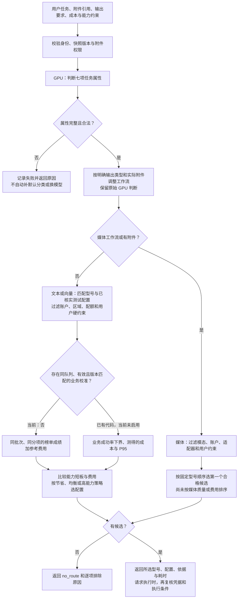
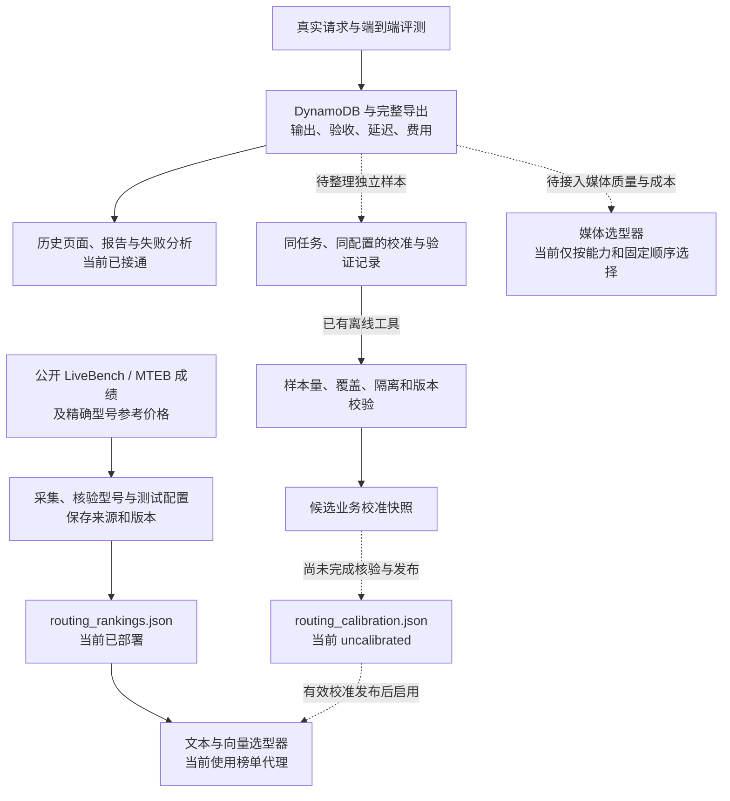

# Bedrock 分类选型：任务评估与程序策略

更新于 2026-11-25。此版本落实“任务评估 → 按类别选择 Bedrock 模型与配置”。[首版调研](ROUTING_OPTIMIZATION.zh.md)保留此前的选型依据。

当前独立网关采用两段式决策：**GPU判断任务需求，ECS中的程序依据评测与约束选择目标模型**。GPU这一阶段不会读取候选榜单、价格或效果报告。服务部署关系见[已部署架构图](INDEPENDENT_SERVICE.zh.md#已部署服务架构)，HTTP调用顺序见[请求时序图](INDEPENDENT_SERVICE.zh.md#一次请求的调用顺序)。

本文区分三种证据模式：文本/向量当前使用公开榜单代理 `benchmark_proxy`；媒体使用能力过滤 `capability_only`；已有代码支持、但尚未启用的业务校准模式为 `business_validation`。已有87项效果评测不会自动改变在线排名。

独立网关额外启用 `gateway-session-v1`：恢复角色消息、按轮次裁剪、限长对话辅助分类、受约束的配置粘性、短期错误冷却，以及 Bedrock 缓存/流式/回退。[OpenRouter 对照与完整实现](SESSION_ROUTING.zh.md)。以下描述基础选型器；旧评测继续使用其冻结路径，不自动带入其他会话或开启回退。

## 范围与现有证据

下游候选严格来自 `app/bedrock_catalog.json`，按精确型号 ID 关联 `app/routing_rankings.json`。现有目录为 124 个模型；2026-11-24 将公开评测映射从 **25 个扩展到 60 个**：57 个文本型号、3 个向量型号。其中 51 个型号的执行配置已映射，另 9 个有精确型号成绩但配置仍待核验，不能自动执行。账户、生命周期、任务分项和配额仍会继续过滤；有映射不代表当前端点可用。

新增覆盖 Nova、Llama、Gemma、Claude 4.5、Devstral、MiniMax、Qwen 等型号。另有 14 个型号只具备核验过的外部资料和参考价，11 个是未独立评测的容量变体，29 个需要专用任务或模态评测，10 个未找到接入范围内的公开成绩。逐型号状态和来源见[覆盖记录](../validation/routing_mappings/coverage.json)；这些类别互斥，不将参考资料计作评测。

独立服务默认分类器为专用 GPU 上的 H2O Lightning 4B，也可选择 Decider/Liquid。原比较入口还支持 Bedrock GPT-6 Sol 等对照；无论选哪一个分类器，下游目标池都来自同一个 Bedrock 目录。

已经完成并保存真实端到端评测，但其结果尚未整理为可用业务校准快照。[当前校准文件](../app/routing_calibration.json)仍为 `uncalibrated`、`cohorts={}`。文本/向量运行基于榜单分项的初始策略，不能将评测已经完成解释为线上选型已按业务成功率校准。

## 决策流程总览

图中实线表示当前代码已实现的调用或判断。业务校准分支已有实现，但当前没有可用校准队列，实际走榜单分支；多模态目前不读取业务校准统计。



三处决定不能混为一个“模型打分”：GPU给出任务属性；选型程序比较候选证据；目标执行后另做任务验收。候选没有满足约束、执行条件不具备、输出不合格，是不同阶段的问题。选型后的执行分支、结果记录与错误处理见[请求时序图](INDEPENDENT_SERVICE.zh.md#一次请求的调用顺序)。

## 一次分类请求，七个结构化属性

分类器接收原始任务、附件类型、明确输出要求和固定候选标签；独立多轮网关还提供最近两轮的限长文本片段。不接收待选型号、价格或预设答案。模板不参与匹配；问候、日常问题、创作和不明确的输入都可进入通用文本能力：

| 字段 | 含义 | 如何用于选型 |
| --- | --- | --- |
| `workflow` | 通用文本、客服、代码、推理、向量、图片/视频/音频理解、图片/视频/语音生成、重排，共 12 类 | 模态过滤、选择对应能力分项或原生适配器 |
| `difficulty` | simple / moderate / complex | 调整均衡档的取舍 |
| `stronger_model_benefit` | low / medium / high | 与难度共同决定是否值得优先能力 |
| `latency` | normal / sensitive | 有同端点业务测量时，纳入延迟维度 |
| `tools` | 是否需要实际调用外部工具 | 检查已核实的工具能力 |
| `structured_output` | 是否要求供应商强制 schema 输出 | 检查已核实的结构化输出能力 |
| `languages` | en / zh / en_zh / other | 选择对应语言的检索成绩 |

写 webhook 代码不等于需要分类器调用外部工具；提示中明确区分。解析时要求七项完整且全部来自固定标签，缺字段、非法值和调用失败不会被补成默认答案。

分类标准由[属性说明](../app/routing_profile.py)中的固定标签与判定说明约束，具体属性由GPU模型根据请求推断。例如难度强调推理步骤而不是行业重要性；延迟敏感要求用户明确表达；原生媒体处理不算外部工具；普通代码生成不要求强制Schema。它们是模型判断，尚无经业务校准的“复杂任务必然需要某型号”规则，不能把 `stronger_model_benefit=high` 当作已经测得的收益。

Bedrock 使用一次 Converse 请求；System One 分类器使用一次包含七个问题的请求。一次网络请求不代表一次模型前向计算，多问题模型的实际推理耗时仍需测量。

## Bedrock 候选与配置

先按账户、区域、生命周期、输入/输出模态筛选，再检查模型允许/排除列表和参考费用限制。指定了工具、结构化输出或上下文要求时，缺少能力证明的模型不进入候选。当前目录缺少这些详细字段，因此相关严格请求可能返回 `no_route`。

账户已授权不代表有推理配额。AWS Service Quotas 的账户实际配额按 **区域＋精确 invoke_id** 绑定；已核实为零的端点在选型前排除，直接目标执行也会复核。当前已核验 48 个型号的配额；Kimi K3 和 GLM 5.3 的 US 跨区域 Token 配额为 0。其余未映射项保留未知，不借用 Mantle 或 global 端点的配额。

正配额不代表实时剩余额度或端点健康。零配额记录保持排除，配额恢复后需要重新采集并发布目录；刷新会改变目录版本，使旧路由凭据失效。只更新配额、不刷新模型列表和评测：

```bash
uv run python -m scripts.refresh_routing_catalog --quotas-only
```

采集在部署环境执行，API 不需要新增 Service Quotas 权限或网络出口。之后按[独立网关发布步骤](INDEPENDENT_SERVICE.zh.md#直接-aws-部署)构建并部署 API 镜像。映射缺失或采集失败时不会覆盖已有记录；完整模型目录刷新也会采集已映射配额。映射仅验证了当前 `us-east-1`，其他区域需先核对。

独立服务已接入真实图片、音频和视频上传及原生执行，详见[多模态能力与边界](INDEPENDENT_SERVICE.zh.md#多模态执行)。文本/向量继续使用可比评测策略；媒体使用 `bedrock-media-v1` 能力过滤，缺少可比质量和完整费用时如实显示未知，按稳定型号顺序选择。当前纯文生图与视频生成无可用目录型号，返回明确原因；不借用文本分数。执行策略版本为 `bedrock-classified-v3`。

候选单位为 **型号＋测试配置＋请求参数**。当前大多数型号只有一个已测档位。每个候选有稳定 `configuration_id`，执行沿用对应的 `request_fields`。

同一型号的其他批次或档位保存在 `configurations`，每条均有自己的来源、数据集版本、请求参数、价格来源和任务分项。配置 ID 绑定型号、推理配置、采样参数及数据集版本。配置待核验的例子包括 Fable 5 的公开评测含 Opus 回退、GPT-OSS 的默认 effort 未明确、Qwen 3 32B 使用额外 `/think` 提示；不能把这些成绩直接套用到当前 Bedrock 请求。

## 评测批次与数据刷新

LiveBench 已将旧榜单文件迁移到 `/v1/`。本次接入 2024-06-24、2024-11-25、2025-04-02、2025-04-25、2025-05-30、2026-01-08、2026-06-25 七个批次，每条成绩保留批次。旧批次未定义 Agentic Coding 时，代码类别使用该批次实际存在的 Coding 分项；已定义却未完成的分项仍为未知，不补零。

`routing_preferences.benchmark_release` 默认 `auto`：在通过限制的候选中，先选择覆盖独立型号最多的可比组，同数时取较新批次，再在组内进行成本/能力选择。也可指定日期；指定批次没有候选时返回 `no_route`，不会暗中换批次。不同来源、数据集或分项集合不会进入同一个能力比较池。此选项用于文本评测，向量继续使用对应 MTEB 数据集。

工作台「更多约束与运行模式 → 文本评测批次」提供对应选择。例如 2025-04-02 有 Nova / Gemma / Llama，2026-01-08 有 Claude 4.5 / Devstral / MiniMax 等。模型页可搜索、按证据状态筛选并展开各批次成绩。已有文本成绩不证明视觉、语音等其他模态能力。

```bash
uv run python -m scripts.refresh_routing_rankings \
  --archive-dir validation/routing_mappings/new-source-snapshot
```

映射由 `app/routing_mappings.json` 和 `app/routing_registry.json` 的显式 ID 定义，不使用模糊名称匹配或剥离容量后缀。脚本保留公开 CSV、分类定义、官方配置 YAML 和 OpenRouter 公开型号 API 的原文及 SHA-256；取不到必需成绩或检测到参考别名版本变化时不覆盖已有榜单。

价格优先使用对应 LiveBench 配置的参考价，缺失时仅使用精确型号的 OpenRouter 参考价，保留来源和采集时间。OpenRouter 的 canonical slug 被固定校验；例如 `mistralai/mistral-large` 已指向 2407，因此没有把该报价关联给 Bedrock 2402。未知价格保持未知；这些价格均不是 Bedrock 实际报价。刷新后需构建并发布 API，新榜单版本会使旧路由凭据失效。

## 程序如何选择

选择过程不再请求决策模型，也不通过提示词要求它做价格运算。

首先应用显式限制：

- `max_reference_cost_usd`：用输入估计和实际输出上限，按参考平价估算；恰好等于限制可通过，未知价格不能通过。
- `min_success_rate`：要求匹配业务队列的成功率 **95% Wilson 下界** 达标。没有业务数据时不能用榜单分数替代。
- `max_latency_ms`：要求匹配业务队列测得的 P95 达标。没有测量时返回无候选；历史 P95 也不是对未来单次请求的保证。
- `min_context_tokens`：要求目录中已核实的上下文容量达标。

通过限制后，按同一类别的可比能力证据与费用形成非劣候选集合。能力代理采用“相对于候选最佳值的最大分项短板”：

```text
quality_regret(m) = max_k [ best_score(k) - score(m, k) ]
```

客服和文本使用 Language/IF；代码使用 Coding/Agentic Coding；核算使用 Reasoning/Mathematics/Data Analysis；向量按需求使用 en、zh 或两者。不会平均不同任务的榜单总分。

三档程序策略：

| 请求档位 | 程序行为 |
| --- | --- |
| low | 在非劣候选中选择费用最低的配置，能力短板用于同价比较 |
| medium | 将能力短板和费用分别按当前非劣池范围归一化，最小化其中最大的偏离；有可比延迟且任务敏感时加入延迟 |
| high | 优先选择能力短板最小的配置，再比较费用 |

显式 low/high 不被分类结果覆盖。medium 遇到“简单＋更强模型收益低”采用 low，遇到“复杂＋收益高”采用 high，其余保持 medium。响应同时保留请求档位、有效档位和原因。

这是透明的初始取舍规则，不是 OpenRouter 的内部权重，也不是已训练的最优策略。用户指定的成功率和延迟要求独立于三档策略，不会被自动放宽。

有业务证据时，能力维度替换为校准集的成功率 Wilson 下界，费用和延迟使用该队列的测量；同一轮不混用业务成功率和榜单分数。有价格的候选不与未知价格候选混作“最便宜”比较；全部价格未知且没有费用限制时仅按能力选取，明确标记 `unknown_quality_only`。

例如，一个普通代码任务只比较同批次的代码相关分项与费用，不拿图片识别成绩替代代码能力。若GPU把“写SQL”误判为需要实际数据库工具，候选可能在排序前就被过滤为空；若把中文文字误判为语音，则会走媒体分支。此时提高目标输出Token上限或更换榜单的排序权重，无法修复前置属性错误。

## 评测证据如何进入选型

当前在线选型读取镜像内快照；日志、历史和评审不会直接变成选型权重。下图分别表示公开评测的现有发布流程、已实现但未启用的业务校准流程，以及尚待实现的媒体质量接入。



实线表示已实现的数据处理或工具关系，不表示离线校准已经产生合格数据；虚线明确标出尚未接通或尚未启用的环节。

| 数据 | 当前参与哪一步 | 使用限制 |
|---|---|---|
| Bedrock目录、账户与配额快照 | 候选资格检查 | 目录支持、正配额不等于实时健康或剩余额度 |
| LiveBench任务分项 | 文本候选的能力比较 | 限同批次、同指标、已核实配置；不是业务成功概率 |
| MTEB对应语言成绩 | 文本向量候选的能力比较 | 按实际所需语言比较；图片向量走媒体适配路径 |
| 已知参考价格与Token估计 | 文本/向量成本比较及参考费用限制 | 不等于Bedrock账单，不含所有媒体与基础设施成本 |
| 87项效果评测及追加评审 | 展示、追溯、离线分析 | 没有自动写入校准文件，不能把47/87等路由方案成绩当作某个目标型号成功率 |
| 匹配队列的业务校准统计 | 代码支持替换榜单代理 | 当前校准表为空；有版本和有效期限制 |
| 媒体质量与完整费用统计 | 尚未进入媒体排序 | 当前 `capability_only` 不按这些数据选择最优型号 |

因此，报告发现某个视觉模型把红图识别成蓝色后，当前在线策略仍可能再次选择它。要让结果影响选型，需要形成分场景、分型号配置的可比较证据，并实际接入、验证和发布相应策略。仅修改报告文本不会改变路由。

当前已发现的失败分组、改进顺序和3项尚未修复的边界归类问题，见[失败原因与多模态改进结论](../validation/independent_gateway/overall-metrics-2026-11-25/failure-analysis.zh.md)。

## 业务校准入口

工具不调用模型，也不会生成或补齐业务结果：

```bash
# 导出当前 Bedrock 型号与已测配置，供真实业务测评使用
.venv/bin/python -m scripts.calibrate_routing \
  --export-configurations --output /tmp/bedrock-configurations.json

# observations.json 必须来自真实、独立标注的任务测评
.venv/bin/python -m scripts.calibrate_routing \
  --observations /path/to/observations.json \
  --minimum-samples 30 --ttl-days 30 \
  --output /tmp/routing-calibration-candidate.json
```

输入包含目录和评测版本，以及逐次观察：

```json
{
  "catalog_version": "<目录版本>",
  "ranking_version": "<评测版本>",
  "observations": [{
    "case_id": "coding-case-001",
    "split": "calibration",
    "configuration_id": "<导出的配置 ID>",
    "profile": {
      "workflow": "coding", "difficulty": "moderate",
      "stronger_model_benefit": "medium", "latency": "normal",
      "tools": "no", "structured_output": "no", "languages": "zh"
    },
    "input_tokens": 1000,
    "max_output_tokens": 4096,
    "passed": true,
    "latency_ms": 1200,
    "total_cost_usd": "0.005",
    "cost_scope": "reference_usd"
  }]
}
```

示例仅展示字段，不是实测结果；单条记录不能通过校准工具的样本量检查。

按任务类型、难度、语言、能力要求、输入长度档和输出上限分队列。每个队列都必须有独立 calibration/validation 两组；两组覆盖同样配置，每组内所有配置覆盖相同任务，包括失败。重复任务/配置、跨组泄漏、缺失覆盖、样本不足和混合账单/参考价格都会被拒绝。

`passed` 应来自独立业务验收，而不是“接口成功”或路由器自己的解释。`total_cost_usd` 应覆盖该测评路径中的失败、重试及约定的路由摊销；工具无法从一个总额字段证明所有账单已被纳入，采集方必须统一计费口径。

校准集提供运行时排序数据，验证集仅用于报告，不能据验证集反复调阈值。对每种策略、固定强模型和固定便宜模型，应另报验证集质量、端到端延迟与每成功任务费用。每组 30 个任务只是导入下限，不能据此保证小幅质量差异已获得统计证明。

输出是候选校准文件；审阅真实测评结果后，将其安装为 `app/routing_calibration.json`。文件绑定目录/评测版本、SHA-256 校验值和有效期。版本不匹配或过期时不再声称业务校准有效；若请求设定业务质量/延迟硬要求，则返回无候选。

## 独立网关 API 与执行

生产入口为[独立FastAPI应用](../app/gateway_main.py)，对外使用 `/api/gateway/*`。登录后先调用 `GET /api/gateway/catalog` 取得当前目录、评测、策略及校准版本，再提交 `POST /api/gateway/runs`：

```json
{
  "task": {
    "text": "编写具有验签、幂等和并发保护的支付 webhook",
    "routing_preferences": {"cost_tier": "medium"}
  },
  "provider": "h2o",
  "mode": "live",
  "execute_target": true,
  "catalog_version": "<GET /api/gateway/catalog 返回的 catalog_version>",
  "ranking_version": "<GET /api/gateway/catalog 返回的 ranking_version>",
  "policy_version": "<GET /api/gateway/catalog 返回的 policy_version>"
}
```

`provider` 可为 `decider`、`liquid`、`h2o`，省略时使用服务端默认H2O。`execute_target=false`只分析路由，仍会调用真实GPU；`mode=replay`不调用GPU，也不能执行目标。示例中的版本必须使用目录接口实际返回值。

响应采用逐行JSON事件，依次包含 `accepted`、各阶段 `stage`、`route` 和 `completed`，异常产生 `error`。分类与 `deterministic_policy` 选型分别可审计：返回实际分类输入、原始与有效属性、候选、排除原因、非劣集合、选择原因、成本口径及版本。流式阶段事件不代表Bedrock最终答案按Token实时输出。

成功的live选型创建15分钟有效、绑定当前用户的内部 `route_token`。请求需要执行目标时，网关内部从共享存储恢复任务和属性，复核版本、候选和配置后执行；历史和完整导出会移除该凭据。执行还会检查附件就绪状态，当前未接通的工具或强制Schema执行参数会被明确拒绝。客户端不能通过替换型号或属性绕过这一步。

共享[路由模块](../app/routing.py)中仍保留旧比较服务的 `/api/routing/auto`、`/auto/execute` 和模型直接选型接口，但独立应用没有注册这些旧路由。旧页面的Bedrock分类器和原始/增强证据对照不代表当前独立网关的默认调用方式。

## 实现对应位置

| 环节 | 代码入口 |
|---|---|
| 身份验证、运行记录、逐行JSON事件 | [gateway_main.py](../app/gateway_main.py)、[gateway.py](../app/gateway.py) |
| 七项分类说明与结果校验 | [routing_profile.py](../app/routing_profile.py) |
| 独立GPU服务调用与时延 | [gateway_decision.py](../app/gateway_decision.py) |
| 分类、流程调整、选型与执行凭据复核 | [routing.py](../app/routing.py) |
| 文本/向量候选、校准检查、三档选择 | [routing_selector.py](../app/routing_selector.py) |
| 任务分项、参考费用计算与限制 | [routing_evidence.py](../app/routing_evidence.py)、[routing_balance.py](../app/routing_balance.py) |
| 媒体能力、适配器、执行就绪与固定顺序 | [routing_media.py](../app/routing_media.py) |
| 离线业务校准与候选快照生成 | [routing_calibration.py](../app/routing_calibration.py)、[calibrate_routing.py](../scripts/calibrate_routing.py) |
| 端到端评测、评审与整体指标 | [gateway_effects.py](../app/gateway_effects.py)、[gateway_effect_judge.py](../app/gateway_effect_judge.py) |

## 尚未包含

实时端点报价、准确目标 tokenizer、跨供应商动态负载分配和依据业务质量自动升级仍需后续接入。独立网关已增加缓存读写、会话粘性和有限故障回退，见[会话机制](SESSION_ROUTING.zh.md)。当前引用价和输入粗估不是真实花费上限；生产成本与性能收益需要真实分类器及下游模型的配对实测证明。
