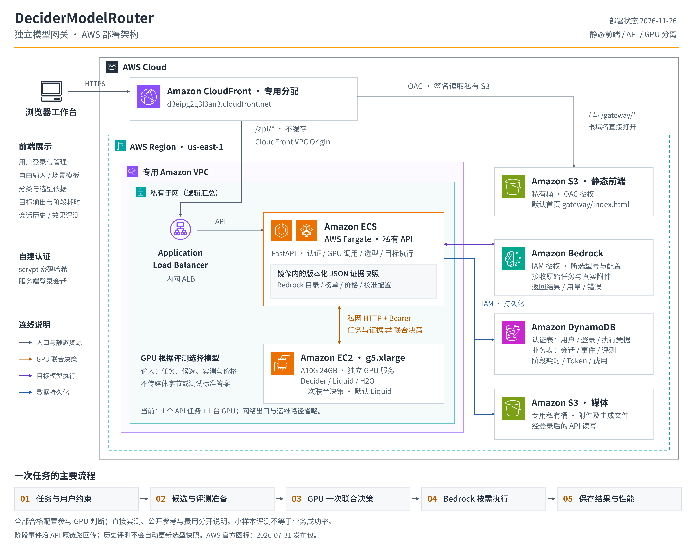
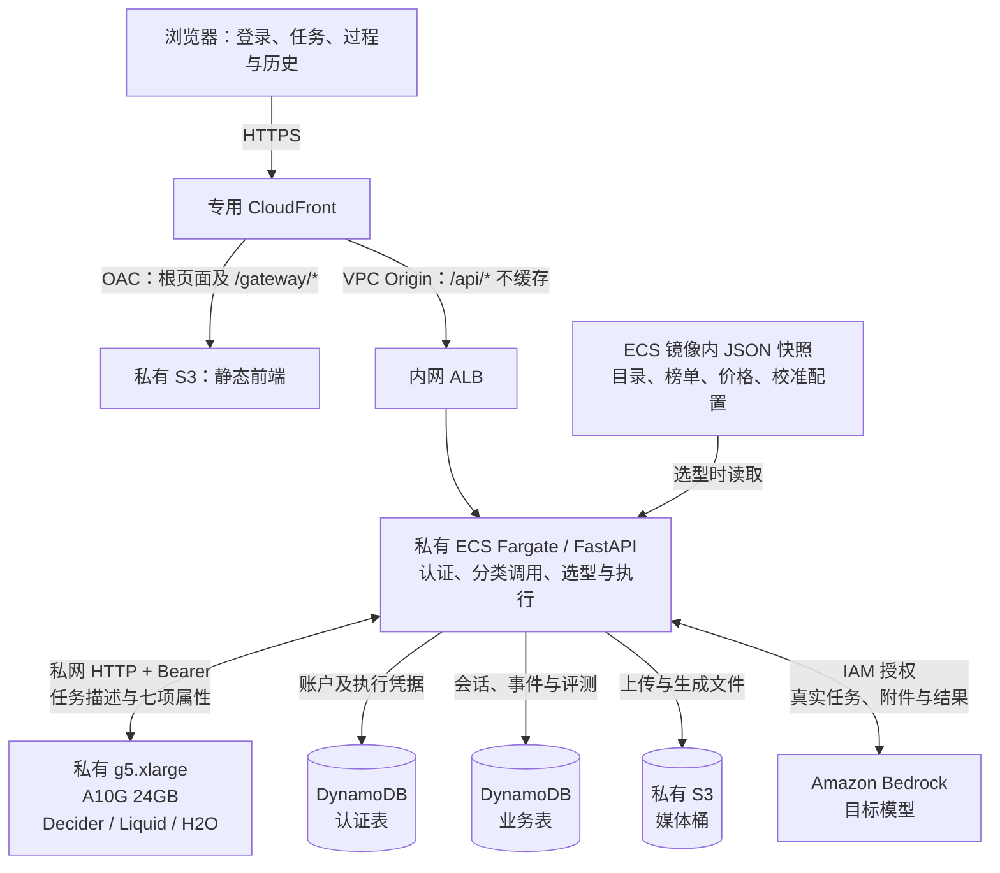
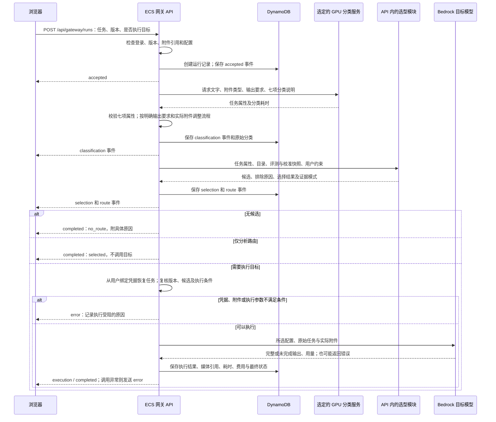

# DeciderModelRouter 独立服务

当前入口和 AWS 资源见 [部署记录](../deployment/DEPLOYED.md)，验证结果见 [独立服务报告](../validation/independent_gateway/README.zh.md)。原项目说明保留在 [LEGACY.md](../LEGACY.md)。

新增多轮输入、模型粘性、Bedrock 提示词缓存、流式输出和受约束回退；数据库继续使用专用 DynamoDB，GPU 继续使用现有实例。[OpenRouter 功能对照、完整会话时序与指标](SESSION_ROUTING.zh.md)。

直接访问 https://d3eipg2g3l3an3.cloudfront.net/ 即可打开工作台。CloudFront 以 `gateway/index.html` 为默认首页，在内部读取 S3 对象，不跳转浏览器地址；样式、脚本和图标位于 `/gateway/`，API 位于 `/api/`。前端发布同时刷新根路径缓存。

## 已部署服务架构

[](diagrams/decider-model-router-aws.zh.svg)

[SVG 矢量图](diagrams/decider-model-router-aws.zh.svg) · [高清 PNG（3840 × 3060）](diagrams/decider-model-router-aws.zh.png) · [生成脚本](../scripts/generate_gateway_architecture.py) · [AWS 官方图标来源](diagrams/aws-icons/README.md)

图中按2026-11-25部署状态绘制：CloudFront位于区域边界外，ALB、ECS和GPU位于专用VPC的私有子网；S3、DynamoDB和Bedrock作为托管服务单独展示。私有子网框是逻辑汇总，当前为一个API任务和一台GPU；图中省略网络出口与运维路径。

<details>
<summary>展开 Mermaid 关系图</summary>



</details>

内网ALB、ECS和GPU均在专用VPC中。图中只有一个独立API服务；分类传输、选型规则和目标适配器都是该服务中的模块。GPU运行独立HTTP服务，每次请求只调用选定的一个分类器，默认Liquid d1-2B；不会同时让三个分类器投票。浏览器通过CloudFront调用API，GPU没有浏览器直连入口。

GPU接收任务文字、附件类型、输出要求及最近两轮对话的限长文本片段，不接收图片/音视频字节、文件地址、候选型号、价格或验收答案。目标模型接收保留的完整角色消息和真实附件。媒体桶通过登录后的API访问，与由OAC读取的静态前端桶分开。

用于选型的目录、榜单和校准数据来自部署镜像中的版本化快照。DynamoDB里的87项效果评测及人工/助手评审用于展示、追溯和离线分析，当前不会自动更新这些快照，也不会自动训练GPU模型。证据流转与选型步骤见[决策流程](BEDROCK_CLASSIFIED_ROUTING.zh.md#决策流程总览)和[评测证据如何进入选型](BEDROCK_CLASSIFIED_ROUTING.zh.md#评测证据如何进入选型)。

## 服务边界

专用 VPC、子网、安全组、NAT、ECS 集群/服务/角色、ALB、CloudFront、S3、两张 DynamoDB 表、GPU 实例和密钥。GPU 从现有已验证运行环境创建私有镜像再启动新实例，镜像创建使用 `NoReboot=True`，原实例继续运行；新实例使用独立角色和轮换后的密钥。镜像用于复制运行环境，线上请求不依赖原 GPU。

本次 `g6.xlarge` / `g6.2xlarge` 在多个可用区返回容量不足，最终使用 `us-east-1f` 的新 `g5.xlarge`（A10G 24GB）。AWS Linux 按需计算参考价为 $1.006/小时，不含 EBS、网络、ECS 等费用；部署脚本可用 `--instance-type` 指定规格。原 GPU 保持运行。A10G 上的 H2O 显式选择 `--linear-backend marlin`：FP8 权重、16 位激活（W8A16），结果注明该配置；默认 CUTLASS FP8 路径在此实例上启动失败。Decider 和 Liquid 仍使用 BF16。

生产只运行 `app.gateway_main:app`。静态资源单独发布到 S3；API 容器不提供前端文件，也不加载旧支付、视觉、GPU 启停和比较页面接口。无 Cognito、CloudFormation、公开注册接口。GPU 无公网 IP、无 SSH 入站，通过 SSM 运维。

## 路由与模板

一次GPU请求识别七项任务属性，再由后端应用能力、目录、配额和用户约束。文本/向量在可比评测组内平衡能力与参考费用；媒体按模态和适配器筛选，当前缺少按实测质量排序的逻辑。只调用Bedrock支持目录中的目标执行标识。具体公式、映射、推理配置和证据见[分类路由说明](BEDROCK_CLASSIFIED_ROUTING.zh.md)。

29个工作台模板包含8个简单通用场景（中英文问候、日常知识、自由写作、澄清需求、生活建议、中英翻译、会议摘要）、12个行业任务以及检索、多模态场景。通用场景显示在前，可按类别筛选；行业模板提供业务背景、材料和验收说明，各模板带有Token预算。“行业Agent”另提供12个行业各4轮连续任务，运行在独立AgentCore Runtime V2，使用Model Router作为模型入口。[架构与调用说明](INDUSTRY_AGENTS.zh.md)。模板不参与分类匹配；登录后任务框为空，`hi`等任意文字仍直接进入一次真实GPU属性判断。分类使用`task-profile-v2`与12个通用能力类别，旧分类参考集单独冻结。工作台代码模板显式使用期望8192、最大16384 Token，可在运行前调整。

GPU 输入包含原始文字、附件类型、明确的输出类型和图片操作，不含媒体字节或存储地址。用户指定的输出类型优先，上传内容要求目标支持相应输入；原始 GPU 属性和必要的流程调整都写入记录。分类模型仍可能判断错误，分类参考评测不等于通用准确率。

## 一次请求的调用顺序

下图是已登录、`mode=live` 的独立网关请求。浏览器经CloudFront和ALB访问API，图中省略这两层转发。事件响应采用逐行JSON（NDJSON），先保存事件，再发送到前端；阶段进度流不等于目标模型逐Token流。



无候选和错误事件也会保存。分类超时、无效属性、输出未完成和结果未知的超时不会自动重试。独立网关的文本目标可在尚无输出且收到明确限流、服务不可用或模型未就绪错误时受约束回退，每次尝试分别留痕；完整条件见[会话路由说明](SESSION_ROUTING.zh.md)。仅分析模式会运行真实分类与选型；`mode=replay`不调用GPU和目标模型，回放数据不进入真实性能统计。前端断开会取消当前网关工作；已提交给目标但未取回的结果仍可能未知。

## 多模态执行

| 任务 | 当前接入接口 | 输入与输出 |
| --- | --- | --- |
| 图片、视频理解 | Bedrock Converse：Nova 等支持的型号 | 图片/视频与文字 → 文字 |
| 音频转写与理解 | Voxtral InvokeModel | WAV/MP3 与文字 → 文字 |
| 语音生成或回复 | Nova 2 Sonic 双向流 | 文字或录音 → WAV 与文字 |
| 图片编辑 | Stability 专用 InvokeModel | 去背景、放大、草图/结构引导、局部重绘 |
| 文档重排 | Cohere Rerank | 查询和最多 20 条候选 → 排序及相关度 |
| 图片向量 | Cohere Embed v4 | 单张图片 → 向量维度和预览 |

目录能力、账户可用性、调用端点、实际输入/输出模态与已接入适配器共同过滤。媒体候选不套用文本 LiveBench 分数；目前按稳定型号顺序选型，质量、P95 和完整媒体费用没有测量时显示未知。指定无法核验的费用、成功率、延迟或上下文硬约束会阻止选择。模型价格档位不能解释为已经验证的媒体成本优化。

截至 2026-11-25，当前 `us-east-1` 目录没有可调用的纯文生图或视频生成型号；对应入口给出无可用模型，不改用视频理解模型冒充生成。已保留 Canvas/Titan 图片与 Nova Reel 异步视频适配器，后续需更新真实目录并验收后才能使用。异步视频完成由单独任务状态表示，原始运行保留提交时状态。

语音为一次有界回复，不是浏览器实时通话。已验证 Nova 2 Sonic 英语；该型号不支持中文语音。录音回复输入要求 16kHz、16 位、单声道 WAV，最长 30 秒；文本输出上限最多 1024 Token，返回实际生效值。音频理解可用 WAV/MP3。每次最多四个附件，图片 3.5MB、音频 10MB、视频 20MB；当前音视频执行一次一个文件，局部重绘要求原图和遮罩两张图。

媒体保存到 `GATEWAY_MEDIA_BUCKET` 指向的专用私有 S3，默认保留 180 天。API 校验账户、类型、长度和 SHA-256；历史仅存不可执行的媒体引用，文件必须经登录后的 API 下载。该桶没有 CloudFront 直读权限。输出支持图片预览、音频/视频播放及历史回看；本地目录由 `GATEWAY_MEDIA_DIR` 指定。

接口依据：[Bedrock 模型模态目录](https://docs.aws.amazon.com/bedrock/latest/userguide/models-supported.html)、[Stability 图片服务参数](https://docs.aws.amazon.com/bedrock/latest/userguide/stable-image-services.html)、[Nova Sonic 跨模态输入](https://docs.aws.amazon.com/nova/latest/nova2-userguide/sonic-cross-modal.html)。接入时另做真实调用验收；目录支持不代表已经测得质量、配额余量或完整价格。

## 数据持久化与性能口径

`decider-model-router-auth` 保存账户、密码哈希、登录会话、限流和路由执行凭据；`decider-model-router-data` 保存业务会话、请求摘要、完整阶段事件、评测和用户目录。两表按需计费，启用加密、TTL 和时间点恢复（PITR）。

- 每个数据分区由服务端登录身份构造。其他用户的会话、运行、评测不可读；管理员管理账户不等于获得其他用户的任务数据。
- 运行开始前先保存请求，随后逐事件落库；数据库不可用时停止后续推理。重复 `client_request_id` 返回 409，防止同一请求重复付费执行。
- 保存输入、版本、决策依据、输出、Token、已知参考费用、错误、会话和人工验收；导出移除路由执行凭据。记录压缩后存储，单记录限制 300KB。
- 业务记录保存 180 天，TTL 清理可能延迟，但读取会排除已过期记录。使用中的会话续期。会话列表最多 500 条；性能统计最多 5000 条并明确提示截断，可缩小时间范围。
- 性能按当前用户、会话及 1–180 天范围计算，使用最近秩法求分位数。回放单列，不计入 GPU/路由/目标性能。失败、无候选和中断保留。
- “完整执行”仅表示模型返回完整输出；人工业务验收另记，通过比例不自动作为路由校准。参考费用不含常驻 GPU、ECS、NAT 等基础设施费用；未知用量不按零计。
- 浏览器断开、容器重启会中断在途工作，已返回事件保留；执行已提交但未收到返回时显示结果及用量未知。历史持久化不意味着后台推理可跨重启继续。超过 10 分钟的陈旧运行会在读取时标记中断。

本地使用 SQLite，默认 `.data/auth.sqlite3`、`.data/gateway.sqlite3`，文件权限 0600。生产 API 使用只读容器文件系统，业务记录写入 DynamoDB，媒体字节写入私有 S3。

## 决策模型评测

评测页可选择 Decider、Liquid、H2O 和 1–16 个冻结参考任务，最多 48 次分类调用。三个模型使用相同任务和标签，按样本顺序执行，不调用 Bedrock 目标模型。提交前显示调用数量，任务离开页面后可继续并回看。

保存数据集版本、任务、模型服务返回的部署配置（未提供则为空）、预期/实际七项属性、逐字段一致情况、全字段一致率、失败、模型和时延。失败计入一致率分母；HTTP P50/P95 包含排队与校验，GPU 往返单独记录。进程退出会保留已完成样本并标记中断，不自动重跑。当前评测并发限制在进程内实现：每账户一项、总计最多两项；滚动发布期间不保证跨容器全局限流。

当前 24 个带标签样本属于**可见的开发参考集**，每次最多选择 16 个，既非独立保留测试集，也非 Bedrock 生成质量评测。新增媒体模板需要真实附件，不计入文字参考集。记录还保存属性提示词版本；历史旧版本成绩保持原样。公开 LiveBench/MTEB 映射、分类参考一致、人工业务验收三者分别展示。生产业务校准仍为 `uncalibrated`；新评测结果不会偷偷替换阈值或训练模型。需要业务校准时，应冻结独立业务题集与验收规则、执行候选目标模型并记录成本/质量，再通过既有校准流程验证发布。

独立的[端到端效果评测](effectiveness-evaluation.zh.md)覆盖87项、25类：实际执行分类、选型和目标调用，并保存低价/高能力对照、完整输出及验收证据。当前主指标按全部计划场景计算，答案评分与边界拦截分别展示。已有真实结果，但尚未形成启用中的业务校准表；[失败原因分析](../validation/independent_gateway/overall-metrics-2026-11-25/failure-analysis.zh.md)记录多模态、通用路由问题，以及3项尚未修复的边界标记不一致问题。

[文本与多模态指标报告](../validation/independent_gateway/overall-metrics-2026-11-25/modality-breakdown/README.zh.md)按原始任务意图拆分64项文本、16项多模态、2项复杂文件和5项约束/系统场景，给出分组通过率和各类验收方法。GPU原始类型匹配与后端调整后的 `workflow_fit` 分开计算；输出完成、答案通过、待评和未测分别展示。报告来自既有导出，不额外调用模型。

## 登录与用户管理

密码使用 scrypt 哈希；认证使用服务端保存的随机会话及 `Secure / HttpOnly / SameSite` Cookie，默认 8 小时。写操作检查同源和客户端请求头，登录有速率限制。密码修改、管理员重置/禁用会更新账户版本，使已有登录失效；账户页的并发修改使用版本条件，重置密码保留账户的禁用状态。

初始管理员为 `admin`，随机密码保存在 AWS Secrets Manager **`DeciderModelRouter/admin-credentials`**，由有权限的运维人员读取。首次登录后可在账户页修改密码；该 Secret 是初始凭据记录，不随用户自行改密自动更新。管理员在页面创建普通用户、禁用/恢复账户、重置密码；不能禁用自己。

命令行管理：

```bash
# 本地默认使用 SQLite；生产先设 AUTH_TABLE 和 AWS_REGION
python -m scripts.manage_users create admin --admin
python -m scripts.manage_users create alice
python -m scripts.manage_users reset alice
python -m scripts.manage_users disable alice
```

不在命令行参数中传递密码；交互输入或 `--generate-to` 保存到新的 0600 文件。凭据不得提交 GitHub。

CLI 的 `reset` 属于运维恢复操作，会重新启用账户。日常重置密码并保留禁用状态，可使用账户管理页面。

## 直接 AWS 部署

入口脚本只调用 AWS SDK，不创建 CloudFormation 栈。`resources.json` 是本次独立部署的恢复检查点，必须使用同一目录恢复中断的创建步骤；不要混用旧项目的 `.deployment/outputs.json`。

```bash
# 1. 建立专用网络、存储、身份、镜像、ALB 与 CloudFront
python -m deployment.independent_gateway \
  --output .deployment/independent-YYYYMMDD \
  --source-gpu SOURCE_RUNTIME_INSTANCE_ID

# 2. 等待私有镜像并创建新 GPU；只改新实例的服务及密钥
python -m deployment.independent_gpu \
  --output .deployment/independent-YYYYMMDD \
  --source-instance SOURCE_RUNTIME_INSTANCE_ID

# 3. 建立私有媒体桶与最小权限，更新同一资源检查点
python -m deployment.independent_media \
  --resources .deployment/independent-YYYYMMDD/resources.json

# 4. 导出包含语音 SDK 的依赖；API 镜像使用 Python 3.12
uv export --locked --no-dev --no-hashes --no-emit-project --extra speech \
  -o deployment/api-requirements.txt
# 构建 ARM64 镜像到本次 ECR；每次使用新标签
docker build --platform linux/arm64 -f deployment/gateway.Dockerfile \
  -t ACCOUNT.dkr.ecr.us-east-1.amazonaws.com/decider-model-router:UNIQUE_TAG .
docker push ACCOUNT.dkr.ecr.us-east-1.amazonaws.com/decider-model-router:UNIQUE_TAG

# 5. 固定镜像摘要，部署 ECS，初始化管理员并发布五个前端文件
python -m deployment.release_independent \
  --resources .deployment/independent-YYYYMMDD/resources.json \
  --gpu .deployment/independent-YYYYMMDD/gpu.json \
  --image ACCOUNT.dkr.ecr.us-east-1.amazonaws.com/decider-model-router:UNIQUE_TAG \
  --output .deployment/independent-YYYYMMDD/release-UNIQUE
```

构建/推送前需用 AWS ECR 凭据登录，发布者需要相应 AWS 权限。资源名固定为 `decider-model-router`，当前脚本面向本账户 `us-east-1`；首次创建时间取决于快照、NAT、CloudFront 和 GPU 容量。前端发布核验 OAC、缓存策略、对象校验和及刷新完成；API 发布等待唯一目标 Task revision 健康。

GPU 镜像生成较慢时，可将发布命令的 `--gpu ...` 换成 `--prepare`，先上线登录、历史和界面；三个分类器均保持未配置，不填充临时 GPU 地址。实例就绪后，再使用实际 `gpu.json` 和新的输出目录发布，完成模型接入。

后续发布使用相同资源检查点和 GPU 状态，新的镜像标签及新的发布输出目录。`api-release.json` 保存前后 Task 定义，`release.json` 保存 S3 对象版本和刷新结果，可据此恢复上一版。数据库不随代码回滚删除。

## 运维边界

`/api/live`、`/api/ready` 是容器健康接口；GPU 暂时不可用不影响登录和历史查询。登录后的 `/api/gateway/status` 显示 GPU 连通性。GPU 服务常驻 `dmr-decider`、`dmr-liquid`、`dmr-h2o`、`dmr-gateway`，只能在本项目新实例上操作。

复制运行环境后，cloud-init 在启动早期禁用继承的旧模型服务，避免其等待旧密钥而阻塞初始化。新 Decider 启动前只读取本项目 Secret，CloudWatch 日志写入专用 `/decider-model-router/gpu`（保留 30 天）；GPU 角色不获得原项目密钥或日志权限。配置了密钥文件的 GPU 代理在文件缺失或为空时拒绝请求。

当前 ECS 单副本、GPU 单实例、单 NAT，提供资源独立性，不宣称多可用区高可用。DynamoDB 支持 PITR；恢复会生成新表，应核对数据后将 ECS 的 `AUTH_TABLE` / `GATEWAY_DATA_TABLE` 指向恢复表并调整 IAM。认证恢复可能使历史会话恢复，必要时同步失效账户会话版本。

真实部署验证包括登录、私有 S3 拒绝匿名访问、API 权限、资源隔离、真实 GPU / Bedrock 调用、浏览器历史、评测、用户隔离以及 ECS 替换后重新读取保存记录。生产模型调用会收费，验证脚本明确记录调用数量，不把测试桩时延当作实测性能。
