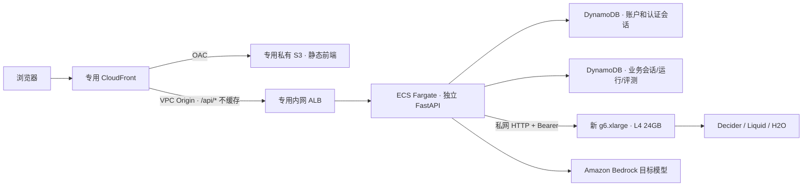

# DeciderModelRouter 独立服务

当前入口和 AWS 资源见 [部署记录](../deployment/DEPLOYED.md)，验证结果见 [独立服务报告](../validation/independent_gateway/README.zh.md)。原项目说明保留在 [LEGACY.md](../LEGACY.md)。

## 服务边界



专用 VPC、子网、安全组、NAT、ECS 集群/服务/角色、ALB、CloudFront、S3、两张 DynamoDB 表、GPU 实例和密钥。GPU 从现有已验证运行环境创建私有镜像再启动新实例，镜像创建使用 `NoReboot=True`，原实例继续运行；新实例使用独立角色和轮换后的密钥。镜像用于复制运行环境，线上请求不依赖原 GPU。

生产只运行 `app.gateway_main:app`。静态资源单独发布到 S3；API 容器不提供前端文件，也不加载旧支付、视觉、GPU 启停和比较页面接口。无 Cognito、CloudFormation、公开注册接口。GPU 无公网 IP、无 SSH 入站，通过 SSM 运维。

## 路由与模板

一次 GPU 请求识别七项任务属性，再由确定性策略过滤能力、目录、评测配置、配额和预算，在同一可比评测组内平衡质量与成本。只调用 Bedrock 支持目录中的目标执行标识。具体公式、映射、推理配置和证据见 [分类路由说明](BEDROCK_CLASSIFIED_ROUTING.zh.md)。

20 个模板提供任务、分类、验收说明和 Token 预算，覆盖原四场景及退款、事故摘要、翻译、提取、改写、金额计算、SQL、HMAC、并发、严格 JSON、实时信息、注入文本等。能力边界任务可以返回“无可用路由”；没有已核验证据时不强行选模。代码模板显式使用期望 8192、最大 16384 Token，可在运行前调整。

## 数据持久化与性能口径

`decider-model-router-auth` 保存账户、密码哈希、登录会话、限流和路由执行凭据；`decider-model-router-data` 保存业务会话、请求摘要、完整阶段事件、评测和用户目录。两表按需计费，启用加密、TTL 和时间点恢复（PITR）。

- 每个数据分区由服务端登录身份构造。其他用户的会话、运行、评测不可读；管理员管理账户不等于获得其他用户的任务数据。
- 运行开始前先保存请求，随后逐事件落库；数据库不可用时停止后续推理。重复 `client_request_id` 返回 409，防止同一请求重复付费执行。
- 保存输入、版本、决策依据、输出、Token、已知参考费用、错误、会话和人工验收；导出移除路由执行凭据。记录压缩后存储，单记录限制 300KB。
- 业务记录保存 180 天，TTL 清理可能延迟，但读取会排除已过期记录。使用中的会话续期。会话列表最多 500 条；性能统计最多 5000 条并明确提示截断，可缩小时间范围。
- 性能按当前用户、会话及 1–180 天范围计算，使用最近秩法求分位数。回放单列，不计入 GPU/路由/目标性能。失败、无候选和中断保留。
- “完整执行”仅表示模型返回完整输出；人工业务验收另记，通过比例不自动作为路由校准。参考费用不含常驻 GPU、ECS、NAT 等基础设施费用；未知用量不按零计。
- 浏览器断开、容器重启会中断在途工作，已返回事件保留；执行已提交但未收到返回时显示结果及用量未知。历史持久化不意味着后台推理可跨重启继续。超过 10 分钟的陈旧运行会在读取时标记中断。

本地使用 SQLite，默认 `.data/auth.sqlite3`、`.data/gateway.sqlite3`，文件权限 0600。生产 API 使用只读容器文件系统，所有业务状态写入 DynamoDB。

## 决策模型评测

评测页可选择 Decider、Liquid、H2O 和 1–16 个冻结参考任务，最多 48 次分类调用。三个模型使用相同任务和标签，按样本顺序执行，不调用 Bedrock 目标模型。提交前显示调用数量，任务离开页面后可继续并回看。

保存数据集版本、任务、预期/实际七项属性、逐字段一致情况、全字段一致率、失败、模型和时延。失败计入一致率分母；HTTP P50/P95 包含排队与校验，GPU 往返单独记录。进程退出会保留已完成样本并标记中断，不自动重跑；单账户限一项运行评测，单 API 进程同时最多两项。

这 16 个样本属于**可见的开发参考集**，既非独立保留测试集，也非 Bedrock 生成质量评测。公开 LiveBench/MTEB 映射、分类参考一致、人工业务验收三者分别展示。生产业务校准仍为 `uncalibrated`；新评测结果不会偷偷替换阈值或训练模型。需要业务校准时，应冻结独立业务题集与验收规则、执行候选目标模型并记录成本/质量，再通过既有校准流程验证发布。

## 登录与用户管理

密码使用 scrypt 哈希；认证使用服务端保存的随机会话及 `Secure / HttpOnly / SameSite` Cookie，默认 8 小时。写操作检查同源和客户端请求头，登录有速率限制。密码修改、管理员重置/禁用会更新账户版本，使已有登录失效；并发修改使用版本条件，避免密码重置重新启用已禁用账户。

初始管理员为 `admin`，随机密码保存在 AWS Secrets Manager **`DeciderModelRouter/admin-credentials`**，由有权限的运维人员读取。首次登录后可在账户页修改密码；该 Secret 是初始凭据记录，不随用户自行改密自动更新。管理员在页面创建普通用户、禁用/恢复账户、重置密码；不能禁用自己。

命令行管理：

```bash
# 本地默认使用 SQLite；生产先设 AUTH_TABLE 和 AWS_REGION
python -m scripts.manage_users create admin --admin
python -m scripts.manage_users create alice
python -m scripts.manage_users reset alice
python -m scripts.manage_users disable alice
```

不在命令行参数中传递密码；交互输入或 `--generate-to` 保存到新的 0600 文件。凭据不得提交 GitHub。

## 直接 AWS 部署

入口脚本只调用 AWS SDK，不创建 CloudFormation 栈。`resources.json` 是本次独立部署的恢复检查点，必须使用同一目录恢复中断的创建步骤；不要混用旧项目的 `.deployment/outputs.json`。

```bash
# 1. 建立专用网络、存储、身份、镜像、ALB 与 CloudFront
python -m deployment.independent_gateway \
  --output .deployment/independent-YYYYMMDD \
  --source-gpu SOURCE_RUNTIME_INSTANCE_ID

# 2. 等待私有镜像并创建新 GPU；只改新实例的服务及密钥
python -m deployment.independent_gpu \
  --output .deployment/independent-YYYYMMDD \
  --source-instance SOURCE_RUNTIME_INSTANCE_ID

# 3. 构建 ARM64 镜像到本次 ECR；每次使用新标签
docker build --platform linux/arm64 -f deployment/gateway.Dockerfile \
  -t ACCOUNT.dkr.ecr.us-east-1.amazonaws.com/decider-model-router:UNIQUE_TAG .
docker push ACCOUNT.dkr.ecr.us-east-1.amazonaws.com/decider-model-router:UNIQUE_TAG

# 4. 固定镜像摘要，部署 ECS，初始化管理员并发布五个前端文件
python -m deployment.release_independent \
  --resources .deployment/independent-YYYYMMDD/resources.json \
  --gpu .deployment/independent-YYYYMMDD/gpu.json \
  --image ACCOUNT.dkr.ecr.us-east-1.amazonaws.com/decider-model-router:UNIQUE_TAG \
  --output .deployment/independent-YYYYMMDD/release-UNIQUE
```

构建/推送前需用 AWS ECR 凭据登录，发布者需要相应 AWS 权限。资源名固定为 `decider-model-router`，当前脚本面向本账户 `us-east-1`；首次创建时间取决于快照、NAT、CloudFront 和 GPU 容量。前端发布核验 OAC、缓存策略、对象校验和及刷新完成；API 发布等待唯一目标 Task revision 健康。

后续发布使用相同资源检查点和 GPU 状态，新的镜像标签及新的发布输出目录。`api-release.json` 保存前后 Task 定义，`release.json` 保存 S3 对象版本和刷新结果，可据此恢复上一版。数据库不随代码回滚删除。

## 运维边界

`/api/live`、`/api/ready` 是容器健康接口；GPU 暂时不可用不影响登录和历史查询。登录后的 `/api/gateway/status` 显示 GPU 连通性。GPU 服务常驻 `dmr-decider`、`dmr-liquid`、`dmr-h2o`、`dmr-gateway`，只能在本项目新实例上操作。

当前 ECS 单副本、GPU 单实例、单 NAT，提供资源独立性，不宣称多可用区高可用。DynamoDB 支持 PITR；恢复会生成新表，应核对数据后将 ECS 的 `AUTH_TABLE` / `GATEWAY_DATA_TABLE` 指向恢复表并调整 IAM。认证恢复可能使历史会话恢复，必要时同步失效账户会话版本。

真实部署验证包括登录、私有 S3 拒绝匿名访问、API 权限、资源隔离、真实 GPU / Bedrock 调用、浏览器历史、评测、用户隔离以及 ECS 替换后重新读取保存记录。生产模型调用会收费，验证脚本明确记录调用数量，不把测试桩时延当作实测性能。
