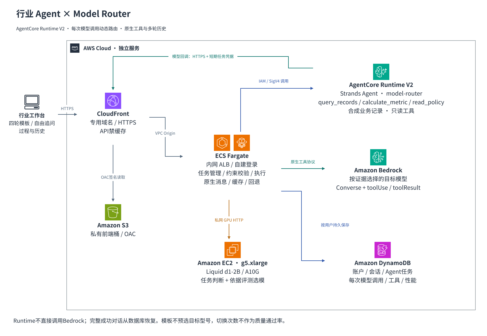
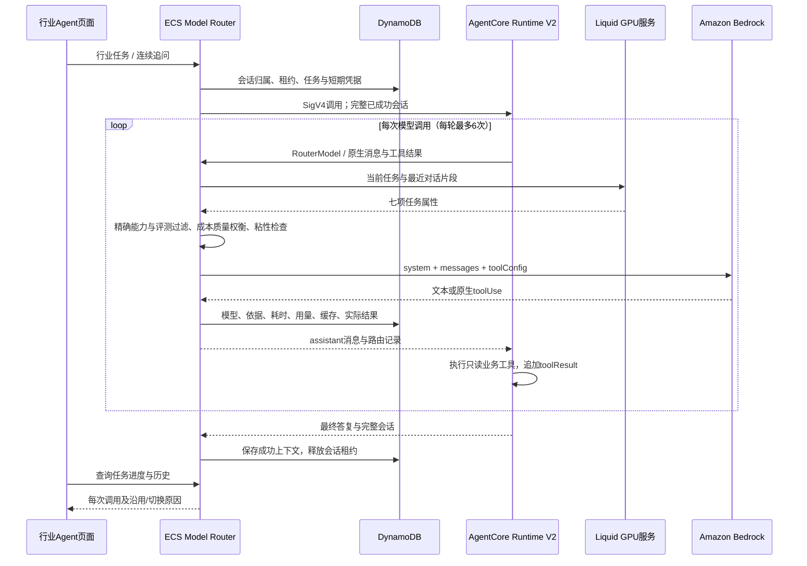

# 行业场景与 AgentCore Runtime V2

行业 Agent 使用 **Strands Agent + 自定义 `RouterModel`**。它的模型配置是 `model-router`；没有另外指定固定的 Bedrock 推理模型。Strands 每次发起模型调用，都会请求 ECS 网关，由默认 Liquid d1-2B 判断任务属性，再按现有评测、费用和会话策略选择实际模型。

Agent 部署时显式指定 AWS `platformVersion: V2`，并读取 `GetAgentRuntime` 核验。这个值是运行平台版本，与每次发布产生的 `agentRuntimeVersion` 不同。Runtime 实现官方 HTTP 服务约定：ARM64、8080端口、`POST /invocations`、`GET /ping` 和 SSE。



[下载高清PNG](diagrams/industry-agent-aws.zh.png)

## 行业模板

工作台同时提供简单通用与行业业务模板：保留常识、写作、澄清、生活建议、翻译、摘要等6个简单场景，共27个模板；“行业 Agent”页面提供12个行业、每个4轮的连续任务，也支持自由追问。行业模板定义业务材料、目标和验收要点，不包含每轮预选模型。

| 行业 | 实际业务问题 | 重点验收依据 |
|---|---|---|
| 零售电商 | 大促缺货、分货优先级、迟发补偿 | 库存缺口、逐单补偿、采购未入库 |
| 制造业 | 质量异常、批次追溯、混杂因素 | 不良率、温度阈值、隔离与复验 |
| 银行与支付 | 对账差异、重复回调、退款乱序 | 金额单位、事件去重、未结算与损失的区别 |
| 保险 | 重复票据、补件、免赔与封顶 | 先去重、事故免赔额只扣一次 |
| 医疗运营 | 检查排程、优先级、清洁资源 | 容量与时间约束、临床决定由专业人员负责 |
| 物流供应链 | 冷链温控、延误与SLA | 超温隔离、延误核查、隔离不等于报废 |
| 能源与园区 | 分时电价、移峰损耗、需量费缺口 | 电量费用与需量费用分开计算 |
| 软件与云服务 | 租户故障、幂等计费、回滚判据 | 错误率、复合幂等键、事实与假设 |
| 电信运营 | 重复告警、备份能力、恢复顺序 | 事件去重、用户分钟与独立人数的区别 |
| 政务服务 | 办理时限、补件暂停、积压清理 | 有效办理时钟、净处理能力 |
| 教育培训 | 教室容量、共同学员、讲师资质 | 不重叠排程、资质缺口 |
| 企业法务 | 付款节点、验收与违约金 | 付款条件、封顶、法律审查边界 |

每组任务依次包含业务查询、约束分析、代码或规则设计、交接摘要。演示数据具有行业业务结构，但均为**合成记录**，不连接真实ERP、银行账本或医疗系统。页面展开区公开原始数据、规则与验收要点。

软件与云服务另有“进阶追问：跨区域计费一致性”按钮：在已有会话上加入网络分区、ACK前崩溃、冲突金额、退款乱序、过期重放与迁移双写等条件，要求不变量、反例和恢复方案。按钮只填写用户任务，不指定模型或修改分类标签。完成后可点击“追问：简短总结上一条回答”，在同一会话观察复杂任务与日常摘要之间的实际选模变化。

## 调用与模型切换



页面显示实际模型、模型是否变化及粘性原因；历史数据同时保存配置ID与配置是否变化。模型没有变化也可能是重新评估后仍胜出；不能仅凭ID不变判断没有重新路由。每轮最多6次模型调用，四轮最多24次；目标失败时沿用网关的受约束回退，Strands自身自动重试关闭。输出达到上限属于未完成；行业页面及未传预算的Agent API默认每次16384 tokens，页面可调整为4096或8192。页面也提供自动均衡、优先节省、优先能力三个偏好，不直接指定目标型号。

复杂回答可能超过CloudFront等待首个响应的时间。Runtime模型回调通过 `Accept: application/x-ndjson` 协商保活响应：立即返回空白行，每5秒继续发送，最终返回一个完整JSON结果或结构化错误。它用于保持连接，**不是答案逐token流式输出**；行业页面持续展示阶段与工具记录，完整回答结束后显示。Agent专用Bedrock客户端等待上限为240秒，整轮任务约600秒，普通网关仍使用原120秒客户端。超时不自动重试，以免重复计费。

连续对话采用原生 `user/assistant/toolUse/toolResult` 内容块。工具调用ID必须完整配对，不将工具结果冒充为普通用户消息。Claude返回的可选 `type: tool_use` 标识规范化为Strands的ID、名称、参数格式；未知工具类型仍拒绝。数据库恢复会话，不依赖Runtime进程内存；超过64KB或64条历史消息时按完整用户轮次裁剪，不拆散工具调用与结果。最近一轮始终保留；它单独超过80KB时，在推理前拒绝继续并提示用户提供摘要，避免静默丢失上一条回答。原生模型消息仍有96KB边界，完整输出及工具循环受此限制。页面显示带入消息数、字节数和裁剪轮数。

当前Agent工具适配器逐型号核验 Nova Micro/Lite/Pro、Claude Haiku 4.5、Claude Sonnet 4.5、Claude Opus 4.1/4.5的原生工具能力，依据各型号的 [AWS官方模型卡](https://docs.aws.amazon.com/bedrock/latest/userguide/models-supported.html)及[工具调用协议](https://docs.aws.amazon.com/bedrock/latest/userguide/tool-use.html)。仍须满足目录可用性、配额和精确评测配置要求；旧版型号默认不加入候选。

Agent的 `auto` 默认采用至少含两个可用工具模型的最新LiveBench批次，再沿用难度、能力与参考成本的选择策略。当前为2026-01-08批次的Haiku 4.5与Opus 4.5（low effort），代码场景含Agentic Coding分项。这修复了“旧Nova组有三个模型、覆盖优先导致新组始终落选”的问题；不同批次分数仍不混排，也不按行业或轮数指定目标模型。显式指定评测批次仍可复现旧策略。此规则优先证据的新鲜度，会增加部分请求的费用，不代表新批次分数就是行业业务通过率。

其他Bedrock型号仍可在普通网关使用，但未核验原生工具协议前不加入Agent候选。跨供应商签名推理块、Agent图片/音视频工具消息尚未接入，普通网关已有多模态能力继续保留。

原生工具能力说明协议可用，不代表行业业务或工具选择正确率。当前LiveBench分项仍为初始能力依据，尚未用本次行业Agent结果自动训练或校准选模策略。

## 工具、认证与历史

Agent实际执行三个本地业务工具：`query_records`查询当前场景记录，`calculate_metric`计算已知数值列，`read_policy`读取业务规则。没有任意SQL、Shell、代码执行、外部搜索或写入生产系统的工具。代码生成任务只产出代码草稿。

浏览器使用现有自建登录。ECS用IAM身份调用专用Runtime；Runtime只有拉取自身镜像和写自身日志的权限，不持有Bedrock调用权限或用户密码。模型回调使用660秒有效、绑定用户和任务的随机凭据；只允许访问专用模型端点，不能访问账户或历史接口。任务结束、账户禁用或密码版本变化后失效。重复步骤返回已保存结果；内容冲突、跳号或失败后重投被拒绝。

Agent任务、工具过程和原生对话保存在独立DynamoDB数据表，按账户隔离。列表用时间索引读取最近100项，旧随机ID记录自动补齐索引，避免按随机ID截取后遗漏新任务。每次目标调用同时进入原有“历史与性能”，可核对分类、候选与执行详情。提示词缓存仍以Bedrock实际读写tokens为准；未知缓存费率不报告虚构折扣。

Agent缓存检查点随完整用户消息和工具结果边界推进，最多4个，兼顾Nova的缓存前缀上限。这样首问较短时，后续积累的长上下文也有机会达到Claude的缓存门槛；检查点不会写进原生会话。缓存按目标模型隔离，切换模型不能假定复用另一模型的缓存。是否命中及写入多少均看实际响应，不以“已启用”当作命中。

## 验证口径

- **执行完成**：Agent工具循环结束并返回完整最终答复，过程成功入库。
- **工具使用正确**：调用了已声明的工具，参数在场景范围内，引用实际返回的数据。
- **业务结果正确**：逐项核对场景验收要点，不能用“HTTP成功”代替。
- **切换合理**：任务能力要求变化时重新评估；沿用和切换都需要对应选型依据。切换次数多不代表效果好。
- **性能与费用**：保存每次GPU HTTP耗时、目标耗时、实际用量、缓存读写和可计价参考费用；Runtime首次启动等待与模型时间分别看待。

旧的分类参考集单独冻结在 `gateway_reference_templates.json`，行业模板更新不改写旧87场景的输出、标签和分数。新增行业多轮测试另行记录，见[真实调用、业务抽查与发布验证](../validation/independent_gateway/industry-agents-2026-11-25/README.zh.md)。

实现：[Runtime与Strands模型接口](../agent_runtime/main.py)、[Agent任务与认证回调](../app/gateway_agents.py)、[原生工具适配器](../app/agent_model.py)、[行业数据与工具](../app/industry_scenarios.py)、[直接AWS部署脚本](../deployment/deploy_industry_agent.py)。

## 部署与复测

使用锁定环境中的Boto3 1.43.109；旧SDK可能不认识 `platformVersion`。Runtime与API分别构建、推送到本项目ECR，以镜像摘要部署。Runtime镜像固定Strands 1.66.0，API不安装或承载Strands循环。首次部署脚本创建专用Runtime执行角色并给本项目ECS角色增加精确Runtime调用权限；后续保留同一Runtime ID更新版本。

```bash
docker build --platform linux/arm64 -f deployment/agent.Dockerfile \
  -t YOUR_AGENT_ECR:RELEASE .
docker push YOUR_AGENT_ECR:RELEASE
.venv/bin/python -m deployment.deploy_industry_agent \
  --resources YOUR_INDEPENDENT_RESOURCES.json \
  --agent-image YOUR_AGENT_ECR@sha256:DIGEST \
  --api-image YOUR_API_ECR@sha256:DIGEST \
  --output .deployment/industry-RELEASE

# 真实付费调用；12行业×4轮，记录逐轮原始结果
.venv/bin/python -m scripts.run_industry_agents_live \
  --scenarios all --max-output-tokens 16384 \
  --output .deployment/industry-live-RELEASE

# 读取已有记录验证网页，不产生新模型调用
.venv/bin/python -m scripts.check_industry_browser \
  --job-id SAVED_JOB_ID --output .deployment/industry-browser-RELEASE
```

资源文件格式沿用[独立发布说明](INDEPENDENT_SERVICE.zh.md)，集群和服务必须是 `decider-model-router`。部署通过SDK直接操作AgentCore、IAM、ECS、S3和CloudFront，不创建CloudFormation栈或新的GPU实例。测试脚本从已有Secrets Manager管理员凭据读取登录信息，不写入报告。

AWS依据：[Runtime服务契约](https://docs.aws.amazon.com/bedrock-agentcore/latest/devguide/runtime-http-protocol-contract.html)、[CreateAgentRuntime API](https://docs.aws.amazon.com/bedrock-agentcore-control/latest/APIReference/API_CreateAgentRuntime.html)。
