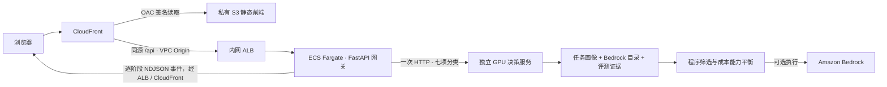

# 模型网关工作台

独立入口：`/gateway/index.html`。生产前端使用 **S3 + CloudFront + OAC**，后端使用 **ECS Fargate**，GPU 决策模型独立部署。网关通过 AWS SDK 直接发布，不使用 CloudFormation。

开发时前端单独运行在 `http://127.0.0.1:5173`，API 运行在 `8000`。原有模型路由对比页保留。



## 使用

工作台提供「路由并执行」「仅分析路由」两种操作。更多选项中可切换到「流程回放」，不调用模型，模型计时和成本不填模拟数字。

- 请求路径：目录校验 → GPU 分类 → 策略选模 → Bedrock 执行。阶段完成就展示结果，无需等待最后的目标响应。
- 路由决策：类别、难度、强模型收益、延迟敏感度、工具需求、结构化输出需求和语言；显示最终型号、实测配置、选择原因。
- 候选依据：费用估计、任务相关能力分项、非劣候选与排除原因。型号来自现有 Bedrock 快照，精确评测映射和约束不足时返回无候选。
- 评测覆盖：60 个型号已有映射，模型页可搜索并按“有评测”“配置待核验”“待补充”筛选，展开具体批次、分项和来源。仅有型号资料或价格的记录不计作质量评测。
- 文本评测批次：更多选项中可指定 LiveBench 日期，使用该批次已评测的型号。默认按可比型号覆盖数、再按批次新旧选择一个组；每次仅在同一批次、同一分项内比较成本和能力。
- 账户配额：已核实为零的调用端点在选模前排除；模型页显示零配额型号、核验时间和配额项。正配额及未知配额不代表实时容量。
- 输出预算：推理 Token 也占用上限。「交易代码」示例显式预设期望 8192、上限 16384 Token，运行前可调整；其他示例为 512 / 4096。切换示例不清除费用限制，按输出上限核算参考费用约束。API 未指定参数时仍为 512 / 4096，接受的显式上限最大为 16384。
- 性能明细：API 排队、GPU HTTP 往返、结果校验、策略计算、凭据存储、Bedrock 排队和调用时间。
- 会话性能：当前页面最近 50 次请求的摘要、路由 P50/P95 和完整输出数量。刷新清空；回放排除；失败与未完成输出单独标识。
- 导出 JSON：包含本次原始阶段记录，移除执行凭据。输入与输出只在当前页面展示，不写入浏览器持久存储。

选择策略与业务校准方法见 [Bedrock 分类路由](BEDROCK_CLASSIFIED_ROUTING.zh.md)。默认仍使用榜单能力代理，不能把榜单分数当成业务成功率。

## 分离运行

安装项目依赖，沿用已有账号；没有账号时：

```bash
uv sync
uv run python -m scripts.manage_users create admin \
  --generate-to .deployment/local-credentials.json
```

终端 A：独立 API，接入已运行的 GPU HTTP 服务。

```bash
AUTH_COOKIE_SECURE=false \
SERVE_FRONTEND=false \
GATEWAY_DECISION_PROVIDER=decider \
STRANDS_DECIDER_URL=http://127.0.0.1:8099 \
BEDROCK_ENABLED=false \
uv run uvicorn app.main:app --host 127.0.0.1 --port 8000
```

终端 B：独立静态前端和开发代理。

```bash
uv run python -m scripts.serve_gateway --api http://127.0.0.1:8000 --port 5173
```

打开 `http://127.0.0.1:5173`。未接真实模型时可用流程回放。真实执行需要在 API 进程设置 `BEDROCK_ENABLED=true`，并提供现有部署区域 `AWS_REGION=us-east-1` 的 AWS 身份和目标模型调用权限。

开发代理只转发 `/api/*`，保留原始 Host、Origin、Cookie 和现有 CSRF 请求头。浏览器仍为同源请求，无需放开 CORS。原 API 的 `SERVE_FRONTEND=true` 模式也提供 `/gateway/index.html`，便于本地查看。

## GPU 服务配置

| API 侧变量 | 用途 |
|---|---|
| `GATEWAY_DECISION_PROVIDER` | `decider`、`liquid` 或 `h2o`。未设置时，有 `OPEN_MODELS_URL` 则默认 H2O，否则 Decider |
| `GATEWAY_DECIDER_URL` | 独立 Decider HTTP 根地址；未设置时继承 `STRANDS_DECIDER_URL` |
| `GATEWAY_DECIDER_MODEL` | 可选预期响应模型 ID；vLLM 默认 `strands-decider-2B-hobson-v19-vllm`，其他部署继承 `DECIDER_MODEL` 或默认 `StrandsAgents/strands-decider-2B-hobson-v19` |
| `DECIDER_API_KEY` | Decider 服务 Bearer 密钥，仅后端使用 |
| `OPEN_MODELS_URL` | 现有 Liquid/H2O 私有常驻网关根地址 |
| `OPEN_MODELS_API_KEY` | 私有常驻网关需要 Bearer 时设置；现有内网部署可留空 |

Decider 调用 `POST /v1/systemone`；Liquid/H2O 调用 `POST /v1/systemone/{provider}`。请求为现有 `state + questions` 协议，一次请求包含七项分类。API 校验模型身份和全部分类结果后才选模。

网关通过 HTTP 调用独立服务，不加载模型、不申请 GPU、不启停实例、不依赖原来的 GPU 生命周期租约。使用 SageMaker 或动态地址的部署应先提供稳定的独立 HTTP 服务地址。前端不会看到私有 URL 或模型密钥。

每个 API 进程、每种分类器最多 2 个在途调用；本地排队上限 5 秒，GPU HTTP 总期限 45 秒。GPU 服务自身仍负责跨 API 实例的并发与调度。429、超时、模型身份不匹配、分类缺失均明确失败，不自动换模型或回放。

`GET /api/gateway/status` 为只读健康检查，不进行推理。H2O/Liquid 读取其独立健康字段，HTTP 200 或其他模型就绪不代表所选模型就绪。Bedrock 配置状态仅表示客户端已配置，实际模型权限仍以调用结果为准。

## API 与阶段事件

所有网关接口沿用现有会话认证和写请求 CSRF 校验。

| 接口 | 功能 |
|---|---|
| `GET /api/gateway/catalog` | 目录/策略版本、分类目录、示例、GPU 服务可选项 |
| `GET /api/gateway/status?provider=h2o` | 当前所选 GPU 服务连接状态 |
| `POST /api/gateway/runs` | 一次分类选模，可选执行；返回 `application/x-ndjson` |

请求示例（版本从 catalog 接口读取）：

```json
{
  "task": {
    "text": "编写 Python 支付 webhook，按 event_id 去重。",
    "allow_cross_region": true,
    "routing_preferences": {
      "cost_tier": "medium",
      "benchmark_release": "auto",
      "expected_output_tokens": 8192,
      "max_output_tokens": 16384
    }
  },
  "provider": "h2o",
  "mode": "live",
  "execute_target": true,
  "catalog_version": "<catalog_version>",
  "ranking_version": "<ranking_version>",
  "policy_version": "<policy_version>"
}
```

每个非空行是一条完整 JSON 事件；网络分块不保证与换行对齐，客户端需要增量解码并按行解析。空行是 5 秒心跳，不能视为模型进度。

```json
{"type":"stage","request_id":"...","sequence":3,"elapsed_ms":12.0,"stage":"classification","status":"started","data":{}}
```

事件顺序为 `accepted` → 多个 `stage` → `route` → 可选执行阶段 → `completed`；中途失败以 `error` 结束。终态为 `selected`、`no_route`、`executed`、`incomplete`。HTTP 已开始流式响应后的错误，通过事件中的 `code/message/stage` 表达。过期版本和参数错误在开启流之前返回 409/422。流结束但未收到终态属于连接中断，不能展示成功。

目标端点的 `ThrottlingException` 对应错误码 **429**，保留已完成的分类和选型。直接执行接口返回 `Retry-After: 60`；流式网关返回 `retry_after_seconds: 60`，仅为重试间隔建议，不保证配额恢复。不会自动重复提交请求、降低推理配置或切换模型。持续限流应核对该端点账户配额；零配额需先恢复额度，再[刷新配额快照](BEDROCK_CLASSIFIED_ROUTING.zh.md#bedrock-候选与配置)并发布。

目标生成使用独立的 Bedrock SDK 客户端，响应读取等待为 **120 秒**；分类客户端仍为 40 秒，GPU HTTP 分类仍为 45 秒。较长的代码生成期间持续发送网关心跳，页面显示等待时间。读取超时不会自动再次提交，已提交的上游请求可能继续生成；输出 Token 上限与评测推理配置不因延长等待而改变。

后端使用同一受验证路由凭据执行目标请求，凭据绑定用户、任务、模型配置和证据版本，15 分钟过期。调用方不能提交模型 URL、覆盖分类画像或替换目标 ID。无候选不会执行。停止等待会取消网关任务；已经提交给 Bedrock 的同步调用可能继续运行、产生用量，前端明确提示。

## 性能与成本口径

`GPU HTTP 往返` 是 API 测量的请求到响应时间，包含网络与 GPU 服务自身排队。`service_reported_ms` 是服务自报观测，不能当作纯 CUDA 时间，也不能再叠加到 HTTP 往返中。Bedrock 队列时间与 SDK 调用时间单独测量。页面的浏览器等待时间包含传输与渲染开销。

当前目标模型返回完整响应，未测量首 Token 时间、纯生成速率、GPU 利用率或显存。回放的事件 `elapsed_ms` 仅描述页面流程到达顺序，所有模型性能字段为 null。

费用基于实际返回 Token × 已有快照参考价，不是 AWS 实际账单，不含 GPU 决策服务、缓存折扣等开销。未知报价/用量显示未知。输出完整只描述响应状态，不代表业务任务已正确完成。

## ECS 后端

后端使用现有 `deployment/api.Dockerfile`，发布为 ECS Fargate API。GPU 模型继续运行在独立 GPU 服务，不打包进 ECS API 镜像。

发布脚本 [`deployment/deploy_gateway.py`](../deployment/deploy_gateway.py) 直接调用 ECS、ECR、S3、CloudFront SDK。资源 ID 从本地文件读取，不查询、生成或更新 CloudFormation 栈。

脚本复制当前 ECS Task Definition，仅替换 API 镜像和三项网关环境变量：`SERVE_FRONTEND=false`、`GATEWAY_DECISION_PROVIDER`、`GATEWAY_DECIDER_MODEL`。有常驻开放模型网关时默认 H2O，否则 Decider；`--provider` 可以明确指定。IAM 角色、Secrets Manager 引用、GPU URL、Bedrock 配置、旁路容器与服务网络配置继承现有设置。路由凭据继续存入共享 DynamoDB。

资源文件可直接使用现有 `.deployment/outputs.json`。新配置格式见 [`gateway-resources.example.json`](../deployment/gateway-resources.example.json)，需填写已存在的 region、cluster、service、bucket、distribution_id。该流程接入现有基础设施，不创建新 VPC 或 GPU。

构建 API 镜像使用现有 Dockerfile，保持 ARM64，与当前 Fargate 服务一致：

```bash
# 替换为实际 ECR 地址和新的镜像标签。
export GATEWAY_REGISTRY='123456789012.dkr.ecr.us-east-1.amazonaws.com'
export GATEWAY_IMAGE_URI="$GATEWAY_REGISTRY/strands-decider-demo-api:gateway-new-release"
aws ecr get-login-password --region us-east-1 \
  | docker login --username AWS --password-stdin "$GATEWAY_REGISTRY"
docker build --platform linux/arm64 -f deployment/api.Dockerfile \
  -t "$GATEWAY_IMAGE_URI" .
docker push "$GATEWAY_IMAGE_URI"

# 只读检查：输出当前 Task、固定后的镜像 digest、网关配置与静态文件哈希。
uv run python -m deployment.deploy_gateway \
  --resources .deployment/outputs.json --image "$GATEWAY_IMAGE_URI" --dry-run

# 直接发布 API 与网关前端。
uv run python -m deployment.deploy_gateway \
  --resources .deployment/outputs.json --image "$GATEWAY_IMAGE_URI"
```

ECR tag 在发布前解析成不可变 digest。脚本等待**指定的新 Task 版本**稳定；ECS 回滚到旧版本不能误判为发布成功。API 发布失败时不上传前端。模型目录和评测快照原样打包，不自动刷新。

## 前端独立发布

前端交付物为 `frontend/gateway/` 中的四个静态文件。脚本仅上传对应的 `gateway/*` 对象，资源文件先上传、HTML 最后上传，不删除 bucket 中的其他内容，也不发布其他实验室页面。入口 `/gateway/index.html`；已有 `/api/*` VPC Origin 指向 ECS。

当网关 API 已经部署，仅更新前端：

```bash
uv run python -m deployment.deploy_gateway \
  --resources .deployment/outputs.json --frontend-only
```

发布前检查 S3 的四项公共访问阻止、私有 Bucket Policy、版本控制，以及 CloudFront 的 S3 OAC、API VPC Origin 和 API 禁用缓存策略。上传后读取具体 S3 版本核对 SHA-256，再刷新 `/gateway/*` 并等待完成。文件使用 `no-cache`，浏览器重新加载时检查新版本。

生产没有前端 ECS 容器；`scripts.serve_gateway` 仅供本地开发。Cookie 和 `AUTH_ORIGIN` 沿用现有 CloudFront 域名。流式 API 不缓存，通过 5 秒空行心跳保持阶段事件到达。

## 发布记录与恢复

每次实际发布在 `.deployment/gateway-releases/<时间>/` 写入 `plan.json`、`previous-task.json`、`release.json`；可用 `--output` 指定一个新目录。记录原 Task ARN、新 Task ARN、文件哈希、S3 前后版本和缓存刷新 ID。任务定义备份保存在权限受限的本地目录，不打印密钥引用或私有 GPU 地址到计划输出。

发布步骤不是跨服务事务。若 S3 上传或缓存刷新中途失败，脚本保留已完成的步骤与对象版本并返回失败；可依据 `release.json` 用 ECS `update-service` 恢复原 Task，用 S3 原版本恢复对应对象，再刷新 `/gateway/*`。本流程不自动删除对象版本或覆盖后续发布。

旧项目的基础设施文件保留作历史维护，网关不调用旧 `deployment/deploy.py`。后续也应继续使用直接发布流程，避免旧栈更新覆盖直接发布的 ECS 配置。

2026-11-24 首版直接发布至 [在线网关](https://d3i7ogfx5ml7dc.cloudfront.net/gateway/index.html)：ECS revision **32**，ARM64 API 镜像摘要 `sha256:00e6b52133279dd910e55f66bd35795832c5938526897802a992e01e18412859`。同日 revision 35 修复代码场景的账户零配额过滤、目标生成等待和显式代码预算。当前已更新至 **revision 36**，将精确评测映射扩展至 60 个型号，增加批次选择与来源展示；51 个配置已映射、9 个待核验，后者不会执行。四个 S3/公网文件均已逐字节校验，缓存刷新完成，私有 S3 与 OAC 保持启用，详见[当前发布记录](../deployment/DEPLOYED.md#bedrock-评测映射扩展2026-11-24)与[新增映射实测](../validation/routing_mappings/README.zh.md)。

复用现有 `i-0ae7eb0abcb815af3` / `g6.xlarge` / NVIDIA L4，未创建新 EC2。该实例发布前处于停止状态，本轮启动原实例，并补齐与已加载驱动 **615.71.09** 相同版本的 NVIDIA 用户态计算库和工具，恢复原有 systemd 模型服务。默认 GPU 决策模型为 H2O-Lightning 4B。部署记录及原 Task 备份位于本机 `.deployment/gateway-20261124-101423/release/`。

## 验证

```bash
uv run pytest -q
uv run --with playwright python -m scripts.check_gateway_browser \
  --output validation/gateway/new-browser-run
```

浏览器检查需要已安装 Chromium（首次可用 `uv run --with playwright playwright install chromium`）。脚本启动三个独立本地进程，使用合成 GPU/Bedrock 测试桩，结束后清理进程；不会调用真实模型。验证登录、提前到达的阶段事件、单次 GPU 调用、候选、执行、无候选、GPU 故障、未完成输出、回放统计、导出和移动布局。

本轮浏览器证据：[verification.json](../validation/gateway/browser-final-2026-11-24/verification.json)，[桌面截图](../validation/gateway/browser-final-2026-11-24/desktop.png)。截图中的数字来自本地测试桩，不作为真实 GPU 性能结果。

首版发布前全量回归 **390 项通过**，包含 16 项直接发布测试，验证仅访问四类 AWS 服务、只读预检、Task 配置继承、S3/OAC 与 API 路径检查、ECS 回滚、对象校验失败和发布记录。实际 ARM64 API 镜像另通过离线启动、目录读取和策略回放冒烟检查。

实际 AWS 验收通过：[结果](../validation/gateway/aws-live-2026-11-24/verification.json)、[桌面](../validation/gateway/aws-live-2026-11-24/desktop.png)、[性能明细](../validation/gateway/aws-live-2026-11-24/timings.png)、[手机](../validation/gateway/aws-live-2026-11-24/mobile.png)。两次真实 H2O 分类请求均完成七项画像并选中 Bedrock `openai.gpt-6-luna`，其中一次通过浏览器实际执行目标模型，返回完整输出。登录、逐阶段事件、候选依据、导出、会话计数、手机布局和退出登录均通过，无浏览器 JavaScript 错误。

该浏览器单次请求的 GPU HTTP 往返 **600.831 ms**、路由总耗时 **635.553 ms**、目标执行 **1,284.118 ms**、后端完整请求 **1,958.303 ms**；目标用量 19 输入 / 100 输出 Token，按目录参考价计算为 **$0.0000519**。这是部署冒烟样本，不是延迟分位数或质量评测，参考费用不含 GPU，也不是 AWS 账单。此前本地测试桩截图与本批真实结果分别保留。

复验命令会产生两次 GPU 分类请求和一次 Bedrock 目标请求，应指定新的输出目录；使用已有账号文件，不在命令行传密码：

```bash
uv run --with playwright python -m scripts.check_gateway_live \
  --url https://d3i7ogfx5ml7dc.cloudfront.net \
  --credentials .deployment/test01-credentials.json \
  --output validation/gateway/new-aws-live-run
```

指定 `--scenario code` 可验证页面默认的交易代码示例及其显式输出预算；默认 `smoke` 使用较小的客服问题与预算。每次使用新目录，失败或截断记录也会保留。

使用 `--benchmark-release 2025-04-02` 可实际验证新增的 Nova / Gemma / Llama 所在批次；验证器还会检查模型页上的 Nova 分项和资料、评测状态的区分。覆盖范围、来源存档与验收见[映射扩展记录](../validation/routing_mappings/README.zh.md)。

同日代码修复后 **409 项回归通过**，[代码场景真实验收](../validation/gateway/aws-code-budget-2026-11-24/verification.json)完整返回 Sonnet 5 的最终答复，目标耗时约 82.5 秒、输出 8975 Token（含推理），参考费用 $0.134847。此前的 40 秒超时和 4096 Token 推理截断均保存在[修复证据](../validation/gateway/README.zh.md#代码场景限流修复与验收)，不计作成功，也不用于推算业务正确率。
