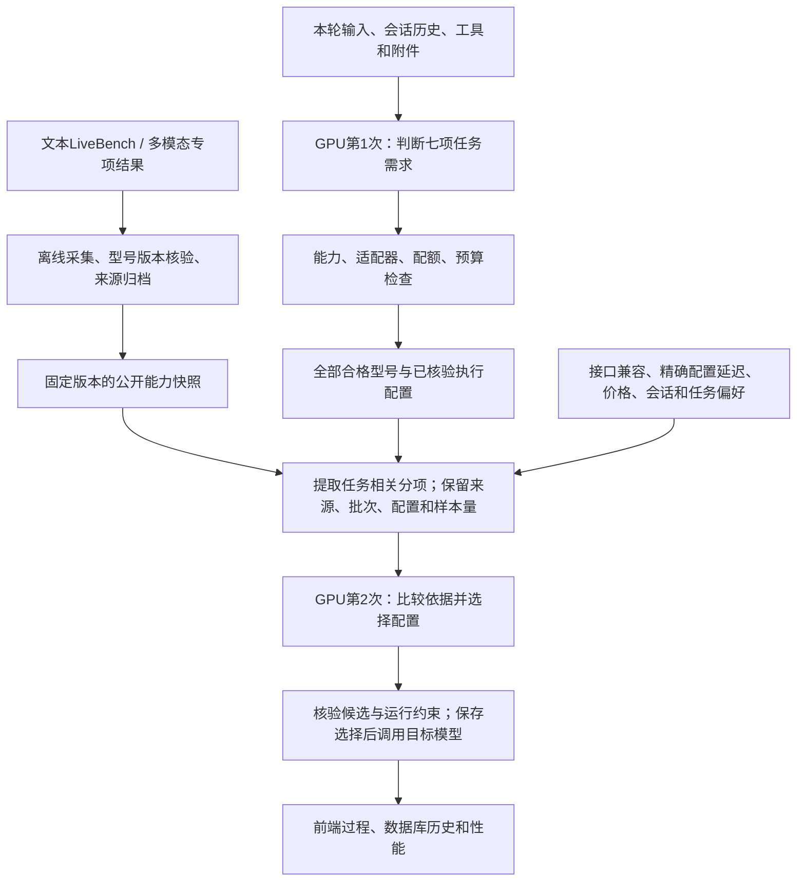

# LiveBench 如何成为文本选模依据

2026-11-26更新：实时策略 `gpu-evidence-livebench-preference-v5`。**文本质量只依据LiveBench；旧6题测试和开发回归分数不再参与文本选模。能力优先、均衡、成本优先均保留为任务选项，由GPU统一权衡，没有程序质量门槛或额外质量重选。** 默认仍为均衡，任务正文无需重复声明偏好。

默认Liquid第一次GPU调用评估七项需求，第二次读取所有符合运行约束的候选及LiveBench相关成绩后选模型。程序只检查接口能力、权限、配额、上下文与预算等约束。端点实测延迟和调用错误作为运行参考保留；多模态保留对应公开或专项评测。旧版质量门槛、max档拦截及56题结果见[历史报告](../validation/independent_gateway/quality-priority-2026-11-26/README.zh.md)，不代表当前策略。

公开快照 `90ec5a0626a24cf809474d44` 没有修改；64型号/232条是整个归档的覆盖量，包含不参与文本选模的OpenRouter记录，不能当成LiveBench覆盖量。

## 数据来源

| 来源 | 本次采用的结果 | 记录数 |
| --- | --- | ---: |
| [LiveBench 2](https://livebench.ai/) | 2026-11-06批次；推理、代码、数据分析、长流程Agent等分项 | 14 |
| [LiveBench 1](https://livebench.ai/) | 项目已核验的历史快照；每个精确测试配置取最新可用批次，最晚2026-06-25 | 48 |
| [OpenRouter GPQA Diamond](https://openrouter.ai/benchmarks/gpqa-diamond) | 页面公开的代表结果，2026-11-26抓取 | 47 |
| [OpenRouter Tau2 Airline](https://openrouter.ai/benchmarks/tau2-bench-airline) | 页面公开的代表结果，2026-11-26抓取 | 46 |
| [OpenRouter Router Benchmarks](https://openrouter.ai/benchmarks/routers) | 单模型基线：Deep SWE 22、SWE Atlas QA 22、Terminal Bench 4.0 4、Tau3 Banking 23、MMMU Pro Vision 6 | 77 |

记录数不是题目数，也不是不同型号数；同一型号可有多个评测或配置。LiveBench 2每个型号的一条记录包含多个分项。OpenRouter抓取日期不冒充测试日期；页面提供运行时间时另行保存。不同来源、版本、指标不能直接混算成一个平均分。

同时抓取了[VGI-Bench](https://openrouter.ai/benchmarks/vgi-bench)，本批次没有可精确绑定当前Bedrock型号的记录，因此未给视频候选补上成绩。本次也没有新增匹配的语音、图片生成公开分数；这些能力继续使用已有端点实测并显示缺口。Browser、Research、Design分项保存在快照中，目前没有相应路由工作流，未传入GPU。

LiveBench 2原始表、分类定义、样本数量与说明来自：

```text
https://livebench.ai/data/20261106/table.csv
https://livebench.ai/data/20261106/categories.json
https://livebench.ai/data/20261106/cost.csv
https://livebench.ai/data/20261106/breakdown.json
https://livebench.ai/data/20261106/notes.json
```

LiveBench 1复用已有核验快照，并归档其完整文件；本次未重新请求全部历史批次。原始网页、CSV、JSON、来源网址及SHA-256见[发布验证目录](../validation/independent_gateway/public-benchmarks-2026-11-26/README.zh.md)。

## 决策流程



参考[OpenRouter Auto Router](https://openrouter.ai/docs/guides/routing/routers/auto-router)的“需求评估＋能力/费用依据”思路；本项目保持两次GPU调用，不宣称复现其私有训练集、校准算法或线上策略。

| 本次任务 | 提供给GPU的质量分项 |
| --- | --- |
| 推理、核算、分析 | LiveBench Reasoning、Mathematics、Data Analysis |
| 编码 | LiveBench Coding、Agentic Coding |
| 通用文本与客服 | LiveBench Language、IF |
| 上述任务的原生工具Agent | 另加LiveBench Long Agentic |
| 图片理解 | MMMU Pro Vision及图片专项实测 |
| 其他多模态与检索 | 对应专项依据；未知明确标注，不借用文本分数 |

同一来源、同一版本和分项才可比较，LiveBench 1与2不混算总分。分数是任务得分均值，不是业务成功概率。GPU接收相关分项及其测试配置、样本量和出处，没有LiveBench分数的型号保持未知，不用旧6题、历史回归或同家族型号成绩补分。文本的OpenRouter GPQA/Agent基线也不再传入，仍可在归档目录查看。

<a id="能力优先校验"></a>

## 能力优先作为任务偏好

`app/routing_quality.py` 的 `livebench-preference-v3` 只记录依据范围和用户偏好。三种选项共用一次选模路径：

- **能力优先（high）**：告诉GPU优先考虑任务相关能力。
- **均衡（medium，默认）**：告诉GPU权衡能力、费用和延迟。
- **成本优先（low）**：告诉GPU选择能够满足任务的低价配置。

不再计算“其他型号高5分则淘汰”，不生成质量PASS/REJECT标签，不因为缺少LiveBench记录或旧推理答题测试而剔除配置，也不在GPU选择后用质量分数拦截或追加GPU重选。所有满足接口、权限、预算和调用约束的配置均交给GPU；程序不指定赢家。最终仍可能选择缺少公开依据的型号，因此保留输入与选择审计，不能承诺质量优先必定选中榜单第一名或业务最优型号。

旧开发测试的内容、格式通过数、失败分类和80条回归评分从文本候选输入移除。旧答题评分也不再控制推理档位资格。配置参数仍须来源可核验并符合接口限制；未知档位延迟保持未知，不继承默认档时延。显式最大延迟约束继续要求该配置有对应运行测量。不能用LiveBench分数核验“最小业务成功率”，显式设置该条件时会说明无法满足，而不伪造概率。

正常仍为两次GPU调用。仅在目标端点发生可回退的实际错误且尚未输出时，现有执行故障回退可再次调用GPU；这与能力偏好无关。执行票据检查策略和依据版本，旧策略票据需要重新决策。历史记录保留当时的质量校验过程，前端标为旧策略。

## 一个实际输入例子

制造业任务被判断为推理时，GPT-6.2 Sol默认配置会收到类似下面的候选信息：

```text
GPT-6.2 Sol
运行参考：该精确端点在旧短请求上的P95为0.53秒，不是当前任务耗时预测
LiveBench 2 / 2026-11-06 / 测试使用最高支持推理档位：
Reasoning=90.6（202题），Data Analysis=81.1（150题）
本次执行：默认配置，输出上限4096；费用未知
任务偏好：high（能力优先），由GPU权衡，无程序质量门槛
```

GPU输入用紧凑文本表示，并在公共引用表中声明来源、批次和分数口径。这里的最高推理档成绩是同型号的外部参考，不代表Bedrock默认档能达到相同效果，也不会自动开启未核验的推理参数。

| 同一LiveBench 2批次 | 推理 | 数据分析 | 代码 | 长流程Agent |
| --- | ---: | ---: | ---: | ---: |
| GPT-6.2 Sol | 90.6 | 81.1 | 83.7 | 63.6 |
| GPT-6.1 Sol | 92.6 | 82.7 | 82.1 | 64.7 |
| Claude Opus 5.5 | 92.2 | 80.3 | 87.1 | 72.8 |

表内为0–100的任务得分均值，不是业务通过率。普通产线推理请求仅传推理、数据分析等相关分项；Agent请求才额外传长流程分项。没有这批成绩的型号不会补零或从同家族型号继承成绩。

## 映射与比较规则

- **型号身份明确**：绑定文件记录Bedrock型号、OpenRouter ID和版本标识、LiveBench行名；不做模糊名称匹配。抓取时验证OpenRouter版本标识，变化则停止更新。
- **保留测试条件**：推理档位、输出预算、来源端点、题量、测试时间在来源披露时保存；未披露明确为未知。公共分数可附在同型号不同执行配置上，但始终标为外部参考；不产生新的可执行参数。
- **不借用路由器成绩**：只接收OpenRouter的单模型基线，排除路由器与多模型组合结果。相同型号/测试/推理档/提供商取最新运行，保留未完成标记，不挑最高成绩。
- **保留不同分数口径**：OpenRouter准确率转换为百分比；LiveBench分类均分保持0–100。不同测试批次分别提供。未知不补零，已测零分保留。
- **成本与延迟独立**：OpenRouter公开费用、耗时仅作来源元数据，不当成当前AWS账单或Bedrock延迟。请求内仍用原有AWS价格/外部参考价格标识及端点实测；未知费用不是免费。
- **资格检查继续生效**：公开高分不绕过工具协议、输出格式、模态适配、配额、上下文与预算限制。缺少公开分数的可用型号仍参与GPU选择，未知不补零，不额外执行质量拦截。

## 更新与查看

维护[精确型号绑定](../app/public_benchmark_bindings.json)，随后运行：

```bash
.venv/bin/python -m scripts.refresh_public_benchmarks \
  --archive-dir .deployment/public-benchmarks-YYYYMMDD/archive
.venv/bin/pytest -q tests/test_public_benchmarks.py
```

脚本只下载公开资料，不调用目标模型。新增批次需要先核验LiveBench发布版本及配置说明，更新绑定文件中的版本；脚本不会把未经审核的新型号别名自动加入。网络、解析、身份核验或覆盖检查失败时保留旧快照。审核生成的`app/public_benchmarks.json`、来源归档及差异，重新发布镜像后生效；线上请求不实时抓取榜单。

前端“模型目录”可展开公开能力评测。每次请求的候选表展示实际提供给GPU的相关记录；数据库保存候选证据、记录ID、输入哈希和快照版本。当前版本为`gpu-evidence-livebench-preference-v5`，历史记录保留原版本。

本次调整质量依据与偏好处理，没有重新完成全场景质量评测。选中了更强品牌、与旧版选择不同、或者接口执行成功，都不足以证明整体正确率提升。
