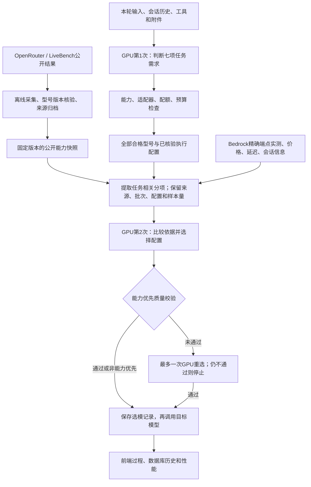

# OpenRouter / LiveBench 如何成为选模依据

2026-11-26接入公开能力快照 `90ec5a0626a24cf809474d44`：128个Bedrock型号中，64个获得OpenRouter或LiveBench的232条参考记录。Liquid仍先判断任务需求，再读取全部合格候选的相关成绩、Bedrock实测、价格和延迟，选择执行配置。没有预设“产线选Sol”或按品牌指定赢家。

之前的[Liquid运行时延迟优化与44项复测](../validation/independent_gateway/latency-quality-2026-11-26/README.zh.md)中，第二阶段同输入P50降低26.1%，但正式44项严格验收30/44，原版31/44。随后用户的能力优先产线请求仍选择MiniMax M2.1，暴露了“只有提示、没有最终质量校验”的问题。本轮新增以下校验与已复核回归依据，公开快照本身未改动。

## 数据来源

| 来源 | 本次采用的结果 | 记录数 |
| --- | --- | ---: |
| [LiveBench 2](https://livebench.ai/) | 2026-11-06批次；推理、代码、数据分析、长流程Agent等分项 | 14 |
| [LiveBench 1](https://livebench.ai/) | 项目已核验的历史快照；每个精确测试配置取最新可用批次，最晚2026-06-25 | 48 |
| [OpenRouter GPQA Diamond](https://openrouter.ai/benchmarks/gpqa-diamond) | 页面公开的代表结果，2026-11-26抓取 | 47 |
| [OpenRouter Tau2 Airline](https://openrouter.ai/benchmarks/tau2-bench-airline) | 页面公开的代表结果，2026-11-26抓取 | 46 |
| [OpenRouter Router Benchmarks](https://openrouter.ai/benchmarks/routers) | 单模型基线：Deep SWE 22、SWE Atlas QA 22、Terminal Bench 4.0 4、Tau3 Banking 23、MMMU Pro Vision 6 | 77 |

记录数不是题目数，也不是不同型号数；同一型号可有多个评测或配置。LiveBench 2每个型号的一条记录包含多个分项。OpenRouter抓取日期不冒充测试日期；页面提供运行时间时另行保存。不同来源、版本、指标不能直接混算成一个平均分。

同时抓取了[VGI-Bench](https://openrouter.ai/benchmarks/vgi-bench)，本批次没有可精确绑定当前Bedrock型号的记录，因此未给视频候选补上成绩。本次也没有新增匹配的语音、图片生成公开分数；这些能力继续使用已有端点实测并显示缺口。Browser、Research、Design分项保存在快照中，目前没有相应路由工作流，未传入GPU。

LiveBench 2原始表、分类定义、样本数量与说明来自：

```text
https://livebench.ai/data/20261106/table.csv
https://livebench.ai/data/20261106/categories.json
https://livebench.ai/data/20261106/cost.csv
https://livebench.ai/data/20261106/breakdown.json
https://livebench.ai/data/20261106/notes.json
```

LiveBench 1复用已有核验快照，并归档其完整文件；本次未重新请求全部历史批次。原始网页、CSV、JSON、来源网址及SHA-256见[发布验证目录](../validation/independent_gateway/public-benchmarks-2026-11-26/README.zh.md)。

## 决策流程



参考[OpenRouter Auto Router](https://openrouter.ai/docs/guides/routing/routers/auto-router)的“需求评估＋能力/费用依据”思路；本项目保持两次GPU调用，不宣称复现其私有训练集、校准算法或线上策略。

| 本次任务 | 提供给GPU的公开分项 |
| --- | --- |
| 推理、核算、分析 | LiveBench Reasoning、Mathematics、Data Analysis；GPQA Diamond |
| 编码 | LiveBench Coding、Agentic Coding；Deep SWE、SWE Atlas QA、Terminal Bench 4.0 |
| 通用文本 | LiveBench Language、IF |
| 客服 | Language、IF、Tau2 Airline |
| 图片理解 | MMMU Pro Vision |
| 带原生工具的Agent | 在主任务分项上增加Long Agentic、Tau2 Airline、Tau3 Banking、Terminal Bench 4.0 |

分项是与任务相关的能力证据，不是行业验收答案。例如GPQA考查高难度知识推理，不能证明模型已掌握某个工厂的隔离规则。多个型号在6题开发测试中同为6/6，不能据此认为能力相同。

## 能力优先校验

`app/routing_quality.py` 的 `quality-priority-v2` 只对 `cost_tier=high` 生效。首次选模仍把所有符合能力/预算约束的配置提供给GPU，同时逐项标明质量约束是否通过。比较使用一个公开来源、同一基准、批次、指标定义中的相关分项，至少包含两个不同型号。无跨批次平均，不用未测值补零。

| 需求 | 约束使用的分项 |
| --- | --- |
| 推理 | LiveBench 2：Reasoning、Data Analysis |
| 代码 | LiveBench 2：Coding |
| 上述原生Agent任务 | 再加Long Agentic |
| 通用与客服 | LiveBench 1：Language、IF |
| 图片理解 | MMMU Pro Vision |
| 无可比公开批次 | 同一精确端点开发套件的内容、完整输出分项；明确小样本限制 |

其他型号在每个相关分项都不低、至少一个分项高5分时，该配置被判定为明确较弱；缺少当前可比批次依据的配置标为依据不足。二者都不通过能力优先校验。5分是路由策略容差，不是统计显著性或能力差距的置信界。没有可比证据时显示缺口，不能承诺最强。这个规则偏保守，可能暂时排除实际上更强但尚无同批次证据的新模型。

例如本次产线任务，MiniMax M2.1缺少可比较的公开分项，原开发6/6不能证明与Sol或Opus相当；此外两条已复核的复杂产线输出均未通过内容要求。首次GPU仍能看到它和这些依据，但能力优先不接受该选择。更改型号的评测数据会改变资格，程序没有MiniMax黑名单或Sol白名单。

还要核验具体执行档位：同型号有已直接评测质量和时延的可用配置时，未测推理档不能借用默认配置成绩。首轮曾选Sol的max档并触及120/180秒等待上限；该档仅有外部能力参考和参数可用性证明。补充配置校验后，产线选择Sol默认档，实测完整回答约11.5秒且内容通过。仍不保证每次满足时限。

首次选择未通过时，最多再调用一次GPU，候选为通过约束的配置；仍不通过则停止执行。正常为两次GPU调用，发生质量重选为三次；每次调用、否决原因、证据版本和耗时都保存。目标失败回退保留原质量标准，不静默降级。票据在执行前重新检查策略、公开评测和回归快照版本。

80条新的开发回归观测来自上轮两组各40个独立任务，严格绑定候选配置/端点/工作流，保存原始输出与评审哈希。GPU仅收到通过数、失败类型和范围，不收到标准答案或答复原文。不同任务和预算不合并为成功概率；多模型Agent最终答案不归因给某一个模型。界面显示的是可核验的策略解释，不是GPU隐藏思考过程。

## 一个实际输入例子

制造业任务被判断为推理时，GPT-6.2 Sol默认配置会收到类似下面的候选信息：

```text
GPT-6.2 Sol
Bedrock推理内容：6/6；完整输出验收：6/6；实测P95：0.53秒
LiveBench 2 / 2026-11-06 / 测试使用最高支持推理档位：
Reasoning=90.6（202题），Data Analysis=81.1（150题）
本次执行：默认配置，输出上限4096；费用未知
```

GPU输入用紧凑文本表示，并在公共引用表中声明来源、批次和分数口径。这里的最高推理档成绩是同型号的外部参考，不代表Bedrock默认档能达到相同效果，也不会自动开启未核验的推理参数。

| 同一LiveBench 2批次 | 推理 | 数据分析 | 代码 | 长流程Agent |
| --- | ---: | ---: | ---: | ---: |
| GPT-6.2 Sol | 90.6 | 81.1 | 83.7 | 63.6 |
| GPT-6.1 Sol | 92.6 | 82.7 | 82.1 | 64.7 |
| Claude Opus 5.5 | 92.2 | 80.3 | 87.1 | 72.8 |

表内为0–100的任务得分均值，不是业务通过率。普通产线推理请求仅传推理、数据分析等相关分项；Agent请求才额外传长流程分项。没有这批成绩的型号不会补零或从同家族型号继承成绩。

## 映射与比较规则

- **型号身份明确**：绑定文件记录Bedrock型号、OpenRouter ID和版本标识、LiveBench行名；不做模糊名称匹配。抓取时验证OpenRouter版本标识，变化则停止更新。
- **保留测试条件**：推理档位、输出预算、来源端点、题量、测试时间在来源披露时保存；未披露明确为未知。公共分数可附在同型号不同执行配置上，但始终标为外部参考；不产生新的可执行参数。
- **不借用路由器成绩**：只接收OpenRouter的单模型基线，排除路由器与多模型组合结果。相同型号/测试/推理档/提供商取最新运行，保留未完成标记，不挑最高成绩。
- **保留不同分数口径**：OpenRouter准确率转换为百分比；LiveBench分类均分保持0–100。不同测试批次分别提供。未知不补零，已测零分保留。
- **成本与延迟独立**：OpenRouter公开费用、耗时仅作来源元数据，不当成当前AWS账单或Bedrock延迟。请求内仍用原有AWS价格/外部参考价格标识及端点实测；未知费用不是免费。
- **资格检查继续生效**：公开高分不绕过工具协议、输出格式、模态适配、配额、上下文与预算限制。没有公开分数的可用型号仍参与首次GPU选择；能力优先的最终选择另需通过上述质量校验。

## 更新与查看

维护[精确型号绑定](../app/public_benchmark_bindings.json)，随后运行：

```bash
.venv/bin/python -m scripts.refresh_public_benchmarks \
  --archive-dir .deployment/public-benchmarks-YYYYMMDD/archive
.venv/bin/pytest -q tests/test_public_benchmarks.py
```

脚本只下载公开资料，不调用目标模型。新增批次需要先核验LiveBench发布版本及配置说明，更新绑定文件中的版本；脚本不会把未经审核的新型号别名自动加入。网络、解析、身份核验或覆盖检查失败时保留旧快照。审核生成的`app/public_benchmarks.json`、来源归档及差异，重新发布镜像后生效；线上请求不实时抓取榜单。

前端“模型目录”可展开公开能力评测。每次请求的候选表展示实际提供给GPU的相关记录；数据库保存候选证据、记录ID、输入哈希和快照版本。新增版本为`gpu-evidence-two-stage-public-v2`，历史记录保留原版本。

本次完成依据接入和定向验证，没有重新完成全场景质量评测。选中了更强品牌、与旧版选择不同、或者接口执行成功，都不足以证明整体正确率提升。
