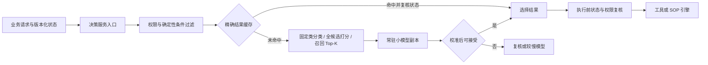

# Redotpay 工具与 SOP 选择：会议初步结论

资料核验：2026-11-19。需求：约 200 个候选、100 ms 以内、高并发、可缓存，并达到业务所需的领先准确性。

**建议同时推进两个方向：用 Karpo 31B 建立质量对照，用 Karpo 2B/4B、Strands 2B 的领域微调竞争在线服务。现有证据不足以承诺任何一个模型开箱即满足“200 项、端到端 P95 ≤100 ms、高并发、SOTA”。**

本报告默认 100 ms 指业务后端发起决策请求到收到完整答案，包含请求内的取数、网络、排队和推理，不包含工具执行或整个 SOP 完成。峰值 QPS 尚未提供，容量示例按 100 / 1,000 QPS。若要求每次请求都在 100 ms 内返回正确选择，P95 达标仍不满足该要求，须另订截止时间、错误预算和超时行为。

证据分为公开榜单、仓库既有实测和规划假设。本次没有运行新的模型测试、使用 Redotpay 真实数据训练或创建云实例。[来源与价格快照](results/redotpay-decision-assessment-2026-11-19.json)保存了提取数据、来源 URL 和文件哈希。

**一、模型怎么选**

| 候选 | 已有证据 | 本项目建议 |
|---|---|---|
| Karpo Decision 31B | Decision Index 0.4.1 Full 73.86；榜单 P50 / P95 = 94.3 / 585.9 ms；最多 255 项，32,768 tokens；BF16 权重约 62.5 GB | 质量对照、经复核的训练标注候选、允许较长延迟的复杂任务；不据此承诺 100 ms 在线服务 |
| Karpo Decision 2B / 4B | 已发布权重及专用推理代码，最多 255 项；支持 CUDA Graphs、可选 FP8；本次取得的 Full 榜单中没有这两个型号的对应成绩 | 优先测试的低延迟候选；不能继承 31B 的榜首结论 |
| Strands Decider 2B | 仓库已验证 v19 的本地部署、vLLM 适配与微调；公开模型已有 v21；官方 schema 支持最多 255 项 | 实施与成本基线。保留 v19 对照，增加 v21，针对工具/SOP 数据微调后决定是否主用 |
| H2O-Lightning 4B / Liquid d1-2B | 仓库同批测试中，H2O 在复杂条件选择上更好，Liquid 在短请求上更快 | 分别作为质量、延迟对照；避免只比较 Karpo 与 Strands |
| 固定标签分类器或小型编码器 | 本仓库没有相应实测；固定 200 类可以直接输出 200 维分类分数，不必每次阅读 200 段描述 | 若工具/SOP 集合较稳定，应加入基线；动态候选可用双编码器召回、短列表精排 |
| Microsoft Decision-1 / 阿里 decision-model-preview | 用户实际测得约 1–2 秒且效果不满意；当前缺少配对原始请求、区域和服务端计时 | 保留基线，先查清延迟来源；不依据宣传数字继续增加投入 |

Karpo 的“第一”需要准确表述：取得的榜单快照生成于 **2026-11-17 18:35 UTC**，共 307 个条目，Karpo 31B 的 Full 数值最高。模型卡说明榜单把相差不足 0.9 分的模型分为同名次，因此与 GLiDE 27B（73.37）共享第一档。Full 来自私有同技能测试与新领域测试，按 60% / 40% 合成并映射到公共尺度；**73.86 不是 73.86% 的业务准确率**。[榜单原始数据](https://huggingface.co/spaces/multimodalart/jev-decision-index/blob/main/data/index.json) · [Karpo 31B 模型卡](https://huggingface.co/MachinePulseAI/karpo-decision-31B)

榜单计时使用一张 **RTX PRO 6000 96 GB**，单进程、一次一个请求，使用模型支持的最快路径；不是 L4，也没有验证 Redotpay 的 200 项请求或并发服务。取得的方法说明采用共同抽样请求、预热后计时，分位数统计返回答案的请求。[计时方法](https://huggingface.co/spaces/multimodalart/jev-decision-index/blob/main/data/methodology.json)

Strands 当前榜单条目指向 **v21**，Full 20.72、P50 / P95 = 52.3 / 126 ms；本仓库主要质量与并发证据来自 **v19**，不能混用版本。v21 模型卡仍明确列出长文档、多步判断和跨域置信度校准等限制。[v21 模型卡](https://huggingface.co/StrandsAgents/strands-decider-2B-hobson-v21)

仓库的 2026-10-29 配对测试更贴近现有支付应用，但也不是 Redotpay 验收集：

| 模型 | 支付参考一致 | 复杂路由参考一致 | 支付中位耗时 |
|---|---:|---:|---:|
| Strands v19 | 66/80 | 26/64 | 65.4 ms |
| Liquid d1-2B | 77/80 | 35/64 | 38.6 ms |
| H2O-Lightning 4B v1.4.1 | 80/80 | 54/64 | 93.4 ms |

以上使用同一张 L4、模型依次运行，客户端调用本机接口；原始和反转候选顺序各算一次观察，80/64 不是独立案例数。没有 Karpo，没有 200 项并发结果，也没有金融微调。该证据支持保留对照模型，不能据此宣布通用 SOTA。[完整报告](../validation/open_decision_models/README.zh.md)

**二、200 项为什么不等于 100 ms**

候选数量只是一个维度。总输入长度约为：

`状态 tokens + 问题/模板 tokens + Σ(候选名称及条件 tokens)`

例如每项平均 30 tokens，200 项就有约 6,000 tokens；加业务上下文后可能超过 7,000 tokens。这是长度示例，实际需用各模型的 tokenizer 统计。决策头一次给出所有选项的分数，省去了逐 token 生成答案，但仍要处理输入。

因此必须同时记录：候选数、候选描述长度、状态长度、单选/多选、问题数量、模型精度和实际序列长度。Strands 的 255 项协议上限不代表这些选项在已配置的窗口内全部可见；现有路径曾使用 4,096 窗口，应启用超长拒绝或等价校验，避免截断条件后仍返回看似正常的选择。

用户测得 1–2 秒的原因尚不能归因。建议对原请求拆分：

`取数 + 网络/网关 + 服务排队 + 分词/预处理 + 模型前向 + 输出封装`

把供应商直连与当前调用链、短/长输入、预热前后、单请求/并发分别比较，记录服务端耗时与客户端完整往返。检查是否调用专用决策接口、有无重试、跨区域访问、共享服务排队或模型冷启动。即便修复网络，长输入的前向计算也不会自动降到宣传值。

**三、推荐部署：根据候选是否固定选择路径**

1. **固定分类集合**：从业务上下文直接分类到工具/SOP ID。把标签含义学进分类模型，不用每次展开全部 SOP。新增标签或规则变化必须版本化、回归验证。
2. **动态候选集合**：先用地区、产品、账户状态和权限等确定性条件去掉不适用项；必要时用预计算候选向量召回 Top-10/20/40，再由决策模型选最终 ID。200 条向量可直接做矩阵相似度计算，不必为了这个规模增加远程向量库。
3. **必须一次阅读全部 200 项**：保留直接打分路径，用真实长度单独压测。其算力需求与召回方案不同；不能把“200 项召回后仅打分 20 项”写成“模型直接比较 200 项达标”。

召回引入质量上限。若正确候选的 Recall@K 为 99.5%，且正确项已召回时精排准确率为 99%，最终准确率约为 **98.505%**。必须一起验收召回和最终决策；对候选不足、信息不全或没有合法动作的情况提供 `clarify`、`no_match`、`manual_review` 等明确出口。

模型选择 SOP 后，SOP 引擎负责顺序、重试、等待外部事件和执行前置条件。若工具选择依赖前一步 SOP 决策，不能假定两者可以并行完成；100 ms 目标要明确是每次选择还是两次选择合计。

**四、100 ms 的预算与并发约束**

以下只是工程预算，尚未实测：

| 环节 | 建议预算 |
|---|---:|
| 同区域网络、入口、解析 | 10 ms |
| 状态读取、权限过滤、缓存查询 | 10 ms |
| 召回与模型预处理 | 10 ms |
| 排队与批次等待 | 5 ms |
| 小模型前向与决策头 | 50 ms |
| 输出校验和序列化 | 5 ms |
| 余量 | 10 ms |
| 合计 | 100 ms |

各环节预算相加用于设计，不是各阶段 P95 相加就得到端到端 P95。最终必须直接测量完整请求。取数若依赖慢速外部接口，应把事实预先同步到有版本与时效定义的本地读模型，并把更新延迟单独验收。

部署建议：业务和推理放在同区域私网；GPU 常驻、完成预热后接流量；连接池复用；按序列长度分队列；按排队时间、在途请求与实测吞吐扩容；为常态与突发负载保留容量。常态服务优先按需或有容量保障的实例，训练可考虑可恢复的 Spot 作业。

**现成服务的并发能力必须区别于 HTTP 接收能力：**

- 当前 Karpo 官方 `Runner` 通过锁使每张 GPU 一次运行一个请求。`torchrun --nproc_per_node N` 是每张卡加载完整模型、把请求分配给各卡，不是把一个模型切到 N 张卡上。CPU 预处理可提前进行，但不能据此声称已有跨请求 GPU 动态批处理。[服务代码](https://github.com/machinepulse-ai/karpo-decision/blob/main/src/karpo_decision/serve/server.py)
- Karpo 的 CUDA Graphs 与 FP8 是具体实现能力。官方 2,215 请求对照中，31B FP8+Graphs 的 top-1 与 BF16 原路径一致率为 99.4%；这是数值路径的一致性，不是业务准确率。精度变更后应重测选择与校准，不能预设无损。[推理代码说明](https://github.com/machinepulse-ai/karpo-decision)
- Strands 的现有 vLLM 适配已支持调度，但仓库明确要求完整 prefill，不能直接打开前缀缓存或分块 prefill。候选决策头、attention mask 等适配也不能用普通聊天模型的 vLLM 启动参数替代。
- 微批若经适配验证，可以从 1–2 ms 等待窗口开始扫描；增加 batch 可能提高吞吐并增加尾延迟。必须用满足延迟目标的吞吐定容量。

Strands v19 的既有短输入 vLLM 扫描如下，输入只有 **304–445 tokens**：

| 客户端并发 | 实测成功请求/秒 | 客户端 P95 |
|---|---:|---:|
| 1 | 18.10 | 59.9 ms |
| 2 | 22.85 | 89.9 ms |
| 4 | 33.11 | 131.8 ms |
| 8 | 33.84 | 245.0 ms |

这说明吞吐最大时并不满足 100 ms。该实验还是固定 worker 的短时闭环负载，不能直接换算为持续到达请求下的 SLA。[实测报告](presentations/v9/sources/vllm/VLLM_PERFORMANCE.zh-CN.md)

低置信度转大模型通常超过 100 ms。如果全部请求都受同一目标约束，必须报告这些请求的真实耗时和最终成功率；在 100 ms 内返回“处理中”或拒绝，不能计为完成了正确工具选择。

**五、缓存具体缓存什么**

| 层次 | 可缓存内容 | 失效依据与边界 |
|---|---|---|
| 候选目录 | ID、描述、适用范围、分词、候选向量 | 工具/SOP/规则/编码器版本变化；分词缓存只节省预处理，不等于省去模型前向 |
| 业务状态 | 账户/订单/工单读模型 | 明确数据来源、状态版本与允许的更新延迟 |
| 精确决策结果 | 相同完整决策输入的结果 | 租户、权限、状态、候选集、规则或模型版本变化即失效 |
| 同请求合并 | 同一缓存键的并发请求共用一次正在进行的推理 | 完整键一致；失败不污染结果缓存 |
| 模型中间状态 | 仅限该模型与推理实现明确支持的可复用部分 | 必须验证 attention 与数值等价性，不能套用通用因果模型的 KV 缓存假设 |

建议缓存键包含：

`tenant + authorization_scope + normalized_query + decision_relevant_state_hash/version + candidate_catalog/subset_hash + SOP/policy_version + model/adapter_version + preprocessing/calibration_version`

若候选排序会影响模型结果，缓存键应包含顺序，或在经过测试后统一采用固定排序。不要把只提供候选 ID、实际省略其语义的请求当作等价输入，除非模型本身已训练成该固定标签分类器。

金融缓存主要风险是状态变化：同一句“退款失败怎么办”，在已经退款、尚未退款、地址未验证或风控冻结时需要不同动作。资金类决定优先用版本化精确匹配，执行前重新校验关键状态；TTL 只是补充。语义近似缓存可先用于无需账户事实的帮助意图，不宜直接复用资金执行决策。

精确命中率需从真实流量测量。若 20% 请求未命中且耗时超过 100 ms，不能由其余 80% 很快推断整体 P95 达标。报告应同时给出命中、未命中、热点失效和模型更新后的延迟及成功率。

**六、实例规格与推理费用**

以下为 2026-11-19 通过 AWS Price List API 查询的 **us-east-1、Linux、Shared、On-Demand** 计算费，按 730 小时/月；实际部署区域须重新报价。不含磁盘、缓存、负载均衡、网络、税费或额外副本。已排除 Capacity Block 的零价占位条目。

| 实例 | GPU | vCPU / 系统内存 | 美元/小时 | 美元/月 | 建议用途 |
|---|---|---|---:|---:|---|
| g6.xlarge | 1 × L4 24 GB | 4 / 16 GiB | 0.8048 | 587.50 | 已有 2B 推理基线 |
| g6.2xlarge | 1 × L4 24 GB | 8 / 32 GiB | 0.9776 | 713.65 | 2B/4B 首轮推理、微调与预处理 |
| g6e.xlarge | 1 × L40S 48 GB | 4 / 32 GiB | 1.8610 | 1,358.53 | 显存更大的推理对照 |
| g6e.2xlarge | 1 × L40S 48 GB | 8 / 64 GiB | 2.24208 | 1,636.72 | 4B/9B、较长输入及 LoRA 首选对照 |
| p5.4xlarge | 1 × H100 80 GB | 16 / 256 GiB | 6.8800 | 5,022.40 | Karpo 31B BF16 质量与性能测试 |

g6.2xlarge 相比 g6.xlarge 增加的是 CPU/内存，GPU 仍是同一规格 L4，不代表推理算力翻倍。31B BF16 在 80 GB 卡上还需留出激活与工作区；长输入可能需更多显存。L40S 48 GB 不足以容纳 31B 的 BF16 权重；FP8 是需要重新验收的另一配置。官方榜单的 RTX PRO 6000 性能不能直接迁移为这些 EC2 实例的性能。

容量应从满足 SLO 的实测单卡吞吐出发：

`副本数 = ceil(峰值 QPS × (1 − 精确缓存命中率) ÷ (实测每卡 QPS × 规划利用比例)) + 故障余量`

**纯示例**：假设在目标输入下实测每卡可达 20 QPS，再取 60% 作为规划负载，每卡按 12 QPS 部署；额外加 1 个故障余量副本。该 20 QPS 不是已经测出的 200 项能力。

| 峰值 | 假设精确命中率 | GPU 未命中流量 | 副本数 | 按 g6.2xlarge 计算费/月 |
|---:|---:|---:|---:|---:|
| 100 QPS | 0% | 100 QPS | 10 | 约 $7,136 |
| 1,000 QPS | 0% | 1,000 QPS | 85 | 约 $60,660 |
| 1,000 QPS | 80% | 200 QPS | 18 | 约 $12,846 |

该表用于说明容量敏感性，不是采购建议。新模型、固定标签分类器或经过验证的批处理可能显著提高每卡吞吐；完整 200 项长输入也可能显著降低它。若缓存大面积失效，按 80% 命中配置的集群不能承接全部未命中流量。跨可用区容灾还需按整区故障计算，额外一张卡并不覆盖该情况。

同样的计费公式可换算每百万请求成本：

`每百万次 GPU 计算费 = 实例小时价 × 1,000,000 ÷ (3,600 × 实际每实例平均完成 QPS)`

例如 g6.2xlarge 持续平均完成 12 QPS 时，约 **$22.63 / 百万次**，不含上表的空闲冗余和其他服务。业务有明显低谷时，应按月度实际请求量摊销，不能套用满载单次成本。

**七、Redotpay 金融场景怎么微调**

训练目标应拆成“意图/工具/SOP 选择”和“可否执行”。模型负责理解语义与选择；余额、额度、确认数、权限、风控状态、幂等和账务一致性等可确定验证的条件由程序核验。模型选对工具不代表参数正确、调用获准或整个业务完成。

数据建议从 **每类 50–200 条经复核样本**开始建立覆盖，200 类约 1万–4万条，另补充相似 SOP 的困难反例、拒绝/澄清与长尾场景；这是启动规模，不是达到目标准确率的保证。数据字段应包含业务快照、适用规则版本、当时实际候选、期望动作及其依据。覆盖中英文、口语、否定、多意图、错误网络/币种、确认不足、重复退款、退款已完成和风控冻结等案例。

按客户/订单/会话分组并按时间隔离训练和测试；同一工单的改写、反序候选或不同时间快照不能随意散到两侧。另设校准集。候选换序、语义等价命名、难负例和候选增删用于检验模型是否依赖位置或 ID。动态标签模型训练时要保留真实候选语义和长输入分布。

训练流程建议为：人工冻结业务答案 → Karpo 31B 辅助标注/筛查并人工复核 → 小模型监督微调 → 独立校准 → 业务留出集与性能回归。教师输出不能直接当真值；若蒸馏概率分布，要统一候选集合并验证温度与校准。

| 训练对象 | 首轮机器建议 | 方法与限制 |
|---|---|---|
| Strands 2B | 1 × L4 24 GB，8 vCPU / 32 GiB 起 | 冻结基座，训练 LoRA + 决策头；已有可复用实测流程 |
| Karpo 2B/4B | L4 24 GB 起测；长输入优先 L40S 48 GB | LoRA + readout，BF16、小 micro-batch、梯度累积与重计算；需适配专用模板和注意力机制 |
| Karpo 9B | L40S 48 GB 起，长序列可用 80 GB | 先验证短批次显存；不把权重能加载等同于训练能运行 |
| Karpo 31B | 80 GB 先验证短序列 LoRA；完整长输入优先更大显存或多卡方案 | 不建议首轮全参数训练；量化训练、分布式训练均需专用适配，不能从现有推理启动方式推导支持 |

Karpo 公开仓库主要提供推理及有限训练辅助代码；本次没有验证可直接运行的端到端领域训练脚本。其微调预算必须包含适配工程。Strands 在这个仓库关联项目上具有更明确的落地证据。

已有 Strands 训练实测：L4 24 GB，12,590 条训练数据、1 epoch，LoRA + pointer head，训练子进程约 64 分钟、含前后评估约 83 分钟。按上面的 g6.2xlarge 价格，83 分钟约 **$1.35 计算费**。这只是短的合成游戏比较任务，不是金融、200 项长输入或标注成本；其 99.95% 测试正确率不能迁移成 Redotpay 的预计准确率。[训练报告](https://github.com/milan9527/StrandsDeciderTetrisFinetuning/blob/main/finetuning/RESULTS.md)

业务训练费用用 token 吞吐估算更可靠：

`训练 GPU 时间 ≈ 样本数 × 平均训练序列 tokens × epoch 数 ÷ 实测有效训练 tokens/s`

例如 5万条、平均 1,000 tokens、3 epochs 为 1.5亿 tokens。**假设**有效训练吞吐为 500–2,000 tokens/s，需要约 21–83 GPU 小时；用 L40S g6e.2xlarge 的费率换算约 **$47–187**。若平均长度是 4,000 tokens、吞吐不变，约 **$187–747**；实际长序列还可能降低吞吐。这些吞吐是假设，先跑代表性训练片段测出真实值后才能报价。

建议首轮 **2B/4B 的 GPU 计算预留 $100–1,000**，覆盖训练和必要迭代；如果要多个种子、完整 200 项长输入和大量回归，应按上式追加。31B 教师在 p5.4xlarge 上运行 10–50 小时另约 **$69–344**，能处理多少数据取决于实测吞吐。若进一步微调 31B，可先按 50–200 个 H100 GPU 小时规划 **$344–1,376 的单卡等价计算费**，仅作数量级预算，多卡实例计费与显存可行性须另验。

以上不含人工标注、业务专家复核、训练适配和上线工程。举例，2万条每条复核 1–3 分钟，需要约 333–1,000 人时；若内部综合成本为 $20–50/小时，则为约 $6,700–50,000。两项单价均为预算假设，不是标注市场报价，说明该项目中数据和规则梳理可能比 GPU 贵得多。

**八、用什么标准给出最终选型**

建议会议批准一个有明确验收条件的 PoC，先冻结输入与答案，再比较候选；不必先承诺训练出 SOTA。

| 验收维度 | 必须报告 |
|---|---|
| 质量 | Top-1、macro-F1、逐 SOP 召回、危险误路由率、拒绝率；与 Karpo 31B 及现有模型的配对差异和置信区间 |
| 自动化覆盖 | 通过校准阈值后自动决策的覆盖率，以及这些决策的错误率；不能只挑容易题报准确率 |
| 输入覆盖 | 20/50/100/200 项；短/中/长描述与状态；中文/英文；候选换序、缺证据、规则冲突和不存在正确项 |
| 性能 | 端到端 P50/P95/P99、100 ms 内正确完成率、错误/超时/429、持续到达 QPS；同时给出模型耗时 |
| 缓存与运行 | 全未命中、自然命中率、热点集中、缓存失效、预热及重启；长短请求混合、至少一轮持续负载与突发测试 |
| 成本 | 满足同一质量、覆盖率与延迟目标时的实际实例数、GPU 小时、月费及每百万次成本 |

建议在业务集上要求快模型相对质量对照不劣于事先约定的容差，例如 0.5 个百分点，并单独约束危险动作误放行。容差只是讨论起点，是否可接受应由损失函数决定。要检验小差异通常需要数千至更多独立案例，具体由配对分歧和统计功效确定。

即使 3,000 个独立高风险案例零误放行，按简化的“3/n”估算，95% 单侧错误率上界仍约为 0.1%；小样本零错不能证明生产零风险。完整 SOP 完成率还需用真实状态推进的端到端测试单独评分。

压测用固定到达速率与突发流量，记录原定发送时间，避免“上一个请求越慢、下一个发得越少”的闭环测试隐藏排队。所有失败计入完成率；慢模型复核和拒绝请求也要在总流量中保留。

**会上可以直接给出的结论是：Karpo 31B 值得作为当前质量对照，但公开 P95 已明显超过 100 ms；在线首选需要由 Karpo 2B/4B、Strands 2B 微调及现有对照模型竞争。200 项/100 ms 的可行路径是控制实际输入长度、选择合适的分类或召回结构、常驻推理和按 SLO 扩副本。首轮小模型训练的 GPU 费用可从百至千美元级规划，生产月费主要由峰值 QPS、未命中率和实测单卡能力决定。**
