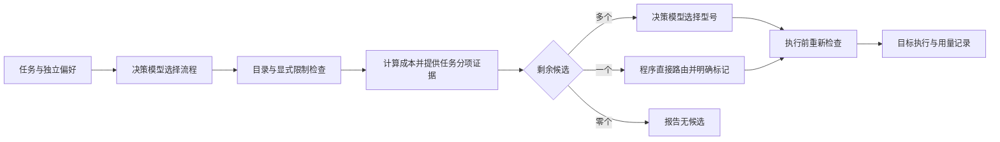

# 模型路由专项评估与成本均衡优化

> 本文保存首版评估及实现状态。后续已新增一次结构化分类、Bedrock 配置程序选型和业务校准入口，当前行为见 [Bedrock 分类选型](BEDROCK_CLASSIFIED_ROUTING.zh.md)。

2026-11-24。本次范围为模型路由模块。结论依据分为本项目历史实测、当日公开资料和本次代码验证，三者分别报告。

**建议：现有部署优先用 H2O-Lightning 4B 验证完整选模，Strands 保留分类基线；新增模型优先补测 d3-mini / d3-nano。路由采用“程序提供可信证据与约束，决策模型判断任务适配”的方式。** Liquid 很适合低延迟任务分类，但既有复杂路由结果和许可证条件不支持直接将它作为默认完整路由器。

本次已落地可切换的 `balanced` 路径、成本证据、执行前限制检查和已有 H2O/Liquid 服务适配。**尚未运行新版策略的真实决策模型及下游模型对照实验，因此没有新的质量提升率、端到端延迟或节省比例。**

## 1. 现有模型中，哪些适合做决策

下面复用项目 2026-10-29 的原始测试记录。32 个路由任务，正序、反序各一次，共 64 个观察；“任务分类”是其中 8 题的两种顺序。两种顺序不是独立样本。

| 决策模型 | 分类符合参考 | 全部路由符合参考 | 复杂条件违规 / 48 | 路由请求 P50 | 本项目建议 |
| --- | ---: | ---: | ---: | ---: | --- |
| Strands Decider v19，2B | 16/16 | 26/64 | 27 | 188.8 ms | 保留分类基线；不承担预算算术 |
| Liquid d1-2B | 16/16 | 35/64 | 23 | 114.3 ms | 快速分类候选；先过滤条件，再测选模 |
| Perplexity Decider Flash v1.2，4B | 16/16 | 47/64 | 3 | 500.1 ms | 质量备选；本项目参考部署较慢 |
| KnowLine-4B-Gen5.5 | 16/16 | 42/64 | 4 | 1153.1 ms | 暂不优先；需另测推荐推理后端 |
| H2O-Lightning 4B | 15/16 | **54/64** | 7 | 275.0 ms | **已有本地部署中的完整选模首选候选** |
| Jev 1.14.0，托管对照 | 16/16 | 59/64 | 2 | 87.3 ms | 作为托管对照，不能列为开源可部署权重 |

违规较少不必然代表更好：还要同时看错误拒绝、合法候选内的偏好错误和完整路由通过数。

这些测试没有执行选中的下游模型，衡量的是给定策略一致性，不是“为业务找到了最佳模型”。本地模型使用同一 L4 的独占复测环境；API 对照包含网络往返。当前常驻 H2O 是 FP8、共享 L4，不能照搬历史独占 BF16 的速度与质量。详细依据：

- [历史完整评估](../validation/open_decision_models/README.zh.md)
- [逐模型汇总](../validation/open_decision_models/results/summary.json)
- [违规与实际动作审计](../validation/open_decision_models/results/business_audit.json)
- [历史权重固定版本](../validation/open_decision_models/models.json)
- [当前常驻部署](../deployment/open_models/README.zh.md)

## 2. 新增开源候选与许可证

| 方案 | 公开信息 | 适配价值 | 尚需验证 |
| --- | --- | --- | --- |
| **d3-mini** | 4.54B，Apache-2.0，Choice / Yes-No / Score；输出候选概率 | 第一新增候选；与现有 4B 决策模型规模相近，适合多属性请求评估 | 当前 L4 上的部署、中文支付请求、候选换序、概率校准和端到端成本 |
| **d3-nano** | 2.21B，Apache-2.0，同类结构化决策协议 | 与 Strands / Liquid 对照低开销分类及选模 | 精度损失是否小于节省的路由时间和资源 |
| d3，27B 档 | 26.09B，Apache-2.0 | 可作为离线教师或质量上界候选 | 不适合当前 24GB L4 的 BF16 常驻目标；仅权重已约 52GB |
| RouteLLM MF / BERT | Apache-2.0 框架，基于偏好数据判断强模型胜率，再按阈值路由 | 如果每个任务只保留一对强弱模型，适合小成本路由；无需生成解释文本 | 官方预训练模型对较老，需当前模型池和真实流量重新校准；embedding 编码也有成本 |
| vLLM Semantic Router | 开源决策层，可配置模型、计算资源和路由策略 | 可借鉴信号、策略、后端分层；其 d3 家族是可单独评估的模型 | 整套网关迁移大于本次范围，不能把框架本身当作一个已验证分类器 |

d3-mini / nano 模型卡所列文本请求中位数分别为 **18.1 / 13.4 ms**，来自作者的 **MI325X** 环境，不是本项目 L4 测量，也不能与上表直接排名。它们的通用决策榜单表现支持“纳入候选”，不支持“已经优于 H2O 的业务路由效果”。

多问题的一次 API 请求也不等于一次模型前向：d3 模型卡说明每个问题有独立前向计算。采用多属性评估时，应测量完整请求的耗时和资源，不能把单问题延迟直接用于 11 个属性。

Strands、H2O、Perplexity Flash、KnowLine 的当前模型卡标注 Apache-2.0。**Liquid d1-2B 是开放权重、LFM Open License v1.0，不是 Apache-2.0。** 许可证第 5 节有商业使用限制，第 1 节定义年收入 1,000 万美元门槛；商业采用需按原文判断资格。代码框架的开源许可证也不能替代模型权重、底座和依赖的许可证。

公开来源均已保存到 [来源目录与 SHA-256 清单](../validation/routing_optimization/sources/manifest.json)。当日模型卡来自 `main`，与历史测试固定的 revision 分开保存。

## 3. OpenRouter：应参考当前做法

**2026-11-24 抓取的 Auto Router 文档，与本项目 2026-10-13 保存的版本不同。**

旧文档描述：轻量任务分类 → 最近七天任务支出份额排序 → 成本档位 → 过滤与回退。最新文档描述：

1. 按模型能力、账户限制、数据保留、供应商限制和允许/排除列表缩小候选。
2. 快速决策模型一次评估请求的 **11 个方面**，例如任务类型、难度、速度要求、是否需要视觉/代码库知识，以及更强模型或更多思考是否有帮助。
3. 路由策略结合评估信号、实时价格、缓存状态和基准表现，选择**模型与推理档位**。
4. 再进入独立的供应商路由，考虑健康、延迟、价格和偏好。
5. 将模型是否遇到困难、已缓存上下文等信号传给下一轮。

最新 `cost_tier` 为 `low / medium / high`；`xhigh / max` 兼容为 `high`。它是路由偏好，不是单次金额上限，也不是模型 reasoning effort。供应商的 `max_price` 是端点单价筛选，不能当作完整请求账单限制。

Provider Routing 当前还考虑有效价格、吞吐、TTFT、429、可靠性和工具返回格式，依据近期流量更新。价格排序和低延迟排序可以显式配置；仅看模型标价不能复现其路由。

本项目没有 OpenRouter 的实时市场、缓存和端点遥测数据，也没有其策略训练数据。本次借鉴**分层职责与证据结构**，不声称复现其内部策略或效果。

来源：[Auto Router](https://openrouter.ai/docs/guides/routing/routers/auto-router)、[Jev Router](https://openrouter.ai/docs/guides/routing/routers/jev-router)、[Provider Routing](https://openrouter.ai/docs/guides/routing/provider-selection)。

## 4. 给决策模型哪些依据

| 信息 | 当前依据及处理 | 局限 |
| --- | --- | --- |
| 原始任务、任务类型 | 现有第一步模型分类；第二步接收原始请求与流程 | 本次保留两步协议；尚未做一次调用输出 11 个属性 |
| 客服 / 文本能力 | Language、IF 分项 | 不是业务答复正确率 |
| 代码能力 | Coding、Agentic Coding 分项 | 不代表生成代码已通过验签、幂等或并发测试 |
| 核算能力 | Reasoning、Mathematics、Data Analysis 分项 | 不是财务正确性的保证 |
| 检索能力 | MTEB MIRACL 中英文分项 | 不把中英文平均值当作任意语言的质量 |
| 推理档位 | 保存评测对应的配置，执行沿用该配置 | 不把高 effort 分数套给低 effort；本次没有自动降档 |
| 单次参考成本 | 程序用 Decimal 计算输入、预期输出及输出上限两种费用 | 使用现有快照参考价，不是 Bedrock 端点报价 |
| 显式限制 | 账户、区域、模态、模型允许/排除列表、参考费用限制 | 目录账户可用不等于实时端点健康 |
| 延迟、缓存、成功率 | 明确标记为未测量 | 不从价格或模型大小推断，也不补成零 |
| 决策审计 | 策略版本、目录版本、证据、输入哈希、候选、输出、耗时 | 概率未经业务校准，不作为自动回退阈值 |

请求文字与策略字段分开。候选按模型 ID 排列，不提供人为“第一名”，不将不可比的评测分项拼成一个总分。费用限制或允许列表排除的模型不会进入模型选择，执行时还会重新检查。



当前实验路径在决策失败或返回非法候选时明确失败，不静默回退。生产自动回退应另行建设：从已满足相同硬条件的池中选备用，限制重试次数和累计费用，分别记录模型失败与程序调整；本次未启用。

## 5. 性能和成本如何平衡

当前参考公式：

```text
预计目标费用 = (输入 token 估计 × 输入单价 + 预期输出 token × 输出单价) / 1,000,000
按输出上限费用 = (输入 token 估计 × 输入单价 + max_output_tokens × 输出单价) / 1,000,000
```

输入优先使用调用方的 `input_tokens` 估计；未提供时用请求的 UTF-8 字节数作为粗略代理。它不是 tokenizer 结果，也没有覆盖供应商的消息包装。向量任务的输出 token 费用为零；缺失输入价格仍为未知。

`max_reference_cost_usd` 用第二个公式作筛选，允许恰好等于限制；价格缺失时不能证明满足限制，因此排除。**它只限制基于外部平价和输入估计的参考金额，不能保证实际花费**：缓存、长上下文阶梯价、工具、媒体及路由费用均不在该估计内。真实支出限制需要可信端点报价、目标 tokenizer、全部计费项与累计预算管理。

模型收到三档明确的选择目标：

- `low`：任务证据足够时优先更便宜的模型。
- `medium`：常规任务倾向低成本；只有相关能力证据支持收益时才选择更贵模型。
- `high`：困难任务优先相关能力，但不能把昂贵视为高质量证据。

三档目前是决策输入策略，不是经过校准的质量阈值。模型仍可能选择不理想的候选，必须用下游效果验证。

真正要优化的是：

```text
在业务质量和 P95 延迟约束内，最小化：
路由资源成本 + 目标模型实际费用 + 失败/重试/升级费用
```

还应单独报告：

```text
每成功任务成本 = 全部请求总成本 / 达到业务验收标准的任务数
每请求摊销 GPU 成本 = GPU 总运行费用 / 该时间段有效处理请求数
总延迟 = 排队 + 分类 + 选模 + 目标执行 + 重试
```

GPU 空闲时间要计入摊销；已有服务器的边际成本与完整成本分别报告。若每小时 GPU 费用为 `H`、有效吞吐为 `r` 请求/秒，则该时段单位请求 GPU 成本为 `H / (3600r)`，不能直接用单请求推理毫秒数替代。

若路由后平均目标费用是 `Ctarget`、路由可变成本是 `Crouter`，固定强模型平均费用是 `Cstrong`，则只有 `Cstrong > Ctarget + Crouter` 时才可能节省。考虑该时段固定部署成本 `F`，盈亏平衡请求数为 `F / (Cstrong - Ctarget - Crouter)`。这些是计算方法，本次没有代入虚构的实例单价或流量。

## 6. 本次实现与使用

界面 `#routing`：

- “选模依据”：原始输入 / 任务分项证据 / 成本均衡；界面默认成本均衡，API 默认仍为原始路径。
- “决策模型”：现有 Strands / Jev / GPT，或已有 Strands / Liquid / H2O。三个本地模型按顺序运行，降低共享 GPU 的并发干扰。
- 成本均衡可选择成本档位及预期输出量；结果展示预期费用和输出上限费用。
- 执行后若目标接口提供完整用量，显示按实际 token 折算的参考费用；这仍不是实际账单。

本地 H2O / Liquid 复用服务端 `OPEN_MODELS_URL`，核对返回模型身份，不接受请求指定任意上游 URL。尚未安装 d3 或改变 GPU 服务。

API 示例：先从 `/api/routing/catalog` 获取 `version`、`rankings.version`、`balance_optimization.version`。先请求 `stage=workflow` 且不带 `workflow`；将返回 `choice` 填入第二步。以下为第二步请求形状：

```json
{
  "stage": "model",
  "workflow": "coding",
  "provider": "h2o",
  "mode": "live",
  "strategy": "balanced",
  "evidence_version": "routing-balance-v1",
  "catalog_version": "<catalog.version>",
  "ranking_version": "<catalog.rankings.version>",
  "task": {
    "text": "编写有签名验证和并发幂等控制的支付 webhook",
    "routing_preferences": {
      "cost_tier": "medium",
      "input_tokens": 1000,
      "expected_output_tokens": 512,
      "max_output_tokens": 4096,
      "max_reference_cost_usd": "0.10",
      "excluded_models": []
    }
  }
}
```

`allowed_models` 可选；未提供表示不额外限制，空数组表示不允许任何模型，使用目录的精确 ID。排除列表优先。偏好只能用于 `balanced`，其他策略收到偏好会拒绝，避免悄悄忽略费用或模型限制。`expected_output_tokens` 不能超过 `max_output_tokens`。

执行时向 `/api/routing/execute` 传入相同任务、策略、版本、流程和所选 `model_id`。`max_output_tokens` 同时控制实际请求的输出上限。只剩一个候选时，响应来源为 `constraint_singleton`、模型身份和推理耗时为 `null`，不把程序选择计为模型成绩。

## 7. 验证边界与下一轮实验

本次验证包括费用边界、未知价格、输入/输出占比、排除优先、空候选、单候选、模型身份、超时、非法选择、执行前重检，以及原有路由回归。浏览器回放只验证页面、协议和结果导出，不计入模型准确率或推理性能。

下一轮计划见 [验证目录](../validation/routing_optimization/README.zh.md)：

1. 冻结当前部署、模型 revision、量化方式、价格来源和评测版本。
2. 用独立中文/英文业务留出集比较 H2O、Strands、Liquid，随后引入 d3-mini/nano；保留换序与重复观察。
3. 对相同任务对照原始、分项证据、成本均衡三种输入；纯输入对照共享流程和候选，全链路对照另测。
4. 实际执行选中的模型，同时保留固定强模型、固定便宜模型基线；检查客服事实、代码测试、核算精度和检索质量。
5. 报告原始选模结果、程序排除/直接选择次数、拒绝与错误、下游质量、实际用量、端到端 P50/P95 和每成功任务成本。
6. 只有达到业务质量与延迟要求后，才用真实成本曲线确定默认模型和成本档位。首轮小样本用于筛选，不足以证明极小的质量损失。

后续生产能力包括端点实时遥测、可信报价、缓存和会话粘性、按配置的质量曲线、一次调用的多属性评估以及受控回退。本次没有将这些未实现能力作为已有优化收益。
