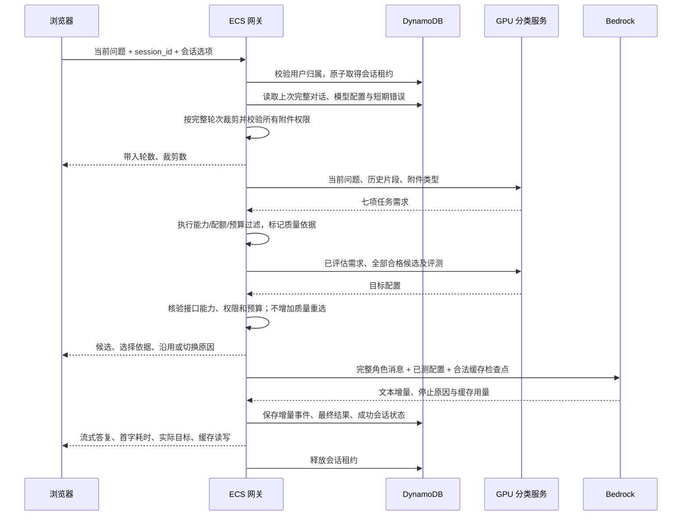

# 多轮会话、模型粘性与缓存复用

更新于2026-11-26。独立网关会话策略为 `gateway-session-v1`，实时型号选择为 `gpu-evidence-livebench-preference-v5`，执行协议为 `bedrock-classified-v4`。GPU根据候选评测选择型号；文本质量仅按LiveBench分项判断，三种偏好统一交给GPU，不设置质量分数门槛或额外重选。旧87场景报告保留原始结果。详见[当前选模机制](BEDROCK_CLASSIFIED_ROUTING.zh.md)。

## 与 OpenRouter 的对应关系

| 能力 | OpenRouter 公开机制 | 当前项目 |
|---|---|---|
| 请求评估 | Auto Router 分析请求属性，再选模型与推理配置 | 第一次GPU评估七项属性，第二次依据评估结果与全部合格候选的评测选模；附历史要求和最新工具结果 |
| 多轮输入 | 统一消息协议，结合会话上下文路由 | 网关接收当前 `task` 和显式 `history`，或从登录用户的会话数据库恢复历史 |
| 会话粘性 | 尽量复用模型、提供商及已缓存上下文，需求变化时调整 | 优先保留上次成功的精确模型配置；每轮仍分类、过滤并核验约束 |
| 提示词缓存 | 供应商原生缓存，实际缓存影响有效成本 | Bedrock Converse 的显式 cachePoint，按精确型号允许列表启用；保存实际缓存读写 token |
| 统一调用 | 跨供应商统一 API 和参数适配 | 统一网关 NDJSON 事件；文本/图像对话使用 Converse，其他媒体保留已实现的原生适配器 |
| 逐步输出 | 流式目标响应 | ConverseStream 文本增量、最终结果、用量、停止原因与首字延迟 |
| 故障回退 | 供应商/型号健康和候选回退 | 限流、服务不可用、模型尚未就绪且没有输出时，最多尝试三个不同端点 |
| 动态健康 | 大量流量的可用性、延迟、吞吐和格式质量 | 当前登录账户观察到的端点错误触发 60 秒冷却；实际耗时展示，但未自动训练排序 |
| 生态与兼容 | 多供应商、API key、工具协议、额度等完整平台 | 目前限定 Bedrock、自建登录与现有网关 API；没有完整 OpenAI 协议、跨云供应商市场或账户账单限额 |

参考：[Auto Router](https://openrouter.ai/docs/guides/routing/routers/auto-router)、[Provider Routing](https://openrouter.ai/docs/guides/routing/provider-selection)、[AWS prompt caching](https://docs.aws.amazon.com/bedrock/latest/userguide/prompt-caching.html)。这是公开机制的工程借鉴；本项目采用可审计的候选约束与GPU两阶段判断，未经独立业务优化实验，不代表 OpenRouter 内部权重。

本次范围不包含行情数据接入或实时搜索。向量与文档重排保留原有能力。

## 工作台选项怎么用

“发起请求 → 会话与调用”下可展开说明。以下选项只控制工作台请求，行业Agent使用自己的会话流程。

| 选项 | 作用与使用建议 |
| --- | --- |
| 记住上文 | 将当前会话之前成功完成的问答发给模型，支持“继续”“修改刚才的方案”等追问。增加输入Token；关闭不删除数据库记录，但本次成功回答会开始新的上下文链。 |
| 优先用上次模型 | 开启“记住上文”且当前条件允许时优先沿用上次模型；仍逐轮判断任务，需求变化可以切换。关闭后每轮重新选模，也可能选中同一模型。 |
| 复用提示词缓存 | 支持的模型可复用相同输入前缀的处理结果，本轮仍生成新答案。可能降低耗时和费用；短输入、首次请求、换模型或过期可能不命中，以实际缓存读取量为准。 |
| 实时显示回答 | 支持流式输出时逐段显示文字；关闭后等生成结束再显示。不改变选模策略，也不减少生成Token。 |
| 限流时尝试其他候选 | 文本调用限流或暂时不可用、且尚未输出时，尝试符合本次约束的备选；含首选最多3个端点。没有备选或已有部分输出时停止。 |
| 历史轮数上限 | 默认8轮，可设1–16轮；一问一答是一轮。过长时会进一步移除最早的完整轮次，实际数量在请求过程里显示。 |

连续追问可保持默认选项。切换无关问题或独立测试另一个模板时，建议新建会话，避免上一题的历史影响路由及回答。

## 一次连续追问如何执行



租约通过 DynamoDB 条件写入实现，SQLite 用事务实现。同一会话的并发请求返回 409，其他会话可继续。租约 600 秒到期，目标执行另有 180 秒总时限。断开连接停止网关工作并保留已落库片段；已提交上游的结果仍可能未知，不能假定取消等于免计费。

会话历史默认最多八轮，可设 1–16 轮。只使用最后一个成功对话的上下文链；失败、仅分析、回放、未完成输出不进入下一轮。新会话为空；关闭「记住上文」后，本次成功回答开启新的上下文链。非对话类媒体任务结束后不会将“文件已生成”等提示作为聊天答案继续传入。

总文本按 48,000 UTF-8 字节裁剪，始终删除完整的最早轮次，不生成隐藏摘要。目标模型收到完整保留消息；GPU 只收到最近片段。费用估算纳入保留的输入与消息包装代理，仍不是 tokenizer 或账单。已核验的上下文上限用于约束检查；未知上限不伪装成已验证能力；显式 `min_context_tokens` 仍要求目录证明，不以默认上限代替证明。图片会话保存私有附件引用并在后续每次调用前重新验证访问权限；向量、重排、原生语音/生成适配器没有多轮聊天协议时返回明确的无候选原因。

## 沿用模型与回退的边界

会话粘性向GPU提供上次成功配置，前提是当前仍带入历史、该配置仍满足能力和硬约束。GPU结合本轮需求、评测、费用和历史决定是否沿用；不再用固定百分比覆盖模型选择。缓存折扣未知时不放宽预算。

回退排除已尝试的端点，将剩余合格文本候选再次交给GPU。原有允许/排除列表和参考费用约束仍然生效，不限制为同一个公开评测批次。含首选最多三个不同invoke_id，整个目标阶段最多180秒；每次重新选模单独记录耗时。

仅 `ThrottlingException`、`ServiceUnavailableException`、`ModelNotReadyException` 在尚无文本输出时允许回退。参数错误、权限错误、内容过滤、读取超时、未知网络错误和部分输出后失败都停止。原生媒体/异步生成目前不回退。成功后把实际执行模型写入会话和性能记录；初始选模以及每次尝试都保留。单模型允许列表可能没有备选，此时如实返回原错误。

短期端点冷却按登录用户隔离、基于真实错误、到期自动失效；它不是 Bedrock 全账户剩余额度，也不是业务质量分数。指标少时不据此制造“成功率”或“最优路由”结论。

## 缓存与性能指标

缓存开启与命中是两件事。只有允许列表内的具体模型接收显式 cachePoint；例如 Nova Micro/Lite/Pro 最小前缀为 1,024 tokens，默认 TTL 五分钟。前缀不足、跨区域调度或缓存过期都可能不命中。稳定的第一条用户前缀与最近三个完整轮次最多放四个检查点，追加新一轮时保留前一轮检查点，使累计变长的对话也能复用前缀；Nova 的 20K 缓存限制按文本字节保守处理，媒体前缀不尝试显式缓存。其他模型仍可对话，但不会盲加不支持的参数。

| 页面指标 | 计算依据 |
|---|---|
| 带入/裁剪轮数 | 实际发送给目标的完整历史轮次；不包括当前问题 |
| 沿用模型数 | 本轮满足粘性条件并保留上次成功配置的请求数 |
| 缓存命中请求数 | Bedrock 返回 `cacheReadInputTokens > 0` 的请求数 |
| 缓存读/写 tokens | 供应商返回的 `cacheReadInputTokens` / `cacheWriteInputTokens`，未知单独标记 |
| 总输入 tokens | 非缓存 `inputTokens` + 缓存读 + 缓存写 |
| 目标首字 P50 | 从调用 ConverseStream 到收到首个文本增量；推理片段不算首字 |
| 目标总耗时 | 包含排队、流式处理、事件落库背压及必要回退；不是纯 GPU 推理时间 |
| 回退请求数 | 至少发起第二个目标候选的请求；包括最终失败 |
| 参考费用 | 只有可计价用量才显示；缓存读写费率未纳入快照时返回未知 |

API 流仍经过 CloudFront `/api/*` 的禁缓存行为。提示词缓存发生在 Bedrock，不把对话答复缓存在 CDN，也没有跨用户的完整答案缓存。

## API 示例与实现位置

`POST /api/gateway/runs` 保持现有版本字段和 `task`，新增：

```json
{
  "session_id": "服务端创建的24位十六进制会话ID",
  "session": {
    "use_history": true,
    "stickiness": true,
    "prompt_cache": true,
    "stream": true,
    "fallback": true,
    "max_history_turns": 8
  }
}
```

浏览器默认启用上面五项。API 的 `stream` 默认 false，其余默认如上。调用方已有历史时，设置 `session.use_history=false`，并提供 `history:[{"role":"user","text":"先前问题"},{"role":"assistant","text":"先前回答"}]`；最新问题继续放 `task.text`。只接受完整 user/assistant 对，不能将用户消息伪装成 system 消息。不得同时使用自动历史和显式历史。新增事件为 `context`、`attempt`、`delta`，原有阶段和最终结果保持。

主要代码：[会话与粘性](../app/gateway_conversation.py)、[Converse/缓存/流式适配](../app/gateway_adapter.py)、[回退](../app/gateway_execution.py)、[网关编排](../app/gateway.py)、[历史与租约](../app/gateway_store.py)。会话执行票据绑定当前请求和上下文摘要，不能从其他请求复用。

测试：[会话回归](../tests/test_gateway_conversation.py)、[浏览器验证](../scripts/check_gateway_browser.py)、[正式服务五次调用与缓存实测](../validation/independent_gateway/sessions-2026-11-25/README.zh.md)。新增实测报告独立保存，不修改旧效果评测分数。
