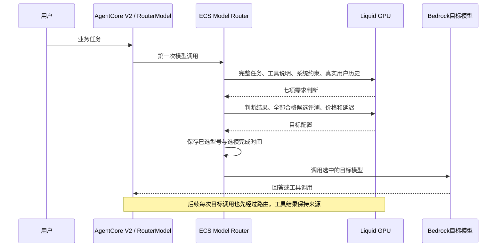

# Agent从第一次调用先决策（2026-11-26）

本次修正Agent首轮决策输入和过程展示。原有后端已经在目标调用前完成GPU路由；缺口是首轮Agent上下文不完整、工具结果混入用户要求，以及页面要等目标返回才显示已选型号。

## 实现

- **首轮信息完整**：不再裁掉用户任务的1300字符之后部分；原接口允许1400字符。GPU从第一次调用即收到实际工具名称、参数Schema及系统约束，没有注入场景验收答案。
- **分清指令与观察**：原生协议中的 `toolResult` 虽使用 `user` 角色，路由现在单独标为工具观察，不再加入 `prior_user_requirements`。完整原生消息仍传给目标模型。
- **持续保持本轮目标**：工具返回单独标记为 `after_tool`，不再给用户任务拼接容易改变语义的“请据此完成任务”。需求问题明确要求评估最终交付物；用户的新追问仍可改变任务和选型。
- **选型提前可见**：选模完成即写入步骤记录，目标开始前等待保存完成；页面可显示“GPU判断需求”“GPU选择模型”“目标模型生成中”和已选型号。最终记录保留各时刻。
- **决策失败停止**：选模完成之前没有目标调用。无候选或GPU错误按失败/无路由处理，不偷偷改用固定模型。

没有固定行业模型名单，也没有把第一次选出的模型锁定到整个会话。正常调用仍为两次GPU判断；沿用Liquid、既有GPU EC2和AgentCore Runtime V2。

## 验证口径

软件回归594项通过。新增关键测试在目标函数开始执行时直接检查：两次GPU调用已完成、选中的型号已保存、目标还没有返回；另检查GPU失败不调用目标、1400字符上限内的完整任务传递，以及两次工具结果不混入真实用户要求。

真实验证脚本为 `scripts/check_agent_initial_decision.py`，通过浏览器操作正式服务，运行支付汇总、同会话代码追问、能源移峰三项。每一步检查选模完成时间不晚于目标启动时间；保留浏览器实际观察到的生成中记录。支付与能源使用明确JSON答案校验；代码仅检查调用完成，未执行生成代码，不计为质量通过。

已部署到 **https://d3eipg2g3l3an3.cloudfront.net/**，根地址200、无跳转；ECS revision 25，1个健康运行任务、0个待启动任务。镜像 `sha256:17e415a4af51b8c7f84766830cf3704c9ff1773315a2e8c524c9d760909bebb7`；CloudFront刷新 `I33Q1NPXF5204N56CKKV9GWQBB` 完成，五项公网前端资源与工作区哈希一致。GPU与Runtime未重建。见[部署核验](deployment.json)、[发布记录](release.json)和[镜像及源码哈希](image.json)。回滚保留revision 24及发布记录中的S3前版本，本次没有执行回滚。此前[16轮行业结果](../two-stage-release-2026-11-26/agents.zh.md)保持原始记录，不把本次软件测试或三个定向请求换算成新的全场景正确率。

## 真实调用结果

**3/3个Agent请求完成，6次目标调用均先完成选模，共12次GPU请求。** 全部来自正式域名和真实AgentCore V2，未指定目标型号；六次选模合计耗时为704–832ms，不含目标生成和AgentCore往返。

| 请求 | 目标调用 | 实际型号 | 生成中显示已选型号 | 内容核验 |
| --- | ---: | --- | --- | --- |
| 支付结算原始净额 | 3 | MiniMax M2.5 | 是 | JSON净额5000分，通过 |
| 同会话代码追问 | 1 | MiniMax M2 | 是 | 完整返回；未执行代码，不计为质量通过 |
| 新会话能源移峰 | 2 | GPT-6.2 Astra | 是 | 原电费4000、新电费3734.5、节省265.5、额外15kWh，通过 |

两个明确数值答案通过，只描述这两个定向用例，不能当作行业或全场景100%正确率。支付请求明确要求使用计算工具，不能与此前自由完成的对账题直接比较。

[实测汇总](live/summary.json) · [支付首次目标生成中截图](live/finance-sum-generating.png) · [代码追问生成中截图](live/finance-code-generating.png) · [能源目标生成中截图](live/energy-shift-generating.png)。各请求的完整最终记录和生成中轮询记录保存在同目录。浏览器无JavaScript错误，正式前端资源哈希一致。

## 仍有的限制

本次解决首轮输入、来源区分和选型展示，不代表已经解决所有分类漂移。当前仍使用单一主任务类别匹配主要评测分项，复杂计算、事实核验及生成代码执行验证尚未形成完整闭环。需要独立同题对照和留出任务评测，才能判断业务正确率是否改善。
