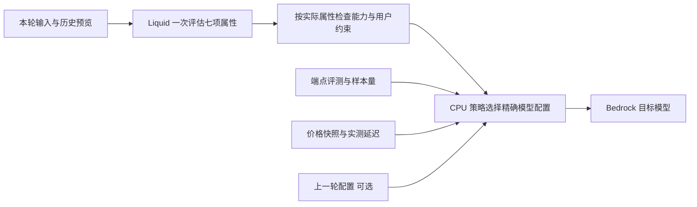

# 一次需求评估 + CPU 策略选模：对照实验

2026-11-26，实验版本 `profile-cpu-policy-experiment-v1`。**路由速度明显改善，但目标回答仍有质量问题，未替换线上方案。**

## 实际测到了什么

同一台 g5.xlarge / A10G、同一个原生 Liquid d1-2B 服务，使用相同的三个输入。下表是中位数，单位毫秒：

| 场景 | 一次 GPU 联合判断属性与模型 | 两次 GPU：属性 → 模型 | 本次：一次 GPU 属性 → CPU 策略 | 其中 CPU 策略 |
|---|---:|---:|---:|---:|
| 普通对话 `hi` | 1,307.97 | 732.14 | **96.20** | 1.11 |
| Python 区间合并 | 1,308.92 | 731.34 | **96.05** | 1.17 |
| 合成的长历史订单任务 | 上次请求因显存不足返回 503 | 944.02 | **203.62** | 1.17 |

本次每类预热一次、正式测量20次，交替反转场景顺序；**60次正式请求全部完成，每次1个GPU请求、1次实际前向计算**。前两种方案沿用同日较早实测，每类3次，不是本次同时交错运行。长联合请求的失败属于当时共享GPU显存状态下的一次观测，没有重跑，也不能泛化为所有长请求都会失败。

普通对话和代码比联合方案减少约92.6%的测量耗时，比两次GPU方案减少约86.9%。本次样本P95分别为96.52、96.44、203.91毫秒，仅是这20次重复输入的统计，不是生产P95或并发SLA。

**计时范围**：GPU主机本地的认证HTTP请求、GPU评估、返回值检查和CPU策略。三种方案均不含ECS网络、候选池构建、持久化、目标模型生成。本次另在开发机CPU上测量使用内存证据快照的候选池构建，中位数为4.30、4.39、4.47毫秒；不同主机的测量不能直接当作线上总耗时。

候选池由单独的真实GPU种子评估预先构建。每次正式GPU输出必须逐字段与种子一致，之后才将**当次输出**交给策略，防止评估结果与候选池错配。未以预设分类替代实际GPU调用。完整历史只保留了这个探针已有的两条各200字预览；“长历史”是1400字重复订单请求加合成预览，不是长上下文业务能力测试。

## 与 OpenRouter 的关系

[OpenRouter Auto Router 官方说明](https://openrouter.ai/docs/guides/routing/routers/auto-router#how-it-works)，核对于2026-11-26：

1. 先按能力与限制缩小候选池。
2. 快速决策模型在一次调用中评估11项需求。
3. 策略结合需求、价格、缓存和基准表现选择型号与推理强度。
4. 交给提供商路由，并在后续轮次保留会话信号。

本实验参考的是**需求评估与模型选择分工**，不是复现其未公开的策略公式。官方文档也没有要求第二次GPU选模。



图中的能力过滤使用现有 `build_pool`；为了与此前GPU探针对齐，性能表中预先完成了这一步。策略不把所有候选评测卡片送入GPU，因此输入从联合方案约14,870/14,885 tokens降至989/1,001；长输入为2,253 tokens。CPU读取107/107/106个合格配置，每个配置都有审计记录。

## 本实验的明确策略

实现：[profile_policy.py](../../../scripts/profile_policy.py)，未被线上网关导入。

| 决策因素 | 处理方法 |
|---|---|
| 能力与限制 | 复用精确Bedrock端点、工具协议、结构化输出、媒体、上下文、预算及允许/排除列表检查；没有合格型号就返回空结果。 |
| 本类任务证据 | 使用同一个开发测试集内的 `content_passed / samples`，以95% Wilson下界作为保守排序依据。待评和调用错误留在分母，原状态保留；不声称它是生产成功概率。 |
| 成本偏好 | 相对本池最高证据下界，低/中/高档允许0.20/0.08/0.00的差距，再在范围内优先选已知低价。阈值是实验参数，未经业务校准。 |
| 任务难度 | 默认中档时，简单且更强模型收益低转低档；复杂或更强模型收益高转高档。用户显式高/低档优先。 |
| 延迟敏感 | 用户明确要求快时，在同一质量范围内优先已知较低P95，再比较价格。未知延迟不会被视为零。 |
| 缺失证据 | 审计保留 `null`；存在正向直接证据时优先得到支持的候选。全部未知时仍可按已知价格兜底，但明确未校准。没有按榜单批次提前删除配置。 |
| 公开评测 | 只在直接证据、已知价格相同时，对**同来源、同批次、同指标集合**的候选比较占优关系；延迟敏感时还要求延迟相同。不同批次原始分数不混算。 |
| 会话沿用 | 上一配置仍在质量范围内、成本不超过最优候选5%，且延迟要求也满足时可沿用。这里只有规则测试，未跑真实Agent连续轮次。 |
| 推理强度 | 返回已核验候选的精确 `request_fields` / `inference_config`；不把默认配置的实测成绩继承给另一推理配置。本次三个实际赢家均为默认配置。 |
| 缓存 | 未假设缓存折扣；没有实时缓存价格与命中预测就不虚构节省金额。 |

严格格式通过数与内容正确数分开保留；本策略没有把过去“必须只输出代码”的格式不符一律当作内容错误。硬性JSON/schema需求仍需已核验的提供商协议；当前快照没有合格候选时明确返回空结果。

这版保守策略也有局限：直接测量样本多的配置占优；只有公开评测、缺少直接测量的推理配置不易胜出。它验证架构和明确规则的可行性，尚不能宣称做到最佳性价比或完整覆盖OpenRouter的11项需求、实时价格、缓存和失败反馈。

## 选择依据与目标回答核查

三个场景均额外直接调用了所选Bedrock模型一次，保留原始输入和输出。目标调用不计入上面的路由时间。

| 场景 | CPU选中的型号 | 既有本类开发内容通过数 | 本次目标调用 | 本次回答质量 |
|---|---|---:|---:|---|
| 普通对话 | GPT-OSS 20B | 4/4 | 0.410秒，完整 | 通过：正常回应问候 |
| 区间合并 | Ministral 14B 3.0 | 3/3 | 7.779秒，完整 | **未通过**：主实现通过，附带改进版错误 |
| 长历史订单任务 | GLM 4.7 Flash | 3/3 | 16.033秒，完整 | **未通过**：并发解释和状态迁移存在错误 |

区间合并的两个实现分别在无网络、无凭据、只读、非root、128MB内存限制的容器中检查105个闭区间样本：

- `merge_intervals`：105/105通过。没有额外要求输入不可变。
- `merge_intervals_refined`：31/105通过。缺少处理不相交区间的 `else: append` 分支，例如 `[[1,2],[4,5]]` 会丢掉第二个区间。

长任务采用助手审阅，未编译执行Java：回答先说请求A将version从1改为2，随后却说请求B仍能匹配version=1；又把应该失败的B写成A。测试要求 `REFUNDING → REFUNDED` 合法，但给出的 `switch` 没有该分支，实际落入 `default: false`。

本批次是**3/3调用完整，1项内容通过、2项内容未通过**。这是小规模生成后诊断，不能当作新策略全场景准确率，也不能与历史87场景直接比较。三次按实际tokens和当日AWS价目快照计算的参考费用分别为 $0.00001766、$0.00023580、$0.00069652；不含路由器、基础设施费用，也不是账单。没有重跑另外两种路由的目标答案，不能据此声称新方案质量更高或总体成本更优。

需求评估也仍有问题：中文区间合并被Liquid标为 `languages=other`，长并发任务的 `stronger_model_benefit=low` 也缺乏充分依据；本策略因其 `difficulty=complex` 进入高档。这些原始输出没有修饰。下一步需要用独立业务样本校准质量门槛，并验证收益评估、推理配置与失败反馈，不能仅凭“GPU更快”就切换生产。

## 验证与复现

27项新增规则/约束测试、9项既有候选池与联合决策测试，共36项通过；新增脚本Ruff检查通过。质量/价格交换、候选顺序、样本不确定性、缺失值、任务难度、费用偏好、延迟、粘性、精确配置、公开榜单可比性和真实工具/视觉能力过滤均有对应检查。**软件测试通过不计入模型回答通过率。**

```bash
.venv/bin/python -m pytest -q tests/test_profile_policy_experiment.py tests/test_gateway_model_decision.py

.venv/bin/python -m scripts.benchmark_profile_policy prepare \
  --baseline validation/independent_gateway/profile-policy-2026-11-26/previous-inputs.json.gz \
  --output /tmp/profile-policy-inputs.json.gz

# 在可访问GPU本地网关的主机执行；密钥只从文件读取，不写入报告。
.venv/bin/python -m scripts.benchmark_profile_policy run \
  --inputs /tmp/profile-policy-inputs.json.gz \
  --url http://127.0.0.1:18124/v1/systemone/liquid \
  --key-file /opt/decider-secrets/api-key --repetitions 20
```

也可以用脚本的 `remote` 子命令生成临时SSM探针。它打包同一份策略与所需快照字段，使用临时目录，不安装服务、不重启进程。标准输出为gzip+base64 JSON以避免SSM输出截断。上述路径及端口属于本项目环境；GPU输出若变化，需要重新评估并构建候选池，不可绕过一致性校验。

- [三方案汇总与验证范围](comparison.json)
- [本次全部请求、计时与候选选择审计](results.json.gz)
- [完整候选快照、原始GPU输入、独立CPU建池计时](inputs.json.gz)
- [前两方案的原始对照结果](previous-comparison.json.gz) · [原始输入](previous-inputs.json.gz)
- [目标模型请求、输出与用量](targets.json.gz) · [回答质量审阅](target-reviews.json)
- [隔离代码测试结果](code-diagnostics.json) · [GPU服务健康检查](gpu-health.json)
- [性能探针](../../../scripts/benchmark_profile_policy.py) · [目标调用脚本](../../../scripts/check_profile_policy_targets.py) · [代码诊断脚本](../../../scripts/check_profile_policy_code.py)

线上仍为 `gpu-evidence-single-pass-v2`，[ECS核查](production-status.json)仍为修订23，本批次没有部署ECS或前端更新；报告在仓库展示，不会冒充工作台中的线上请求历史。
