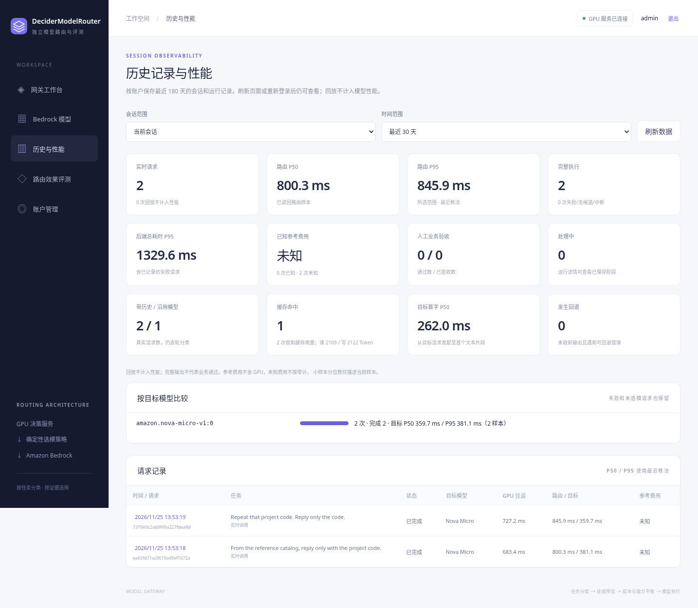

# 多轮、粘性、缓存与流式验证

2026-11-25，正式入口 https://d3eipg2g3l3an3.cloudfront.net/ 。发布到独立 ECS revision **9**，会话策略 `gateway-session-v1`；基础选型仍为 `bedrock-classified-v3`。

**五次真实 GPU 分类、五次真实 Bedrock 调用全部完成。** 使用默认 H2O 分类器和允许列表中的 Nova Micro，验证连续追问、沿用配置、原生缓存、流式事件、持久化及新会话隔离。这是小规模功能验收，不能推出全场景准确率提升或成本节省百分比。

## 真实请求结果

| 请求 | 带入历史 | 结果 | 沿用模型 | 缓存读 / 写 tokens | 目标首字 ms | HTTP 客户端总耗时 ms |
|---|---:|---|---|---:|---:|---:|
| 记忆首轮 | 0 轮 | `ACK.` | 首次选模 | 0 / 16 | 273.539 | 1345.285 |
| 记忆追问 | 1 轮 | `ORBIT-742`，与上轮给定编号一致 | 是 | 16 / 3 | 228.731 | 1247.507 |
| 长前缀首轮 | 1 轮显式历史 | `ORBIT-742` | 首次选模 | 0 / 2104 | 271.847 | 1430.318 |
| 长前缀追问 | 2 轮 | `ORBIT-742` | 是 | 2109 / 18 | 261.968 | 1446.409 |
| 新会话 | 0 轮 | `NEW` | 首次选模 | 0 / 4 | 229.039 | 1225.559 |

总耗时由 HTTP 客户端测量，包含网络、会话处理、GPU 分类、选型、目标响应和数据库记录。首字由后端从目标调用发起至第一个文本片段计时。长前缀第二轮虽然命中缓存，整个请求仍略慢；没有控制变量的配对性能实验，因此不据此宣称加速或降本。

缓存数字直接来自 Bedrock `usage`。本次短前缀也返回了缓存读写计数，保留实际值；允许列表的最小前缀说明仍引用 AWS 文档，不用这几个样本推翻官方适用条件。缓存读写费率尚未进入参考价快照，五次参考费用均保持未知，不按零计。

原始结果：[汇总 JSON](verification.json)、[记忆首轮](memory-first.json)、[记忆追问](memory-followup.json)、[缓存首轮](cache-first.json)、[缓存追问](cache-followup.json)、[新会话](new-session.json)。导出已移除执行票据；提示全部为测试用的虚构内容。

## 前端与数据库

正式页面可查看新增会话：

- **验证 · 连续追问与模型粘性**
- **验证 · Bedrock 原生提示词缓存**
- **验证 · 新会话隔离**

切换会话后展开「当前会话对话记录」；在「历史与性能」选择「当前会话」，可查看带历史次数、沿用模型、缓存命中/读写 tokens、目标首字和回退数。缓存测试会话为两次请求、一次沿用、一次缓存命中、2,109 读 / 2,122 写 tokens。

正式浏览器验证了桌面、390px 手机布局、对话和实际缓存指标、重新加载后的两条记录，JavaScript 错误为零，未新增模型调用。[浏览器结果](live-browser.json)。



[对话页面](live-conversation.png) · [手机页面](live-mobile.png)

五次运行的完整事件逐项与数据库读取结果一致，最终助手消息进入会话快照。其他用户访问本次历史返回 **404**，临时测试账户已停用。没有为了验证故障回退向线上模型制造限流；该部分使用明确标注的测试桩验证。

## 软件与发布验证

- 全量 **513 项测试通过**；后续原子会话状态调整后，相关 **26 项定向回归通过**。覆盖完整角色输入、GPU 上下文、重置/裁剪、排除列表/预算不被粘性绕过、SQLite/DynamoDB 租约、缓存计数、稳定检查点、真实格式流式事件，以及输出前限流回退与部分输出后禁止回退。[软件记录](software-verification.json)。
- 三进程浏览器测试使用合成 GPU 和 Bedrock 响应，验证新事件、持久化、错误、回放、账户和手机布局，**不作为模型效果证据**。[测试桩浏览器结果](browser-verification.json)。
- Python 3.12 ARM64 镜像健康检查 200，七个运行时源文件与工作区 SHA-256 一致。[镜像验证](image-smoke.json)、[源码摘要](source-hashes.json)。
- ECS revision 9，镜像 `sha256:0bf8665ec1bb233f0d351570fbf939f1199ad41c630ba2946e022e59345f5cbe`，CloudFront 刷新 `IBGGC2FUX1K7ILTCRSW75LRHIT` 完成。根 URL 200、无跳转，五个公网静态文件与本地一致；匿名 S3 访问 403。[AWS 验证](aws-verification.json)。
- 独立 GPU `i-01180cf02d12e6e31`、原 GPU `i-0ae7eb0abcb815af3` 的实例型号、启动时间与私网地址未变；原共享 ECS 仍为 revision 36。

旧 87 场景评测文件 SHA-256 仍为 `187b310813a31fe8b762d605351d27692af667e9c1a9eda269fda1cfde62d6b3`。本次不重算其模型通过率，也不把会话软件测试混入效果评测。

复现小规模线上检查会实际调用模型并保存新的测试会话：

```bash
.venv/bin/python -m scripts.check_gateway_sessions_live \
  --output .deployment/new-session-live-check
.venv/bin/python -m scripts.check_gateway_sessions_live \
  --output .deployment/new-session-live-check --browser-only
```

密钥从 Secrets Manager 在内存中读取，不写入报告。机制、接口、阈值及当前边界见[会话路由说明](../../../docs/SESSION_ROUTING.zh.md)。
